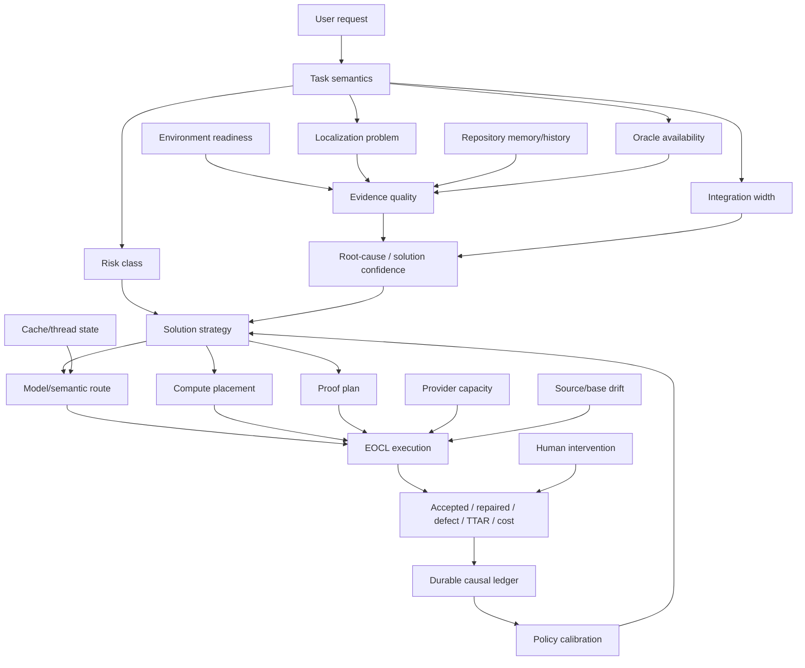
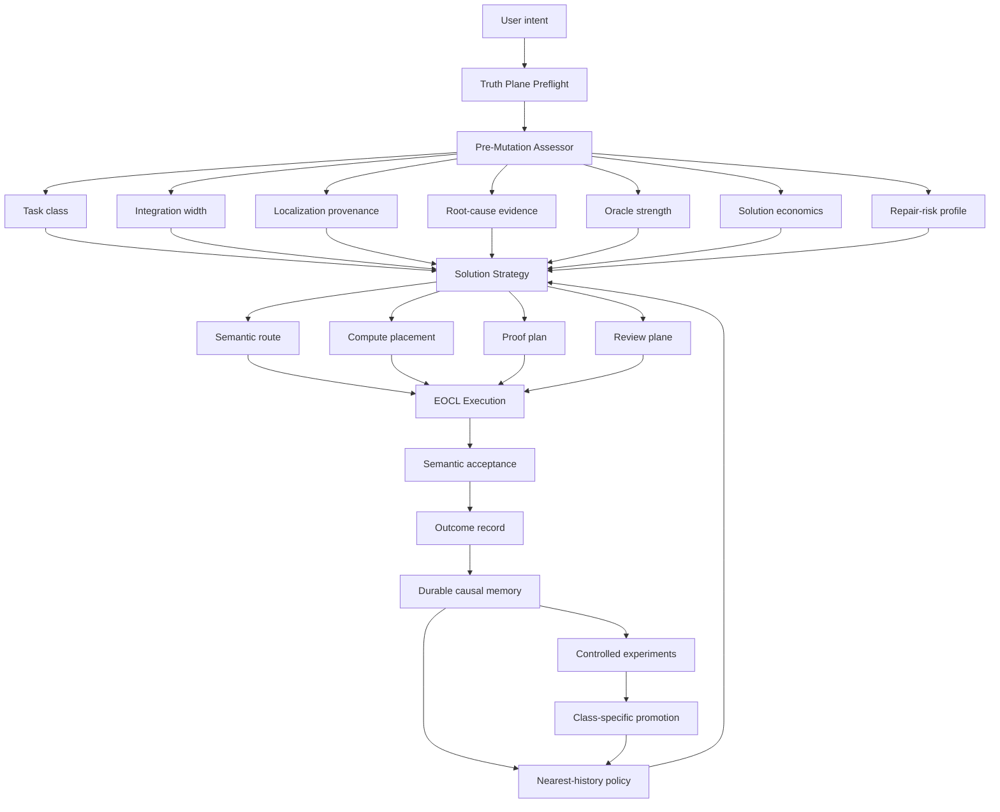

# Coding Web / Tools-Codex-web

## Nghiên cứu khoa học toàn diện về hệ thống điều phối AI cho kỹ nghệ phần mềm, dữ kiện lịch sử thực tiễn, bối cảnh nghiên cứu quốc tế, hệ sinh thái mã nguồn mở và lộ trình hoàn thiện

**Ngày chốt nghiên cứu:** 18/08/2026  
**Múi giờ:** Asia/Bangkok (UTC+7)  
**Repository chính:** `uyenthudao2410-code/Codex-web`  
**Tên sản phẩm được sử dụng trong tài liệu:** Coding Web / Tools-Codex-web  
**Phiên bản desktop quan sát:** `web-mcp-assistant 0.3.4`  
**Nguồn causal audit chính:** `.coding-tools/orchestration/ledger.sqlite3`  
**Projection vận hành chính:** `.coding-tools/performance.json`, `.coding-tools/task-state.json`  
**Loại tài liệu:** scientific assessment + literature review + open-source landscape review + experimental roadmap  
**Trạng thái:** tài liệu nghiên cứu và định hướng; không tự động thay đổi routing, proof policy, runtime authority, release state hoặc production activation.

---

## Tóm tắt

Coding Web đã tiến hóa trong một thời gian ngắn từ một công cụ nối ChatGPT với máy lập trình thành một **Execution Hub có authority, durable state, deterministic proof, recovery và evaluation plane**. Hệ thống hiện có một Runtime authority dùng chung cho ChatWeb và Codex Desktop; ChatWeb/Sol giữ semantic control và final acceptance; Coding Tools MCP giữ mutation, proof, task/run/wave state và write fencing; Electron/Recovery Host giữ lifecycle và secrets; các model/provider khác chỉ là bounded candidate, reviewer hoặc secondary execution lane.

Dữ kiện lịch sử cho thấy kiến trúc nền đã vượt qua phần lớn vấn đề mà nhiều agent framework hiện vẫn giải bằng prompt discipline: route drift, write ownership, source drift, proof reuse, final acceptance, resumability, multi-client continuity và runtime recovery đã được chuyển thành state machine hoặc invariant có thể kiểm tra. Tuy nhiên, North Star của dự án chưa đạt. **Bottleneck đã dịch chuyển từ “có thể thực thi hay không” sang “có chọn đúng việc, đúng nguyên nhân, đúng phạm vi và đúng oracle trước lần mutation đầu tiên hay không”.**

Các chỉ số nội bộ quan trọng nhất tại thời điểm nghiên cứu:

- `5.619` tool calls; `567` lỗi tổng hợp, tương đương khoảng `10,09%` tool-call observations;
- idempotency coverage cho thao tác bắt buộc: `607/611 = 99,35%`;
- proof-cache hit: `1/716 = 0,14%`, tổng thời gian tiết kiệm chỉ `996 ms`;
- local execution khoảng `9,14 giờ`, trong khi `estimated_wait` khoảng `33,43 giờ`, tỷ lệ `3,66x`;
- `2.309` localization queries, nhưng LSP chỉ handle `5/1.346 = 0,37%` attempts; `99,78%` tổng query rơi vào text fallback;
- khoảng `99,00%` execution-mode observations là `mcp_only`; khoảng `99,10%` route-resolved observations là deterministic;
- baseline P4 hiện ghi khoảng `63,4%` first-pass, `36,6%` repaired; repaired median khoảng `4,75x` first-pass; feature repaired khoảng `51%`, bugfix khoảng `34%`;
- oracle observation coverage khoảng `17,5%`, causal repair mapping khoảng `47%` — chưa đủ để tự động hóa một treatment mạnh.

Các nghiên cứu quốc tế gần đây củng cố hướng phát triển hiện tại:

1. **Agent-system scaling có tính task-dependent.** Multi-agent hữu ích khi workstream độc lập, nhưng coordination overhead và error amplification có thể làm sequential/tool-heavy work tệ hơn.
2. **Integration width là bottleneck lớn của repository reasoning.** Nhiều file không đồng nghĩa khó; số contract, caller, state và dataflow phải tổng hợp đồng thời mới là biến quyết định.
3. **Environment và oracle quan trọng ngang model reasoning.** Nhiều failure thực tế đến từ setup, dependency, working directory, source identity và weak oracle.
4. **Context nhiều hơn không đồng nghĩa reasoning tốt hơn.** Repository memory, state tree và selected evidence thường có giá trị hơn broad transcript/repository dump.
5. **Tests xanh không đủ.** Cần semantic acceptance, independent requirement reconstruction và executable/specification-aware oracle.
6. **Framework phức tạp không mặc nhiên thắng.** Lean prompts, mini-swe-agent, simple router và bounded packet nhiều khi cạnh tranh hoặc vượt scaffolding phức tạp.
7. **Tiêu chuẩn mở đang trở thành hạ tầng của thời đại:** MCP, ACP, AGENTS.md, AAIF và neutral agent/runtime interfaces.

Kết luận chiến lược của báo cáo:

> **Mục tiêu cao nhất của Coding Web là trở thành một Accepted-Result Learning Control System: quan sát và dự báo chất lượng quyết định trước mutation; cưỡng chế authority và proof trong execution; liên kết outcome với prediction sau acceptance; rồi chỉ promote policy khi dữ liệu đại diện cục bộ chứng minh Pareto improvement trên first-pass acceptance, TTAR, cost và local burden mà không làm giảm quality/safety.**

P4 Solution Economics Shadow là bước đúng tiếp theo. Nhưng nó nên được xem như nền của một **Pre-Mutation Decision/Risk Model**, không chỉ là chính sách “viết ít code”. Sau P4, hệ thống cần tiến theo thứ tự: measurement completeness → feature first-pass program → soft solution guard → localization/repository-memory experiments → backward independent review → class-specific server-first/model routing → nearest-history policy → conservative/conformal routing → joint solution/model/placement/proof optimization.

---

# 1. Câu hỏi nghiên cứu

Báo cáo này trả lời tám câu hỏi chính.

### RQ1 — Dự án thực sự đang tối ưu điều gì?

North Star có phải là model call rẻ nhất, build nhanh nhất, nhiều worker nhất, cache hit cao nhất hay server utilization cao nhất không? Hay phải là **accepted engineering outcome** với quality floor, first-pass rate, TTAR và total expected cost tốt nhất?

### RQ2 — Hệ thống đã trưởng thành đến đâu?

Những thành phần nào đã đủ mạnh để coi là kiến trúc nền ổn định; những thành phần nào mới chỉ có source implementation; những phần nào đã có live acceptance; và những claim nào vẫn thiếu representative causal evidence?

### RQ3 — Dữ kiện lịch sử nói bottleneck hiện nằm ở đâu?

Rework, wait, routing, localization, proof cache, recovery, source identity, environment hay model capacity — yếu tố nào đang có expected leverage lớn nhất?

### RQ4 — Những nghiên cứu AI/software-agent 2024–2026 cho thấy điều gì?

Tư duy nghiên cứu đã dịch chuyển từ “LLM viết code” sang những vấn đề nào: harness, agent computer interface, durable state, context engineering, oracle, multi-agent topology, long-horizon quality, governance và adaptive routing?

### RQ5 — Hệ sinh thái GitHub nổi bật đang đi theo hướng nào?

Codex, OpenCode, OpenHands, Cline, goose, LangGraph, Continue, SWE-agent/mini-swe-agent/SWE-ReX, Aider, Microsoft Agent Framework, UFO và MCP đang thể hiện những design principles gì? Coding Web nên học gì và không nên sao chép gì?

### RQ6 — J-space và các phương pháp cognitive-control có ý nghĩa gì cho dự án?

Liệu nên tích hợp một prompt/persona J-Space, hay nên chuyển nguyên lý bounded active state, selective broadcast và deliberate reasoning thành projection/invariant của hệ thống?

### RQ7 — Kiến trúc mục tiêu tiếp theo là gì?

Hệ thống cần thêm subsystem, learned router, nhiều agent, server fleet hay một closed-loop causal learning plane đặt trước mutation và sau acceptance?

### RQ8 — Lộ trình và phương pháp thực nghiệm nào đủ nghiêm ngặt?

Cần unit of analysis, pair identity, randomization, ITT, non-inferiority, missing-data policy, power analysis, promotion gate, rollback và reporting contract như thế nào để không lặp lại lỗi benchmark single-run hoặc survivor bias?

---

# 2. Phạm vi và giới hạn

## 2.1 Phạm vi

Tài liệu đánh giá:

- product boundary của Windows Electron Execution Hub + Coding Tools MCP;
- EOCL, recovery, routing, proof, handoff, multi-client authority;
- lịch sử benchmark và run/wave evidence từ 12–18/08/2026;
- projection `.coding-tools` đã commit;
- P4 Solution Economics Shadow đang ở trạng thái REPLAN;
- nghiên cứu peer-reviewed, conference proceedings, preprint có phương pháp rõ;
- các dự án GitHub và chuẩn mở nổi bật tính đến ngày chốt nghiên cứu;
- lộ trình kỹ thuật, thực nghiệm và governance để đạt North Star.

## 2.2 Giới hạn

1. `.coding-tools/performance.json` là projection tổng hợp, không thay thế causal event ledger. Một số counter là event/state observations, không phải unique-run outcome.
2. Hai cohort rework lịch sử có inclusion window/task mix khác nhau; không được gọi chênh lệch first-pass là causal regression.
3. `estimated_wait_ms` không được đồng nhất với model latency. Nó là projection và cần timing provenance.
4. Internal estimated credits không phải provider invoice.
5. GitHub stars là tín hiệu adoption/visibility, không phải bằng chứng chất lượng.
6. Một số nguồn 2026 là preprint, chưa peer review; chúng được ghi rõ.
7. Trong phiên nghiên cứu trước đó, live Coding MCP lại trả raw `ExceptionGroup: unhandled errors in a TaskGroup` cho `workspace_context` và `agent_workflow prepare`. Đây là observation mới, **không phải bằng chứng source regression**, vì exact process/source identity của instance lỗi chưa được xác lập.
8. Tài liệu không dùng hoặc lưu private chain-of-thought. Mọi đề xuất state đều là structured, content-bounded, auditable evidence.

---

# 3. Phương pháp luận và hệ phân cấp bằng chứng

## 3.1 Evidence hierarchy

Báo cáo phân loại nguồn theo sáu lớp.

| Mã | Loại bằng chứng | Ví dụ | Quyền dùng trong quyết định |
|---|---|---|---|
| `A-INT` | Internal measured causal evidence | ledger event, run/wave/proof/checkpoint, exact fingerprint | Mạnh nhất cho production decision |
| `B-INT` | Internal controlled experiment | 10-regression routing benchmark, exact Mini/Luna pair, P3 pair | Dùng cho local hypothesis và promotion nếu đủ đại diện |
| `C-EXT` | Peer-reviewed/proceedings | ACL, AAAI, ICSE, ICLR, TMLR | Dùng xây mechanism/method; không thay local evidence |
| `D-EXT` | Preprint có method rõ | RETRACE, SlopCodeBench, RoadmapBench, MAGE | Dùng tạo hypothesis; cần thận trọng về external validity |
| `E-GH` | Open-source implementation evidence | Codex, OpenHands, goose, MCP, SWE-ReX | Dùng học architecture/trend, không coi stars là performance proof |
| `F-HYP` | Derived hypothesis của báo cáo | First-Pass Solution Guard, nearest-history policy | Chỉ được promote sau local experiment |

## 3.2 Thứ tự nguồn sự thật nội bộ

Khi nguồn nội bộ mâu thuẫn, dùng thứ tự:

1. current source + focused tests + live runtime contract của exact instance;
2. canonical EOCL ledger + proof/checkpoint;
3. `docs/CURRENT_STATE.md`;
4. current README/architecture/roadmap;
5. committed projections `.coding-tools/performance.json`, `task-state.json`;
6. dated research documents;
7. operator recollection hoặc final prose.

## 3.3 Quy tắc suy luận

- Không lấy correlation lịch sử làm treatment effect.
- Không lấy accepted-only sample để suy ra policy success.
- Không gán `0` cho unknown tokens/cost/oracle/quality.
- Không dùng test count làm completion metric.
- Không dùng file/LOC count như proxy duy nhất cho integration difficulty.
- Không so arm nếu source/oracle/environment/policy fingerprint khác treatment.
- Không gọi route/model đã chạy nếu runtime chỉ cho biết requested route mà không xác minh resolved route.
- Không dùng một benchmark ngoài dự án để mở production policy.
- Mọi recommendation phải tách rõ `KEEP`, `REVISE`, `HOLD`, `REMOVE/DEFER`.

## 3.4 Unit of analysis

Primary unit:

```text
one task assignment × one experimental replicate × one fixed policy arm
```

Không dùng:

```text
one tool call
one event
one test assertion
one line changed
```

làm independent statistical sample.

## 3.5 Quality floor

Tối ưu theo lexicographic order:

1. correctness, security, data/financial semantics, authority, compatibility, truthful proof;
2. first-pass acceptance và critical-defect non-inferiority;
3. total expected cost per accepted result, TTAR p50/p90, local burden;
4. extension quality cho long-horizon/repeated surfaces;
5. simplicity: ít rule, model call, worker, context và handoff hơn khi outcome tương đương.

---

# 4. North Star của dự án

## 4.1 Phát biểu chuẩn hóa

> **Coding Web tự động phối hợp semantic intelligence của ChatWeb với deterministic tools, model lanes và compute resources sẵn có để tạo ra accepted engineering outcome đúng ngay lần đầu, nhanh nhất và rẻ nhất có thể, trong khi giữ một authority, exact-source proof, local-affinity constraints và khả năng rollback/audit.**

## 4.2 Những thứ không phải North Star

- model rẻ nhất;
- model mạnh nhất;
- số model/agent nhiều nhất;
- cache hit rate;
- CPU/GPU utilization;
- server offload ratio;
- token giảm đơn lẻ;
- LOC tối thiểu;
- test count;
- tool-call count;
- throughput nếu quality/TTAR xấu;
- dashboard nhiều dữ liệu.

## 4.3 Objective function khái niệm

Với task context `x` và policy/action vector `a`:

```text
HardFilter(a, x):
  security && authority && compatibility && source_identity && proof_validity
```

Chỉ trong action set qua HardFilter mới tối ưu:

```text
Utility(a | x)
  = P(first_pass_accepted | x, a)
  - λt · E[log(1 + TTAR)]
  - λc · E[cost_per_accepted]
  - λl · E[local_burden]
  - λh · E[human_intervention]
  - λe · E[extension_erosion]
```

Safety không được biến thành một reward term có thể bù bằng cost saving; nó là hard constraint.

## 4.4 Moat dài hạn

Moat của dự án không phải access tới một model cụ thể. Model và rate card thay đổi nhanh. Moat tiềm năng là:

1. **durable causal corpus** của real engineering tasks;
2. exact source/oracle/policy/outcome identity;
3. pre-mutation strategy observations;
4. authority/proof runtime đủ mạnh để intervention an toàn;
5. local empirical policy biết task shape nào phù hợp với solution, route, placement và proof nào.

---

# 5. Lịch sử tiến hóa thực tế của Coding Web

## 5.1 Giai đoạn 12/08 — Từ “model nào tốt” sang “topology nào tạo accepted result”

Controlled benchmark dùng 10 regressions trên production source, cùng focused oracle và full package gate:

| Route | First-pass accepted | Khi model available | Capacity failures | Kết luận |
|---|---:|---:|---:|---|
| ChatWeb Sol → MCP | `10/10 = 100%` | 100% | 0 | Giữ baseline |
| Luna autonomous | `2/10 = 20%` | `2/6 = 33,3%` | 4 | Không auto-route |
| Terra autonomous | `6/10 = 60%` | `6/8 = 75%` | 2 | Experimental only |

Bài học:

- model list price không phải accepted-result economics;
- autonomous shell/tool loop có thể tệ hơn controller + deterministic writer;
- lower-tier cascade tuần tự làm TTAR xấu;
- quality floor phải loại route trước khi so cost.

## 5.2 Giai đoạn 13/08 — EOCL chuyển accountability thành runtime invariant

EOCL bổ sung:

- durable `RUN`, `WAVE`, `DELEGATION`, `EVENT`, `PROOF`, `CHECKPOINT`;
- append-only hash chain;
- explicit state path;
- active write lease và one-authoritative-writer rule;
- source/worktree/contract fingerprint;
- typed `REPLAN` và bắt buộc `replan_reason`;
- proof reuse chỉ khi exact fingerprint match;
- `ACCEPTING` tách khỏi `CHECKPOINTED`;
- ChatWeb/Sol final accept/reject.

Đây là bước kiến trúc quan trọng nhất: “tests green” không còn đồng nghĩa “task done”.

## 5.3 Giai đoạn 14/08 — Execution Hub và bài học control-plane economics

Cross-client canary chứng minh ChatWeb và Codex Desktop đọc cùng handoff capsule qua một shared Runtime. Đây là nền continuity đúng: đồng bộ state/proof, không replay transcript.

Benchmark localized tasks cho thấy:

### Task normalize

| Route | Outcome | Model wall | Estimated credits |
|---|---|---:|---:|
| Mini | first-pass accepted | `7,281s` | `0,178478` |
| Luna | first-pass accepted | `8,625s` | `0,297000` |
| Sol xhigh | deadline, no accepted candidate | `30,015s` | `0,948850` |

### Task remaining-capacity

Mini hiểu đúng fix nhưng packet target dùng short path, sau đó proof chạy sai workdir. Hai model calls cộng lại `0,348015` credits và `8,779s`; Luna first-pass chỉ `0,281800` credits và `4,875s`.

Bài học:

> **Packet construction, path normalization, workdir và proof path có thể đảo ngược hoàn toàn lợi thế của model tier.**

### Same-thread continuation

Cùng Mini và cùng second prompt:

- warm continuation: `0,041760` credits, `4,484s`, cache `94,32%`;
- fresh lane: `0,171395` credits, `5,360s`, cache `14,91%`.

Saving khoảng `75,6%` credits và `16,3%` wall time. Nhưng reuse chỉ đúng khi semantic continuity còn hợp lệ; blind review cần fresh state.

## 5.4 Giai đoạn 15/08 — Chuyển North Star sang accepted-result economics

Baseline collection đặt rõ:

1. quality/security/acceptance correctness;
2. total expected cost per accepted result;
3. TTA p50/p90;
4. rework/proof duplication;
5. model diversity/utilization cuối cùng.

Initial snapshot có `265` ledger runs nhưng `0` valid representative pairs; auto fail-closed deterministic. Đây là quyết định khoa học đúng thay vì “thiếu automation”.

## 5.5 Giai đoạn 16/08 — Solution Economics đặt câu hỏi trước routing

Pipeline cũ:

```text
workload đã tồn tại → model nào → node nào → proof nào
```

Pipeline mới:

```text
workload có cần tồn tại không?
  → reuse/native/stdlib/existing capability?
  → smallest causal solution?
  → model/placement/proof
```

Phương pháp luận này không tối thiểu hóa LOC; nó tối thiểu hóa **engineering work** dưới quality floor. Always-on minimality persona bị loại vì có thể tăng hidden-edge failure hoặc under-implementation.

## 5.6 Giai đoạn 17/08 — Dữ liệu xác nhận rework là leverage lớn nhất

Cohort 188 accepted organic runs:

- first-pass: `130/188 = 69,15%`;
- repaired: `58/188 = 30,85%`;
- first-pass TTA p50: `36,357s`;
- repaired TTA p50: `192,319s`;
- repaired median penalty: `5,29x`.

Cohort khác 122 accepted runs:

- first-pass `59,8%`;
- repaired `40,2%`.

Không được gọi đây là causal degradation do cohort khác nhau. Nhưng cả hai đều chứng minh repair đủ lớn để làm mọi optimization vài giây trở thành thứ yếu nếu repair probability tăng.

Ngày 17/08 cũng harden intention-to-treat: assigned candidate bị aborted/replanned vẫn nằm trong denominator; không được survivor-filter chỉ accepted rows.

## 5.7 Giai đoạn 18/08 — Compute placement và P4 pre-mutation shadow

P3 compute-placement implementation run có:

- 3 waves;
- 2 failures/replans;
- Sol xhigh candidate không hoàn tất trước deadline;
- deterministic wave tiếp theo check failed;
- wave thứ ba accepted.

Nó minh họa rằng model escalation có thể thêm repair cost ngay cả trong một feature được accept cuối cùng.

P4 hiện đang xây pre-mutation recommendation event. Wave gần nhất chạy `116 passed, 3 subtests passed`, nhưng không sửa source. Sol reject vì baseline-green proof không chứng minh objective đã được implement. Run chuyển `REPLAN`.

Đây là hành vi đúng của EOCL và là dữ kiện cho thấy hệ thống đã vượt “test ritual”.

---

# 6. Kiến trúc hiện tại và đánh giá maturity

## 6.1 Product boundary

```text
ChatWeb / ChatGPT
      │ MCP over tunnel
      ▼
Recovery Host / Electron Execution Hub authority
      │
      ├── ONE Coding Tools MCP Runtime
      │       ├── workspace / Git / commands
      │       ├── task / RUN / WAVE / proof
      │       ├── mutation + write fencing
      │       └── evaluation / telemetry
      │
      ├── Codex Desktop thin stdio proxy
      ├── Electron Execution Control Center
      └── independent Recovery MCP/Tunnel

Secondary lanes:
Codex App Server / OpenCode / other providers
  → bounded candidate, review or read-only work
```

## 6.2 Authority model

| Vai trò | Authority |
|---|---|
| ChatWeb/Sol | intent, architecture, shared semantics, conflict resolution, final acceptance |
| Coding Tools MCP | deterministic mutation, command, proof, durable task/run/proof state, write lease |
| Electron/Recovery Host | service lifecycle, secret ownership, exact process activation |
| Codex Desktop | second client/front-end; controller transfer explicit; không tự có write lease |
| Candidate models/providers | bounded candidate/review; không phải primary checkout authority |

## 6.3 Smart tool surface

`smart-v3` cố ý chỉ expose 8 tools:

1. `workspace_context`
2. `agent_workflow`
3. `task_control`
4. `exec_command`
5. `command_control`
6. `document_workflow`
7. `request_permissions`
8. `view_image`

Đây là design phù hợp với nghiên cứu lean prompts và tool-choice stability. Không nên thêm public tool cho từng model, node, policy hoặc analytics view.

## 6.4 Maturity assessment

Thang 0–5 dưới đây là maturity classification, không phải phần trăm completion.

| Hạng mục | Mức | Đánh giá |
|---|---:|---|
| Authority / EOCL | 4,5 | Strong, runtime-enforced, có accepted runs và failure recovery |
| Exact source / proof | 4,3 | Fingerprint, proof ledger, packaging/activation distinction tốt |
| Recovery / lifecycle | 4,0 | Kiến trúc sâu, có packaged/installed evidence; live regressions vẫn cần canary |
| Multi-client continuity | 4,0 | Shared Runtime/capsule proven; authority transfer vẫn explicit |
| Tool-surface discipline | 4,5 | 8-tool surface, internal bridge, stale-schema fingerprint |
| Measurement infrastructure | 4,0 | Rich event ledger và projections |
| Measurement completeness | 2,4 | Oracle/causal/cost coverage chưa đủ |
| First-pass economics | 2,3 | Repair 30–40%+, feature khoảng 51% |
| Model-routing evidence | 1,5 | Non-deterministic representative cohort quá nhỏ |
| Server-first efficacy | 1,8 | Source/control implemented, representative economics deferred |
| Semantic localization value | 1,5 | LSP resource stable nhưng handled rate rất thấp |
| Long-horizon extension quality | 1,8 | Chưa có systematic gate/outcome corpus |
| Closed-loop policy learning | 1,2 | P4 đang khởi tạo prediction→outcome link |

## 6.5 Kết luận maturity

Dự án đã qua ba ngưỡng:

```text
prototype execution tool
  → reliable authority/recovery harness
  → accepted-result orchestration platform
```

Nó đang bước vào ngưỡng thứ tư:

```text
evidence-driven causal optimization platform
```

---

# 7. Phân tích định lượng hiện trạng

## 7.1 Bảng chỉ số tổng hợp

| Metric | Giá trị | Derived interpretation |
|---|---:|---|
| Tool calls | `5.619` | Corpus vận hành đã đủ lớn cho diagnostics, chưa tự động là causal sample |
| Errors | `567` | Khoảng `10,09%` tool-call observations |
| UNKNOWN errors | `48` | Khoảng `8,47%` tổng lỗi; taxonomy còn incomplete |
| Required idempotency calls | `611` | — |
| Required keyed | `607` | `99,35%` coverage; 4 accept calls thiếu run identity |
| Proof-cache eligible | `716` | — |
| Proof-cache hits | `1` | `0,14%` hit rate |
| Proof-cache saved | `996 ms` | Không có economic leverage đáng kể hiện tại |
| Local execution | `32.897.819 ms` | Khoảng `9,14 giờ` |
| Estimated wait | `120.360.952 ms` | Khoảng `33,43 giờ`; `3,66x` local execution |
| Request bytes | `7.450.111` | — |
| Response bytes | `386.444.600` | Khoảng `51,87x` request bytes |
| Model-visible bytes | `12.250.569` | Khoảng `3,17%` response bytes; reducer/projection đã cắt phần lớn raw output |
| Localization samples | `380` | — |
| Localization queries | `2.309` | — |
| LSP attempted | `1.346` | — |
| LSP handled | `5` | `0,37%` attempts |
| Fallback search queries | `2.304` | `99,78%` tổng localization queries |
| `mcp_only` observations | `4.067/4.108` | `99,00%` execution-mode observations |
| deterministic routes | `2.520/2.543` | `99,10%` resolved route observations |
| REPLAN state observations | `602` | Signal lớn nhưng không phải unique-run repair rate |
| CHECKPOINTED state observations | `297` | Không dùng để tính acceptance rate trực tiếp |

## 7.2 Error taxonomy

Aggregate error class:

| Class | Count | Share of 567 |
|---|---:|---:|
| VALIDATION | 213 | `37,57%` |
| RUNTIME | 203 | `35,80%` |
| UNKNOWN | 48 | `8,47%` |
| AUTHORITY_DENIED | 43 | `7,58%` |
| USER_BLOCKED | 42 | `7,41%` |
| IDEMPOTENCY | 10 | `1,76%` |
| NOT_FOUND | 8 | `1,41%` |

Hai class VALIDATION + RUNTIME chiếm hơn 73% aggregate errors. Đây là bằng chứng rằng phần lớn cost center không nhất thiết là “model reasoning yếu”; chúng liên quan tới contract, preflight, environment, process/tool plane và acceptance.

Current causal-taxonomy epoch đã giảm unknown trong window mới, nhưng vẫn cần:

- typed child exception cho TaskGroup;
- phân tách environment/workdir/path;
- provider capacity vs provider semantic failure;
- source/base/contract drift;
- no-op implementation vs proof failure;
- acceptance correction vs wrong root cause.

## 7.3 Idempotency

`607/611 = 99,35%` required calls có key là maturity tốt. Bốn missing đều ở `task_control:accept` do `missing_run`.

Kết luận:

- giữ current policy;
- không cần redesign;
- fix residual missing-run identity nếu reproducible;
- deduplicated call count chỉ `1`, nên idempotency hiện chủ yếu là safety insurance chứ chưa phải performance optimizer.

## 7.4 Wait versus compute

`estimated_wait/local_execution = 3,66x` không cho phép kết luận 78,5% TTAR là model wait, vì hai projection không chắc cùng denominator/clock boundary. Tuy nhiên nó loại bỏ chiến lược đơn giản:

> “Tăng server compute sẽ giải quyết phần lớn latency.”

Critical path cần tách thành:

```text
T_total
  = user→controller-visible
  + controller preflight/localization
  + route/dispatch queue
  + model/provider wall
  + apply/mutation
  + proof
  + acceptance wait
  + replan/repair
```

Ưu tiên instrumentation:

1. `time_to_first_useful_evidence`;
2. `time_to_first_write`;
3. `time_to_first_green`;
4. `time_to_accepting`;
5. `acceptance_wait`;
6. repair-loop wall;
7. provider capacity delay;
8. local/server transfer/queue/execution/proof decomposition.

## 7.5 Response volume và model-visible reduction

Response bytes lớn hơn request bytes khoảng `51,87x`, nhưng model-visible bytes chỉ khoảng `3,17%` response volume. Điều này cho thấy hệ thống đã có bounded output/projection, một design tốt.

Câu hỏi tiếp theo không phải “cắt thêm bytes bằng mọi giá”, mà là:

- phần `3,17%` đó có đúng decision-relevant evidence không?
- reducer có bỏ caller/contract/invariant quan trọng không?
- packet quality có liên hệ với repair không?
- same evidence có bị gửi lặp lại qua wave không?

## 7.6 Localization

LSP handle `5/1.346 = 0,37%`, text fallback chiếm `99,78%` query.

Có ít nhất sáu giả thuyết cạnh tranh:

1. query mix chủ yếu không phải symbol-semantic query;
2. provider thường unavailable hoặc admission denied;
3. query parser không map natural-language query sang LSP operation;
4. workspace/language coverage thấp;
5. fallback-by-design đang được count như failed attempt;
6. LSP hữu ích nhưng instrumentation `handled` quá hẹp.

Không được kết luận LSP vô dụng trước khi audit reason codes. Nhưng cũng không nên đầu tư thêm concurrency/provider architecture trước khi chứng minh accepted-result value.

## 7.7 Proof cache

Hit rate `0,14%`, saving `996ms` trên corpus hiện tại.

Decision:

```text
exact proof identity   KEEP
proof correctness      KEEP
performance expansion  HOLD
weaken fingerprints    FORBIDDEN
```

Nếu sau này repeated integrated fingerprints tạo hit opportunity thật, đánh giá lại. Hiện tại proof cache không phải roadmap priority.

## 7.8 Route distribution

Resolved route observations:

| Route | Count |
|---|---:|
| deterministic | 2.520 |
| sol_xhigh | 15 |
| luna | 4 |
| terra | 3 |
| mini | 1 |

Không đủ data để học general router. `auto → deterministic` là đúng.

Hướng nghiên cứu route phải tách:

- capability-conditional outcome;
- deployed outcome gồm capacity/deadline;
- packet quality;
- warm/cold state;
- first-pass/repair;
- total accepted-result economics.

## 7.9 Rework

P4 baseline:

| Outcome | Approx. rate |
|---|---:|
| First-pass | `63,4%` |
| Repaired | `36,6%` |
| Feature repaired | `~51%` |
| Bugfix repaired | `~34%` |
| Repaired median penalty | `~4,75x` |

Đây là leverage lớn nhất vì repair multiplicatively tăng:

- model/tool calls;
- repeated context;
- proof;
- wait;
- source-drift exposure;
- human acceptance burden;
- probability của adjacent regressions.

Nhưng causal coverage hiện chỉ khoảng `47%`; oracle observation coverage khoảng `17,5%`. Vì vậy chưa biết tỷ lệ repair nào do:

- wrong root cause;
- missing requirement;
- weak oracle;
- source drift;
- environment/workdir;
- runtime/provider failure;
- patch ambiguity;
- acceptance correction;
- no-op delivery;
- legitimate iterative feature discovery.

Kết luận: **P4 phải hoàn thành prospective evidence capture trước treatment.**

---

# 8. Bottleneck map

## 8.1 Bản đồ causal khái niệm



## 8.2 Bottleneck ưu tiên

| Rank | Bottleneck | Evidence | Expected leverage |
|---:|---|---|---|
| 1 | Pre-mutation decision quality | repair 36,6%; feature 51%; penalty 4,75x | Rất cao |
| 2 | Measurement completeness | oracle 17,5%; causal mapping 47% | Rất cao vì block policy learning |
| 3 | Truth/runtime reliability | raw TaskGroup symptom tái xuất hiện | Rất cao, hard prerequisite |
| 4 | Critical-path wait attribution | wait/local 3,66x | Cao |
| 5 | Localization/packet quality | LSP 0,37%; historical path/workdir failure | Cao nhưng chưa quantified |
| 6 | Feature integration width | feature repaired ~51% | Cao |
| 7 | Independent semantic verification | tests green/no-op example | Trung–cao, risk-dependent |
| 8 | Server-first economics | source/control ready, representative pairs thiếu | Trung, class-specific |
| 9 | Model routing economics | non-det sample tiny | Trung sau khi solution quality ổn định |
| 10 | Proof-cache performance | 0,14%, 996ms | Thấp |

## 8.3 Bottleneck không nên nhầm lẫn

- LSP resource stability khác LSP semantic usefulness.
- Server-first source capability khác server-first efficacy.
- Route availability khác route promotion readiness.
- Tests pass khác semantic delivery.
- Source implemented khác live activated.
- Live activated khác packaged/released.
- Accepted immediate khác long-horizon maintainable.

---

# 9. Tổng quan nghiên cứu quốc tế

## 9.1 Multi-agent và scaling

### Towards a Science of Scaling Agent Systems

Nghiên cứu đánh giá hàng trăm cấu hình qua nhiều architecture. Kết luận quan trọng:

- lợi ích multi-agent phụ thuộc task;
- centralized coordination giảm error amplification hơn independent agents;
- tool-heavy tasks chịu coordination overhead lớn;
- capability saturation làm marginal benefit giảm;
- sequential reasoning có thể suy giảm mạnh dưới multi-agent;
- chọn đúng architecture quan trọng hơn tăng agent count.

**Áp dụng:** giữ one Runtime, centralized Sol integration, single-lane default; chỉ fan-out workstream độc lập với disjoint ownership và positive expected value.

### LLMRouterBench

Trên hơn 400.000 instances, 21 datasets, 33 models và nhiều router, nhiều phương pháp phức tạp có kết quả tương tự simple baseline; ensemble lớn có diminishing returns.

**Áp dụng:** chưa xây learned router. Fast path + task-class rule + nearest comparable history trước.

### ContextualRouter và conformal routing

Retrieval trên task lịch sử tương tự có thể cạnh tranh với router phức tạp khi data sparse. Conformal routing gợi ý dùng violation budget/confidence bound cho cheap route.

**Áp dụng:** sau P4, route bằng comparable local cohort; cheap-route promotion cần conservative bound, không dùng raw `9/10`.

## 9.2 Repository-level reasoning

### RepoReason

Phân rã difficulty thành reading load, simulation depth và integration width. Nghiên cứu chỉ ra aggregation deficit: model có thể hiểu từng phần nhưng thất bại khi phải tổng hợp nhiều contract/state/dataflow.

**Áp dụng:** integration width thành first-class predictor; route Sol/critical review theo semantics, không file count.

### RepoReasoner và long context

Cross-file reasoning khó ngay cả với oracle context; context dài hơn không luôn tốt vì noise.

**Áp dụng:** bounded decision-relevant neighborhood, không repository dump.

### Repository Memory

Commit history và evolving module summaries cải thiện code localization trong nghiên cứu của Microsoft/ICLR 2026.

**Áp dụng:** selective retrieval từ commit/accepted-run history cho module hiện tại; không tải toàn history.

### CodePlan, RPG/ZeroRepo

Planning graph/dependency-aware planning giúp repository-scale changes tốt hơn flat generation.

**Áp dụng:** feature high integration width nên có settled contract/work graph; không bắt worker viết prose plan nếu không giải quyết dependency thật.

## 9.3 Environment và execution harness

### GitTaskBench

Real repository workflows gặp nhiều failure từ environment setup và dependency resolution, không chỉ code reasoning.

**Áp dụng:** preflight environment/oracle trước model spend; recurring setup friction phải được sửa trong harness.

### RepoLaunch và SWE-ReX

RepoLaunch tự động hóa dependency/build/test across language/platform. SWE-ReX tách sandboxed execution substrate khỏi agent logic.

**Áp dụng:** Coding Web đang đúng khi tách semantic controller khỏi deterministic execution. Tiếp tục chuẩn hóa environment manifest, not agent prompt.

## 9.4 Oracle và verification

### LogicHunter

Active specification-aware oracle giúp phát hiện semantic failure mà crash/test signal truyền thống bỏ sót; paper báo precision cao trong corpus đánh giá.

**Áp dụng:** oracle strength/provenance là first-class route variable; weak oracle phải dẫn tới evidence acquisition hoặc broader semantic check.

### Agent-generated tests study

Tăng volume agent-written tests không tạo outcome gain đáng kể trong study; nhiều tests chủ yếu là feedback probes hơn assertion mạnh.

**Áp dụng:** không bắt mọi agent viết test. Chỉ thêm test khi nó phân biệt hypothesis, bảo vệ demonstrated regression hoặc đóng oracle gap.

### RETRACE

Independent backward reconstruction kiểm patch từ requirement và evidence thay vì tin rationale của primary model; báo Pass@1 improvement trên tested backbones.

**Áp dụng:** reviewer nhận requirement + protected invariants + diff + proof, không replay chain-of-thought/rationale dài.

## 9.5 Long-horizon quality

### SlopCodeBench

Qua 93 checkpoints repeated extension, đa số trajectory tăng verbosity và structural erosion; không có complete end-to-end solve trong evaluated agents.

**Áp dụng:** immediate green tests không đủ cho hot/repeated surface; cần conditional extension-quality gate.

### RoadmapBench

115 real version-upgrade tasks, median hàng nghìn dòng và hàng chục file; strongest system vẫn chỉ giải được một phần nhỏ.

**Áp dụng:** multi-session work phải là sequence proven milestones, centralized architecture/integration.

### Coding Agents Don't Know When to Act

Already-fixed/should-abstain tasks vẫn khiến agents tạo undesirable changes với tỷ lệ đáng kể.

**Áp dụng:** `no_change` phải là valid accepted action khi evidence chứng minh objective đã đạt; nhưng no-op wave không được accept nếu objective yêu cầu implementation chưa tồn tại.

## 9.6 Context engineering

### MAGE

Hierarchical execution-state memory với active root-to-current path giúp giảm token và tăng long-horizon success trong evaluated settings.

### SWE-AGILE, U-Fold và dialogue reasoning

Sliding window, reasoning digests và context folding cho thấy selected state có thể tốt hơn full history. Một số nghiên cứu cho thấy reasoning trở nên khó hơn trong multi-turn dialogue và dài context.

**Áp dụng:** preserve compact state capsule/projection; append deltas; fresh session khi repeated drift; không đồng bộ transcript giữa clients.

### AGENTS.md studies — bằng chứng trái chiều

- Một study ICLR 2026 báo context files không tăng success nhưng tăng inference cost hơn 20%.
- Một ICSE JAWs study trên 10 repos/124 PRs báo runtime và output tokens giảm, completion tương đương.
- Configuration-smell work ghi nhận context bloat, skill leakage và lint leakage.

**Áp dụng:** repository instructions phải minimal, non-duplicative, decision-relevant và local A/B; không universalize “càng nhiều instructions càng tốt” hoặc “xóa hết”.

## 9.7 J-space và global workspace

Anthropic công bố nghiên cứu J-space ngày 06/07/2026. J-space là tập representation verbalizable có vai trò directed modulation, flexible reasoning, generalization và selective broadcast; nó chỉ chiếm một phần nhỏ activation variance và có limited capacity.

Điều paper chứng minh:

- verbalizable representations có functional role rộng hơn output report;
- flexible/deliberate reasoning phụ thuộc workspace nhiều hơn automatic processing;
- workspace content sparse/limited;
- mechanistic intervention có thể thay đổi behavior.

Điều paper **không** chứng minh:

- một bộ prompt protocol cụ thể sẽ tăng coding benchmark;
- model có thể tự introspect chính xác J-space bằng lời;
- “awakening”, repetition schedule hoặc persona là universal solution.

**Áp dụng đúng cho Coding Web:** bounded active semantic projection, selective broadcast, deliberate reasoning chỉ ở điểm cần flexibility; deterministic steps giao runtime. Không tạo J-Space ledger/persona thứ hai.

## 9.8 OpenAI model guidance

Official GPT-5.6 guidance nhấn mạnh:

- Programmatic Tool Calling cho bounded tool-heavy stages không cần fresh judgment giữa mọi step;
- multi-agent cho independent workstreams;
- representative local evaluation cho effort/topology;
- outcome-focused prompts, không cần “think harder” prose;
- cache economics phải tính write/read cost;
- fewer calls chỉ là improvement khi final output vẫn qua eval.

**Áp dụng:** chuyển recurring deterministic sequences thành meta-tool/program; giữ semantic judgment direct; leaner prompts; không thêm orchestration prose.

---

# 10. Landscape các dự án GitHub nổi bật

> Snapshot xấp xỉ ngày 18/08/2026. Star count chỉ dùng như adoption/visibility signal và có thể thay đổi nhanh.

## 10.1 Bảng so sánh

| Dự án | Hướng tư duy chính | Điểm mạnh đáng học | Rủi ro/giới hạn | Bài học cho Coding Web |
|---|---|---|---|---|
| `openai/codex` | Local coding agent, terminal/desktop/cloud, Rust runtime | Native execution UX, repository tooling, model-specific integration, sandbox/approval | Tied closely to provider/runtime; community issues cho thấy route/session/capacity có thể version-sensitive | Capability probe exact runtime; requested ≠ resolved; Desktop không đồng nghĩa authority transfer |
| `anomalyco/opencode` | Provider-agnostic client/server coding agent; Plan/Build agents; LSP | Mode separation, provider neutrality, client/server architecture | Broad provider/tool surface; security responsibility lớn; “no sandbox” configurations cần thận trọng | Giữ Plan/read-only và Build/write separation; không mở provider writes trực tiếp |
| `OpenHands/OpenHands` | SDK + CLI + local GUI + cloud/enterprise; scale to thousands | Modular Agent SDK, ephemeral workspace, deployment spectrum | Platform breadth tạo complexity; scale không đồng nghĩa task-level ROI | Học SDK/execution abstraction; không biến Coding Web thành generic cloud platform trước use case |
| `Cline/Cline` | IDE/CLI/SDK; Plan/Act; approvals, checkpoints; teams/schedules | Human-control UX, MCP integration, persistent team state | Feature surface rất rộng; multi-agent/scheduling có coordination/security cost | Học Plan/Act và checkpoint UX; giữ teams/schedules off nếu chưa có measured demand |
| `aaif-goose/goose` | Local-first general agent; desktop/CLI/API; MCP + ACP; provider-neutral | Open standards, 70+ MCP extensions, Rust portability, foundation governance | Extension ecosystem tăng attack surface và compatibility burden | Ưu tiên standards/interoperability; curate extension/tool surface thay vì expose tất cả |
| `langchain-ai/langgraph` | Durable stateful agent graphs, human-in-loop | Explicit graph/state, persistence, interrupts | Framework abstraction có thể trùng EOCL, tăng ceremony | Không thay EOCL bằng generic graph; chỉ học durable state/event semantics |
| `continuedev/continue` | Source-controlled AI checks trong CI, policy as code | Versioned checks, enforceable quality workflow | Check quality phụ thuộc oracle/rule; dễ tạo noisy automation | Chuyển validated policy thành repository/runtime checks, không chỉ prompt |
| `SWE-agent/SWE-agent` | Research coding agent và Agent-Computer Interface | ACI/harness insight, benchmark reproducibility | README hiện hướng người dùng sang mini-swe-agent; research stack phức tạp | Harness và interface quan trọng hơn prompt; retire complexity khi mini version thắng |
| `SWE-agent/mini-swe-agent` | Radical simplicity | Rất ít abstraction, dễ audit/reproduce, strong benchmark signal | Có thể thiếu enterprise authority/recovery/governance | Dùng làm đối trọng chống architecture accretion |
| `SWE-agent/SWE-ReX` | Sandboxed execution substrate tách khỏi agent | Agent/runtime separation, reusable execution env | Không tự giải semantic control/acceptance | Coding Tools MCP nên tiếp tục là deterministic execution/proof fabric |
| `Aider-AI/aider` | Terminal pair programming, repo map, Git-native | Compact repo map, edit formats, Git workflow | Ít lifecycle/multi-client governance hơn Coding Web | Học selected code map và Git-native evidence; không broad dump |
| `microsoft/agent-framework` | Production-grade multi-agent/workflow framework; successor hướng consolidation | Typed workflows, enterprise integration, observability | Generic framework có thể quá rộng; AutoGen maintenance cho thấy lifecycle risk | Không phụ thuộc framework trend; giữ core runtime nhỏ và standards-compatible |
| `microsoft/UFO` | Desktop AgentOS, hybrid GUI + native APIs, multi-device | Local-affinity routing, OS-native actions, control-plane thinking | Desktop automation có high-risk surface, brittle UI perception | Học hybrid native/API preference và device affinity; keep bounded authority |
| `modelcontextprotocol/*` | Open tool/context protocol; stateless transport evolution; Tasks/Skills/Apps extensions | Interoperability, explicit schemas/capabilities, neutral governance | Reference servers không mặc nhiên production-ready; protocol state ≠ business state | Giữ smart surface nhỏ, capability negotiation, no second state authority |
| `RooCodeInc/Roo-Code` | Large IDE agent ecosystem; repository archived 05/2026 | Nhiều mode/provider/feature experiment | Archive là cảnh báo governance/lifecycle; feature breadth không bảo đảm sustainability | Đánh giá maintenance/governance trước khi vay architecture |

## 10.2 OpenAI Codex

Xu hướng Codex thể hiện:

- local agent execution ngày càng gần terminal/IDE/desktop;
- model/runtime capability thay đổi nhanh theo version;
- sandbox, approval, effort và session state là sản phẩm hạng nhất;
- subagent/multi-agent là option, không phải default universal;
- long-running sessions cần lifecycle/handoff hygiene.

Coding Web đã đi đúng khi không cho Codex Desktop tự spawn peer primary Runtime và không suy authority từ process presence.

## 10.3 OpenCode

OpenCode tách Plan agent (read-only) và Build agent (full access), đồng thời dùng client/server và LSP. Đây là convergence đáng chú ý với Coding Web:

```text
semantic/read-only planning
       ≠
authoritative mutation
```

Điểm cần học: mode ergonomics và provider neutrality. Điểm không nên copy: expose broad provider/action surface trực tiếp vào primary checkout.

## 10.4 OpenHands

OpenHands đang tiến từ monolithic agent app sang composable SDK + CLI + GUI + cloud. Điều này phản ánh xu hướng:

> agent intelligence và execution/deployment experience nên là modular layers.

Coding Web có thể học interface modular giữa controller/candidate/execution environment, nhưng không cần xây “scale to thousands” khi current workload chủ yếu single-user Windows workstation.

## 10.5 Cline

Cline phát triển từ IDE assistant sang SDK, CLI, Plan/Act, MCP, team và scheduling. Đây là bằng chứng thị trường rằng:

- mode separation;
- persistent sessions;
- approval/checkpoints;
- messaging integrations;
- recurring automation

đang trở thành product expectations.

Tuy nhiên, Coding Web nên đo use case trước khi thêm schedules/team orchestration. Current evidence cho thấy coordination/rework lớn hơn thiếu worker.

## 10.6 goose, MCP, ACP và AAIF

Goose đã chuyển vào Agentic AI Foundation, dùng MCP cho tools/extensions và ACP cho coding-agent interoperability. AAIF quy tụ MCP, AGENTS.md và goose dưới neutral governance.

Đây là một tín hiệu mạnh của thời đại:

> **Moat dài hạn không nên nằm ở proprietary wiring giữa agent và tool; nó nên nằm ở policy, evidence, data và outcome learning trên chuẩn interoperable.**

Coding Web nên:

- giữ MCP compatibility hiện đại;
- theo dõi stateless/per-request capability negotiation;
- tách durable business ledger khỏi protocol session;
- xem ACP như potential front-end/agent adapter, không authority protocol;
- version/fingerprint tool contract.

## 10.7 LangGraph và Microsoft Agent Framework

Hai hệ thống cho thấy durable state/workflow orchestration đã trở thành commodity framework feature. Coding Web không cần thay EOCL bằng chúng. Giá trị cần học:

- explicit state graph;
- interrupt/resume;
- typed event;
- observability;
- human approval node;
- durable checkpoint.

Nhưng architecture accretion sẽ xảy ra nếu một generic framework được đặt lên trên EOCL hiện có.

## 10.8 Continue

Continue dịch chuyển từ code assistant sang **source-controlled AI checks**. Đây là xu hướng quan trọng: prompt/rule được version, chạy trong CI và tạo enforceable result.

Coding Web nên tiến tương tự:

```text
validated policy
  → deterministic/runtime check
  → measured outcome
```

thay vì giữ policy vĩnh viễn trong system prompt.

## 10.9 SWE-agent, mini-swe-agent và SWE-ReX

Ba project tạo một lesson hoàn chỉnh:

- SWE-agent: Agent-Computer Interface/harness matters;
- mini-swe-agent: simplicity có thể giữ hoặc tăng hiệu quả;
- SWE-ReX: execution substrate nên độc lập với agent logic.

Coding Web đã có execution substrate mạnh. Giai đoạn tới nên làm semantic policy lean hơn, không xây thêm scaffold rộng.

## 10.10 Aider

Aider nổi bật với repo map và Git-native loop. Ý nghĩa cho Coding Web:

- model không cần toàn repo;
- selected symbol/dependency map có thể tốt hơn raw search dump;
- Git diff/commit identity là natural evidence plane;
- edit-format discipline giảm ambiguous patch.

## 10.11 UFO / Desktop AgentOS

UFO2 nhấn mạnh hybrid giữa vision/GUI interaction và native API, cùng multi-device orchestration. Với Windows product, Coding Web có thể học:

- native API trước computer-use khi có thể;
- device/local-affinity là route variable;
- UI action cần explicit risk/confirmation;
- desktop process identity và session boundary phải được audit.

## 10.12 Dự án archived/maintenance là dữ kiện quan trọng

Roo Code archived và AutoGen chuyển maintenance mode nhắc rằng:

- popularity không đảm bảo governance;
- framework abstraction có lifecycle;
- project phải tránh coupling sâu vào một orchestration framework đang biến động;
- standards và own causal data bền hơn feature imitation.

---

# 11. Tư duy của thời đại đang đi đến đâu?

Từ paper, standard và GitHub landscape, có thể rút ra mười xu hướng.

## 11.1 Từ chatbot sang execution runtime

Agent hiện đại không chỉ tạo text. Nó cần:

- workspace;
- sandbox;
- command/process control;
- durable state;
- tool contract;
- approval;
- proof;
- recovery.

Coding Web đã ở đúng lớp này.

## 11.2 Từ prompt engineering sang harness engineering

Sự khác biệt ngày càng nằm ở:

- ACI;
- environment;
- context selection;
- edit application;
- oracle;
- lifecycle;
- authority.

Một model tốt trong harness sai có accepted-result economics tệ.

## 11.3 Từ agent monolith sang separation of concerns

Các hệ thống tách:

```text
semantic controller
execution substrate
tool protocol
workspace/sandbox
review/verification
UI/client
```

Coding Web one-Runtime + bounded providers là architecture đúng.

## 11.4 Từ proprietary integration sang standards

MCP, ACP, A2A/AAIF, AGENTS.md cho thấy interoperability đang trở thành hạ tầng. Đây là cơ hội để Coding Web tập trung moat vào outcome/evidence, không connector glue.

## 11.5 Từ “nhiều agent hơn” sang topology-aware orchestration

Research không ủng hộ fan-out mặc định. Centralized small-team orchestration, single-lane sequential work và bounded packets đang hợp lý hơn “swarm”.

## 11.6 Từ long context sang selected state

Repository memory, state tree, folding và digest cho thấy context phải được cấu trúc. Broad context có thể làm tăng noise/cost.

## 11.7 Từ tests-green sang semantic verification

Independent reconstruction, specification-aware oracle, CI checks và explicit acceptance đang thay thế completion-by-test-count.

## 11.8 Từ global router sang class-specific empirical policy

Global benchmark/model leaderboard không đủ. Hệ thống cần route theo task shape, oracle, integration width, risk, environment và local history.

## 11.9 Từ immediate success sang extension quality

Repeated modifications có thể tích lũy entropy dù từng patch xanh. Long-horizon quality trở thành quality floor có điều kiện.

## 11.10 Từ feature accumulation sang evidence-gated retirement

Một hệ tốt không chỉ thêm feature; nó:

- giữ subsystem có measured value;
- revise subsystem có gap rõ;
- hold subsystem chưa có ROI;
- remove rule không đổi decision;
- retire abstraction khi simpler path thắng.

---

# 12. So sánh Coding Web với frontier

## 12.1 Những mặt Coding Web đang đi trước nhiều framework

| Năng lực | Coding Web | Nhiều generic agent project |
|---|---|---|
| One authoritative Runtime | Explicit | Thường mỗi client/process tự có runtime |
| Write lease/fencing | Runtime-enforced | Thường prompt/approval-level |
| RUN/WAVE lineage | Canonical ledger | Session/thread-centric |
| Proof fingerprint | Exact-source invalidation | Test output không bound source |
| Semantic final acceptance | `ACCEPTING → CHECKPOINTED` | “Agent finished/tests pass” |
| Source/live/package distinction | Explicit | Thường conflated |
| Recovery authority | Host/Supervisor/MCP separation | Process restart ad hoc |
| Pair/evaluation identity | Rich schema | Benchmark outside runtime |
| Missing data semantics | Unknown ≠ zero | Thường absent = 0 |
| Public tool surface discipline | 8 tools | Broad registry |

## 12.2 Những mặt frontier đang gợi ý Coding Web cần bổ sung

| Gap | External signal | Cần làm |
|---|---|---|
| Pre-mutation decision quality | Solution Economics, J-space principle, action-bias research | P4 shadow + risk model |
| Integration-width measurement | RepoReason | First-class predictor |
| Repository memory | ICLR Repository Memory, MAGE | Selective accepted-history/module summaries |
| Independent backward review | RETRACE | Requirement→diff→proof review |
| Specification-aware oracle | LogicHunter | Oracle provenance + active discriminator |
| Long-horizon extension quality | SlopCodeBench/RoadmapBench | Conditional maintainability gate |
| Abstention/no-change correctness | Fixed/already-solved task studies | Formal no-change action + proof |
| Simple empirical router | LLMRouterBench/ContextualRouter | Nearest-history before learned router |
| Confidence-bounded cheap routes | Conformal routing | Violation budget for low-risk classes |
| Deterministic meta-tools | OpenAI guidance/Meta-tools research | Mine recurring safe tool sequences |

## 12.3 Core gap

Coding Web đã có **execution accountability**, nhưng chưa có **decision accountability trước mutation**.

EOCL biết:

```text
ai đã route/wrote/proved/accepted thế nào
```

P4 cần giúp biết:

```text
trước khi write, hệ thống tin root cause nào?
đã loại alternative nào?
solution class nào được chọn?
expected surface/oracle/risk là gì?
```

Khi prediction và outcome cùng ledger, project mới học được.

---

# 13. Kiến trúc mục tiêu: Accepted-Result Learning Control System

## 13.1 Sơ đồ



## 13.2 Pre-Mutation Assessor

Structured fields đề xuất:

```yaml
pre_mutation_assessment:
  schema_version: 1
  run_id: ...
  wave_id: ...
  source_identity:
    base_head: ...
    worktree_fp: ...
    contract_fp: ...
  task:
    class: feature|bugfix|refactor|test_failure|...
    risk: low|medium|high|critical
    integration_width: low|medium|high|unknown
    seriality: low|medium|high|unknown
    tool_density: low|medium|high|unknown
  localization:
    mode: reproduction|caller_supplied|semantic|text_fallback|history_retrieval
    evidence_coverage: unknown|partial|sufficient
    selected_paths_count: null
  causal_model:
    leading_hypothesis: structured_code
    root_cause_confidence: unknown|low|medium|high
    confidence_provenance: []
    competing_hypotheses: []
    falsified_hypotheses: []
    cheapest_discriminator: null
  oracle:
    strength: unknown|weak|strong
    identity: null
    provenance: []
  solution:
    class: reuse|native|stdlib|existing_dependency|minimal_custom|architectural
    target_surface: []
    estimated_files: null
    estimated_symbols: null
    estimated_lines: null
    public_contract_change: unknown|false|true
    persistent_state_change: unknown|false|true
    process_protocol_change: unknown|false|true
  risk_prediction:
    expected_repair_risk: unknown|low|medium|high
    reasons: []
  recommendation:
    next_action: write|measure|clarify_contract|strengthen_oracle|abstain
```

Không lưu raw prompt, code, patch hoặc chain-of-thought.

## 13.3 Bounded Active Semantic Projection

Lấy cảm hứng từ J-space, MAGE và context-folding:

```text
GOAL
PROTECTED INVARIANTS
LATEST VERIFIED EVIDENCE
LEADING CAUSAL HYPOTHESIS
ONE MATERIAL ALTERNATIVE
ORACLE / DISCRIMINATOR
INTEGRATION BOUNDARIES
NEXT CRITICAL ACTION
```

Projection được derive từ canonical state; không tạo nguồn sự thật mới.

## 13.4 First-Pass Solution Guard

Sau khi shadow chứng minh predictor hữu ích:

```text
IF high predicted repair risk
AND missing discriminating evidence
THEN do not acquire write lease
REQUIRE measure/clarify/oracle action
```

Không dùng một rule toàn cục. Guard class/risk-specific và có escape path cho urgent/explicit operator override với audit.

## 13.5 Historical Policy Memory

Retrieve only comparable rows:

```text
task class
risk
integration width
oracle strength
localization mode
solution class
source/runtime epoch
cache stratum
```

Output:

```text
comparable sample size
first-pass rate by policy
repair rate
TTAR distribution
cost/local burden coverage
critical defects
confidence/uncertainty
```

## 13.6 Joint policy — giai đoạn cuối

Action vector:

```text
solution_strategy
semantic_route
compute_placement
context_plan
proof_plan
review_plane
```

Không brute-force all combinations. Hierarchical selection:

1. hard safety/authority filter;
2. solution strategy;
3. route;
4. placement;
5. proof;
6. conditional review.

---

# 14. Chương trình nghiên cứu và lộ trình thực thi

Để tránh xung đột với numbering P0–P9 lịch sử, báo cáo dùng `W0–W8` cho workstream tương lai.

## W0 — Truth plane và hoàn thành P4 hiện tại

### Mục tiêu

Khôi phục/khẳng định exact live tool-plane truth và hoàn tất Solution Economics Shadow source implementation đang REPLAN.

### Dữ kiện hiện tại

- committed state ghi P0 live activation từng accepted;
- trong một phiên sau đó, `workspace_context` và `agent_workflow prepare` lại trả raw TaskGroup/ExceptionGroup;
- current P4 wave tests xanh nhưng no-op, bị Sol reject;
- public contract phải giữ đúng 8 tools;
- không thay production routing/proof/placement behavior.

### Hypotheses

- `H0.1`: raw TaskGroup symptom là instance/session/runtime activation issue có thể typed và recovered mà không redesign P0–P3.
- `H0.2`: P4 có thể triển khai bằng event-ledger extension, không cần analytics database thứ hai và không thay production action.

### Actions

1. Xác lập process/source/server instance identity trên live connector.
2. Reproduce bằng smallest read-only call.
3. Thu child exception/log bounded; map typed failure.
4. Verify watchdog/recovery path bằng exact live canary.
5. Replan P4 bằng concrete guarded patches.
6. Implement pre-mutation event, strict idempotency, outcome join, aggregate report.
7. Verify 8-tool schema unchanged.
8. Accept/checkpoint explicit; không dừng ở test-green.

### Acceptance gate

```text
workspace_context live PASS
agent_workflow prepare live PASS
task_control audit PASS
raw ExceptionGroup escape = 0
stale/orphan/conflicting authority = 0
P4 source changes present
P4 focused tests PASS
P4 event proven pre-write
P4 automatic_activation = false
smart-v3 tool_count = 8
EOCL CHECKPOINTED
```

### Stop rule

Không bắt đầu intervention/auto-routing wave khi truth plane không đọc được hoặc P4 prediction chưa chứng minh precedes mutation.

---

## W1 — Prospective measurement completeness

### Mục tiêu

Biến missingness hiện tại thành đủ dữ liệu để phân tích predictor của first-pass/repair.

### Hypotheses

- `H1.1`: prospective capture đạt coverage cao hơn backfill lịch sử với ít ambiguity.
- `H1.2`: oracle, localization provenance và integration width giải thích repair tốt hơn model label đơn độc.

### Minimum prospective fields

- exact task/source/environment/oracle/policy identity;
- workflow/task class;
- risk class;
- integration width;
- localization mode/reason code;
- root-cause confidence + provenance;
- oracle strength + provenance;
- predicted solution class/surface;
- first write sequence;
- route requested/resolved;
- capacity/cache/topology;
- first-pass/repaired/replan count;
- TTAR stages;
- quality/manual-fix outcome;
- local/server burden khi observed.

### Coverage targets trước treatment

Các số là governance target, không phải scientific law:

```text
pre-mutation assessment coverage    >= 90% eligible P4 runs
oracle provenance coverage          >= 80% controlled runs
localization provenance coverage    >= 90%
integration-width coverage          >= 90%
source/oracle/policy mismatch        0 valid pairs
unknown represented as zero         0
raw outcome without EOCL identity    0
```

### Experiment

Prospective observational cohort, feature + bugfix, không thay behavior. Report calibration table:

```text
predictor bucket → n → first-pass → repaired → TTAR → defect
```

### Acceptance gate

- data dictionary stable;
- predictor missingness documented;
- no leakage of treatment into baseline;
- prediction timestamp trước write;
- outcome join deterministic;
- sufficient sample diversity cho W2 pilot.

---

## W2 — Feature First-Pass Program

### Lý do ưu tiên

Feature repaired khoảng `51%`, cao hơn bugfix khoảng `34%`. Feature thường có:

- weak/no failing reproduction;
- contract ambiguity;
- high integration width;
- multiple valid designs;
- UI/runtime/source activation boundaries;
- acceptance criteria không executable hoàn toàn.

### Research questions

1. Integration width có dự báo repair không?
2. Weak oracle có tăng acceptance correction không?
3. Text-fallback localization có liên hệ với missing caller/contract không?
4. Estimated surface under/over-predict actual surface như thế nào?
5. No-op/under-delivery có thể được dự báo từ solution contract không?

### Interventions — shadow only trước

- contract boundary checklist;
- caller/consumer coverage marker;
- public/persistent/protocol change flags;
- cheapest discriminating evidence;
- smallest coherent solution, không smallest patch;
- one credible adjacent risk.

### Candidate predictor model

Bắt đầu với interpretable model:

- categorical risk table;
- logistic regression hoặc Bayesian hierarchical model;
- no black-box model trước khi labels/coverage ổn định.

Features:

```text
integration_width
oracle_strength
root_cause_confidence
localization_mode
environment_ready
contract_change
persistent_state_change
estimated_surface
historical_hotspot
```

Outcome:

```text
first_pass_accepted
repaired
critical_defect
log_TTAR
```

### Promotion gate

Không promote guard chỉ vì AUROC cao. Cần:

- calibration hợp lý;
- predictor stable qua task strata/time split;
- high-risk bucket có enough support;
- no use of post-write leakage fields;
- decision curve cho thấy intervention có expected value.

---

## W3 — First-Pass Solution Guard, soft intervention

### Treatment

```text
A = current policy + P4 observation only
B = current policy + soft pre-write guard
```

Soft guard không auto-solve. Khi high-risk profile:

```text
measure one discriminator
or clarify contract
or strengthen oracle
or explicitly accept uncertainty
```

### Eligible classes

- feature;
- bugfix không có strong oracle;
- medium/high integration width;
- non-critical trước;
- exclude auth/security/data-loss/destructive migration trong initial pilot.

### Primary outcomes

1. first-pass acceptance risk difference;
2. critical defect non-inferiority;
3. repaired rate;
4. restricted mean time-to-accepted result;
5. human intervention;
6. extra pre-write overhead.

### Failure modes cần theo dõi

- guard ceremony làm simple tasks chậm;
- model “manufacture confidence” không evidence;
- excessive clarification;
- false hold khi immediate fix obvious;
- under-implementation do lean pressure;
- predictor drift theo runtime/model changes.

### Promotion

Class-specific. Không bật global guard. Promote chỉ nếu quality không giảm và reduction in repair/TTAR vượt overhead.

### Rollback

Policy versioned; `automatic_activation=false` cho đến confirmatory result; operator override audited; instant revert về observation-only.

---

## W4 — Localization và Repository Memory

### W4.1 Audit LSP

Ghi reason codes cho mọi attempt:

```text
handled
unsupported_query
provider_unavailable
admission_denied
language_not_supported
symbol_not_found
protocol_error
fallback_by_design
budget_exceeded
```

### W4.2 Usefulness metrics

Không dùng handled rate làm outcome chính. Dùng:

- time to useful evidence;
- search/read calls;
- context bytes;
- correct target/caller coverage;
- root-cause accuracy proxy;
- first-pass acceptance;
- repair cause;
- TTAR.

### W4.3 A/B task strata

Symbol-heavy tasks:

```text
A = bounded text search
B = semantic-first LSP
C = text + selective repository memory
```

Repository memory gồm:

- accepted change summaries;
- module evolution summary;
- relevant prior failure/repair;
- public contract history;
- hot-spot map.

Không đưa raw full commit history.

### Promotion gate

- B/C cải thiện accepted-result economics hoặc coverage;
- no context leakage/stale assumptions;
- source epoch exact;
- memory retrieval cost thấp hơn saved rework.

Nếu không, giữ LSP/memory niche capability.

---

## W5 — Oracle và independent backward review

### W5.1 Oracle Strength Service

Không phải public tool. Internal assessment:

```text
strong  = executable and discriminates requested behavior
weak    = partial/observational/indirect
unknown = not established
```

Oracle provenance:

- existing failing test;
- reproduction script;
- compiler/type/schema;
- runtime behavior;
- invariant/property;
- semantic reviewer;
- manual acceptance only.

### W5.2 Active discriminator

Khi competing hypotheses còn mở, tìm cheapest check làm outcome khác nhau giữa chúng.

Ví dụ:

```text
A: cache stale
B: write race
Discriminator: bypass cache once under same reproduction
```

### W5.3 Backward review

Reviewer input:

```text
requested behavior
protected invariants
risk class
diff
proof summary
known uncovered boundary
```

Reviewer không nhận primary rationale. Output:

```text
missing requirement
unsupported change
unproven assumption
proof gap
adjacent high-risk concern
```

### Review routing

- `NONE`: deterministic proof + Sol sufficient;
- `PACKET`: localized independent semantic check;
- `SCOPED`: small repository slice;
- `CRITICAL`: trust/data/public-contract boundary;
- không multiple homogeneous reviewers mặc định.

### Metrics

```text
novel findings
accepted findings
duplicate findings
stale findings
defect caught pre-acceptance
external cost
critical-path delay
```

### Promotion gate

Positive `AcceptedNovelFindings / ReviewCost`, critical-path penalty chấp nhận được, không tăng review backlog.

---

## W6 — Server-first representative evidence

### Current status

Exact-source placement control đã implemented/accepted. Global server-first vẫn OFF; representative efficacy deferred.

### Eligible first cohort

- deterministic/read-only validation;
- strong oracle;
- portable environment;
- no GUI/device/secret affinity;
- exact source snapshot;
- workload đủ HEAVY để transfer/setup có thể amortize.

### Pair

```text
A = local_only
B = server_preferred
```

Giữ nguyên:

- source;
- task semantics;
- oracle;
- risk policy;
- proof plan;
- controller class;
- cache/environment stratum;
- order randomized.

### Outcomes

Primary:

- acceptance/first-pass;
- restricted mean TTAR;
- critical defects.

Secondary:

- queue/transfer/execution/proof;
- local CPU/HEAVY minutes;
- remote compute minutes;
- fallback rate;
- placement regret.

### Promotion

Chỉ theo task class. Có thể promote vì local burden giảm dù TTAR trung tính nếu user chấp nhận. Không flip global switch.

---

## W7 — Model routing từ nearest history đến confidence-bounded policy

### Bước 1: Comparable-history retrieval

Với task mới, retrieve rows gần nhất theo:

```text
task_class
integration_width
oracle_strength
risk
solution_class
localization_mode
cache stratum
topology/runtime epoch
```

### Bước 2: Simple empirical policy

Chọn cheapest route có:

- đủ support;
- quality floor;
- no critical defect;
- favorable first-pass/TTAR economics.

### Bước 3: Conformal/conservative gate

Cho low-risk high-volume class, xác định allowed violation budget `α`. Cheap route chỉ eligible khi upper confidence bound không vượt budget.

### Bước 4: Paired route studies

Tách từng lane:

- Mini bounded candidate;
- Luna bounded candidate;
- Terra cross-file experiment;
- Sol xhigh deep lane.

Không serial cascade mặc định. Typed failure quay về Sol control để đổi evidence/strategy.

### Promotion gate

- ITT;
- representative pairs;
- class-specific;
- provider capacity included in deployed view;
- capability-conditional view báo riêng;
- complete cost coverage cho cost claim;
- p90 không catastrophic;
- route resolved known.

---

## W8 — Joint optimizer và long-horizon control

Chỉ bắt đầu khi W3/W4/W5/W6/W7 có data.

### Joint context

```text
task class
risk
integration width
oracle
root-cause confidence
solution reducibility
change surface
local/server affinity
cache/thread health
provider capacity
historical outcomes
hotspot/repeated surface
```

### Action

```text
solution strategy
model route
compute placement
context plan
proof plan
review plane
```

### Algorithm sequence

1. deterministic rule + hard filters;
2. nearest-history policy;
3. Bayesian/UCB/Thompson only trong low-risk strata nếu exploration có value;
4. learned sequential router chỉ khi simple baseline bị Pareto-dominated.

Không exploration trên auth/security/destructive/data-loss/financial semantics.

### Long-horizon gate

Cho hot/repeated/cross-cutting surface:

- duplication delta;
- complexity concentration;
- new state authority;
- new protocol/public interface;
- testability;
- extension friction;
- maintainability reviewer or static metric.

Không broaden thành cleanup không liên quan.

---

# 15. Phương pháp thực nghiệm chuẩn hóa

## 15.1 Experiment manifest

Trước paid/confirmatory cohort, commit/freeze manifest:

```yaml
experiment_id: ...
research_question: ...
hypothesis: ...
primary_outcomes: ...
secondary_outcomes: ...
quality_noninferiority_margin: ...
task_sampling_frame: ...
strata: ...
assignment: ...
order_randomization: ...
cache_policy: ...
capacity_policy: ...
missing_data_policy: ...
analysis_script_sha256: ...
source_policy_fingerprint: ...
promotion_gate: ...
stop_rule: ...
rollback: ...
```

## 15.2 Pair eligibility

Hai arm chỉ pair-eligible khi cùng:

```text
pair_id
task semantics hash
starting source/base/worktree identity
oracle_id
environment_id
tool contract fingerprint
risk policy
proof policy
controller/acceptance owner
topology except treatment
```

Policy/model/placement được thay đổi đúng theo treatment.

## 15.3 Randomization

- randomize A→B / B→A;
- isolated worktree/environment;
- cold/warm cache stratified;
- record order index;
- no cross-arm hook/plugin leakage;
- capacity failures retained;
- no manual patch reuse giữa arms.

## 15.4 Intention-to-treat

Primary denominator gồm:

- accepted;
- rejected;
- aborted;
- blocked;
- capacity;
- deadline;
- no-op;
- environment failure sau assignment.

Không chỉ analyze accepted rows.

## 15.5 Outcomes và estimands

### Binary quality

```text
Δ_accept = P(accepted | B) - P(accepted | A)
Δ_first  = P(first_pass | B) - P(first_pass | A)
Δ_repair = P(repaired | B) - P(repaired | A)
```

Paired exact/McNemar hoặc Bayesian paired model tùy sample.

### Time-to-accepted

Không chỉ median accepted-only. Báo:

1. TTAR conditional khi accepted;
2. ITT restricted mean time-to-accepted trong fixed horizon;
3. failure/aborted probability;
4. p50/p90 với bootstrap CI;
5. stage decomposition.

### Cost

```text
TotalCost
  = controller
  + model/provider
  + deterministic execution
  + review
  + repair/retry
  + human intervention
  + optional compute cost
```

Unknown components giữ missing, không zero.

### Local burden

- CPU/GPU time;
- HEAVY process time;
- interactive machine contention;
- disk/network transfer;
- user-blocking time.

### Extension quality

- structural/duplication delta;
- hotspot complexity;
- interface/state growth;
- delayed defect linked exact run khi có evidence.

## 15.6 Statistical plan

### Pilot

10–20 pairs chỉ dùng:

- instrumentation validation;
- variance/failure mix;
- break-even estimate;
- power planning;
- no broad promotion.

### Confirmatory

- sample size từ pilot variance/base rate;
- task-cluster aware bootstrap hoặc mixed model;
- report effect size + interval, không chỉ p-value;
- non-inferiority quality gate trước efficiency;
- FDR khi nhiều secondary metrics;
- time split/holdout để kiểm policy drift.

### Conservative route promotion

Với cheap route:

- minimum diverse support;
- upper confidence bound cho failure/critical defect;
- no critical defect in qualified sample;
- explicit risk class;
- revalidate sau model/runtime/pricing change.

## 15.7 Causal confounders

Bắt buộc capture:

- task difficulty/integration width;
- oracle strength;
- environment readiness;
- source/policy/runtime epoch;
- cache/thread state;
- provider capacity;
- human steering;
- concurrent base drift;
- localization mode;
- risk class;
- review plane;
- model requested/resolved;
- order effect;
- local/server affinity.

## 15.8 Contamination control

Fingerprint:

```text
source
repository instructions
skills/plugins/hooks
routing policy
solution policy
review policy
tool contract
runtime
model/effort
environment
oracle
```

Một mismatch ngoài treatment làm pair invalid confirmatory.

## 15.9 Reporting contract

Mọi experiment report:

```text
HYPOTHESIS
EVIDENCE CLASS
BASELINE
TREATMENT
PAIR/SAMPLE/STRATA
QUALITY FLOOR
FIRST-PASS/REPAIR
TTAR/COST/LOCAL BURDEN
CAPACITY/FAILURE MIX
EFFECT SIZE + UNCERTAINTY
LIMITATIONS
KEEP / REVISE / HOLD / REMOVE
PROMOTION / ROLLBACK
```

---

# 16. KPI hierarchy và dashboard tối thiểu

## 16.1 Hard safety/authority metrics

Các metric này phải luôn bằng 0 trong qualified production/experiment rows:

```text
SILENT_MODE_DRIFT
WRITE_WITHOUT_ACTIVE_LEASE
PARALLEL_SHARED_CHECKOUT_WRITERS
PROOF_REUSE_WITH_MISMATCHED_FINGERPRINT
ACCEPTANCE_WITHOUT_REQUIRED_PROOF
SOURCE_LIVE_IDENTITY_FALSE_CLAIM
UNKNOWN_COST_RECORDED_AS_ZERO
CRITICAL_SECURITY_OR_DATA_DEFECT
```

## 16.2 Primary outcome metrics

1. `accepted_rate` — ITT;
2. `first_pass_accepted_rate`;
3. `repaired_rate`;
4. `critical_defect_rate`;
5. `manual_fix_required_rate`;
6. `restricted_mean_TTAR`;
7. TTAR p50/p90;
8. cost per accepted result;
9. local burden per accepted result.

## 16.3 Decision-quality metrics

- pre-mutation assessment coverage;
- root-cause confidence calibration;
- oracle provenance coverage;
- predicted vs actual surface;
- predicted repair risk calibration;
- no-change/abstention correctness;
- cheapest-discriminator yield;
- contract-boundary coverage;
- localization target/caller coverage.

## 16.4 Routing/placement metrics

- route requested/resolved;
- route availability/capacity;
- false-cheap route rate;
- false-expensive route rate;
- route regret trên comparable pairs;
- placement queue/transfer/execution/fallback;
- local burden saved;
- warm/cold delta;
- time to first dispatch.

## 16.5 Proof/review metrics

- focused proof duration;
- affected-boundary proof duration;
- broad gate count;
- proof duplicate rate;
- proof cache opportunity/hit/saving;
- external review yield;
- defect caught pre-acceptance;
- review critical-path delay;
- stale finding rate.

## 16.6 Diagnostic-only metrics

Không dùng độc lập để promote:

- LOC;
- number of files;
- tool calls;
- worker count;
- cache hit;
- model tokens;
- server utilization;
- number of tests;
- offload ratio.

---

# 17. Data contract đề xuất

## 17.1 One row per run/replicate

```text
TASK_ID, RUN_ID, WAVE_COUNT, TASK_CLASS, RISK_CLASS
POLICY, POLICY_VERSION, POLICY_EPOCH, STUDY_KIND, PAIR_ID, REPLICATE_ID
SOURCE_REV, WORKTREE_FP, CONTRACT_FP, TOOL_CONTRACT_FP, ENV_ID, ORACLE_ID
CONTROL_OWNER, ACCEPTANCE_OWNER, DESKTOP_MODE, TOPOLOGY_ID
INTEGRATION_WIDTH, SERIALITY, TOOL_DENSITY, ENV_READY
LOCALIZATION_MODE, LOCALIZATION_REASON, SELECTED_PATH_COUNT
ROOT_CAUSE_CONFIDENCE, CONFIDENCE_PROVENANCE, ALTERNATIVES_FALSIFIED
ORACLE_STRENGTH, ORACLE_PROVENANCE
SOLUTION_CLASS, ESTIMATED_SURFACE, ACTUAL_SURFACE
ROUTE_REQUESTED, ROUTE_RESOLVED, MODEL_RESOLVED, EFFORT_RESOLVED
COMPUTE_PLACEMENT_REQUESTED, COMPUTE_PLACEMENT_ACTUAL, FALLBACK
REVIEW_PLANE, REVIEW_MODEL, REVIEW_RESULT
RESULT, FIRST_PASS, REPAIRED, REPLAN_COUNT, CRITICAL_DEFECTS
TIME_TO_USEFUL_EVIDENCE, TIME_TO_FIRST_WRITE, TIME_TO_FIRST_GREEN
TIME_TO_ACCEPTING, ACCEPTANCE_WAIT, TTAR
LOCAL_EXECUTION_MS, QUEUE_MS, TRANSFER_MS, PROOF_MS
INPUT_TOKENS, CACHED_TOKENS, OUTPUT_TOKENS, MONETARY_COST, COST_SOURCE
HUMAN_STEERING_COUNT, MANUAL_FIX_REQUIRED
EXTENSION_QUALITY_GATE, NOTES_CODED
```

## 17.2 Event sequencing invariants

```text
pre_mutation_assessment.seq < first_write_lease.seq
oracle_preflight.seq        < first_write_lease.seq  (khi required)
route_selected.seq          < executing.seq
proof.seq                   > write completion.seq
acceptance.seq              > required proof.seq
```

## 17.3 Missingness

Mỗi nullable metric cần một trong:

```text
observed
provider_reported
derived
not_available
not_applicable
not_instrumented
redacted
```

Không chỉ `null` nếu reason quan trọng cho analysis.

## 17.4 Privacy

Không lưu:

- prompt/response raw nếu không cần;
- chain-of-thought;
- secrets;
- raw stdout/stderr vô hạn;
- source code/patch trong analytics event khi SHA/paths/surface đủ;
- user content ngoài workspace boundary.

---

# 18. Kế hoạch theo cửa sổ thực thi

Các cửa sổ dưới đây là sequencing target, phụ thuộc acceptance gate; không phải cam kết thời gian cố định.

## 0–30 ngày: Truth + P4 + measurement

1. Close raw TaskGroup live truth issue hoặc xác định exact external blocker.
2. Replan/implement/checkpoint P4.
3. Stabilize schema/data dictionary.
4. Start prospective feature/bugfix capture.
5. Add integration-width/localization/oracle provenance.
6. Generate fresh ledger baseline.
7. Keep all auto policies OFF.

**Exit:** P4 coverage đáng tin, truth plane stable, no production behavior change.

## 31–60 ngày: Feature first-pass + localization audit

1. Build feature cohort.
2. Audit LSP reason codes.
3. Compare text vs semantic vs history retrieval on eligible tasks.
4. Calibrate interpretable repair-risk model.
5. Define soft-guard treatment manifest.
6. Prototype backward reviewer packet.

**Exit:** validated predictors hoặc kết luận predictor không hữu ích; no forced guard yet.

## 61–90 ngày: Controlled interventions

1. Run soft First-Pass Guard pilot.
2. Run independent backward-review pilot.
3. Start server-first representative pairs.
4. Improve oracle/discriminator capture.
5. Analyze class-specific first-pass/TTAR effects.

**Exit:** pilot informs power and confirmatory design; no broad promotion from pilot.

## 91–180 ngày: Class-specific policy promotion

1. Confirmatory solution-guard study.
2. Confirmatory server/local classes.
3. Mini/Luna bounded candidate pairs after solution quality stabilizes.
4. Nearest-history policy in shadow.
5. Conformal/conservative cheap-route gate.
6. Conditional long-horizon quality gate.

**Exit:** one or more class-specific policies promoted with rollback, or explicitly held/removed.

## Sau 180 ngày: Joint optimizer nếu evidence cho phép

- hierarchical solution/route/placement/proof selection;
- low-risk contextual exploration;
- policy drift monitoring;
- automatic retirement of non-value rules;
- multi-device/fleet only if measured workload requires.

---

# 19. Decision matrix: KEEP / REVISE / HOLD / DEFER

## 19.1 KEEP

| Thành phần | Lý do |
|---|---|
| One Runtime authority | Tránh split-brain state/write |
| ChatWeb/Sol final acceptance | Centralized semantic integration |
| EOCL RUN/WAVE | Causal lineage và typed recovery |
| Write lease/fencing | Hard safety invariant |
| Exact proof fingerprint | Ngăn stale/mixed-source proof |
| 8-tool smart surface | Tool-choice stability, lean prompt |
| Deterministic fail-closed auto | Evidence chưa đủ cho model auto-route |
| Recovery Host/Supervisor architecture | Lifecycle resilience |
| Unknown-not-zero semantics | Scientific/economic honesty |
| Shadow-first policy | Ngăn intervention trước evidence |
| `.coding-tools` durable history | Corpus chiến lược của dự án |

## 19.2 REVISE / INVESTIGATE

| Thành phần | Hướng revise |
|---|---|
| P4 Solution Economics | Mở rộng thành pre-mutation decision/risk model có provenance |
| Localization | Reason-code audit + accepted-result A/B |
| Context packet | Integration boundary/caller coverage, selected memory |
| Oracle | Strength/provenance/active discriminator |
| Feature workflow | Contract/integration-width first-pass program |
| Independent review | Backward requirement reconstruction, conditional |
| Timing | Critical-path decomposition, exact clock provenance |
| Error taxonomy | Giảm UNKNOWN và map repair causes |
| Long-horizon acceptance | Conditional extension-quality gate |

## 19.3 HOLD

| Thành phần | Vì sao hold |
|---|---|
| Proof-cache expansion | `0,14%`, `996ms` |
| Global server-first | Representative efficacy thiếu |
| Auto Mini/Luna/Terra/Sol | Non-det sample quá nhỏ |
| Learned router | Chưa có causal dataset; simple baseline chưa thử |
| Auto-handoff | Chưa đủ A/B continuity/no-duplicate evidence |
| Always-on external reviewer | Review yield chưa quantified |
| Generic multi-agent fan-out | Sequential/tool-heavy overhead |
| Broad LSP concurrency | Semantic value chưa chứng minh |

## 19.4 DEFER / DO NOT BUILD NOW

- second analytics database;
- second primary writer/runtime;
- Kubernetes-like scheduler;
- full REAPI/CAS before transfer/cache bottleneck;
- global server fleet management;
- arbitrary remote shell via Recovery;
- public tools cho model/node/policy;
- always-on J-Space/minimality persona;
- transcript synchronization ChatWeb↔Desktop;
- multi-agent swarm default;
- LOC-minimization KPI;
- synthetic no-op volume để mở routing;
- auto RL exploration ở high-risk tasks.

---

# 20. Rủi ro của lộ trình

## 20.1 Measurement bureaucracy

Rủi ro: pre-mutation schema quá dài làm simple task chậm.

Mitigation:

- auto-derive deterministic fields;
- fast path cho localized strong-oracle leaf;
- adaptive fields theo risk/integration width;
- delete fields không đổi decision;
- measure pre-write overhead.

## 20.2 Self-reported confidence gaming

Rủi ro: model luôn chọn `high` để qua gate.

Mitigation:

- confidence cần evidence provenance;
- calibrate against outcome;
- runtime-derived signals;
- require falsified alternative/discriminator cho high-risk.

## 20.3 Dataset drift

Model/runtime/repo changes làm historical policy stale.

Mitigation:

- policy/runtime/source epoch;
- time decay;
- holdout/time split;
- re-calibration trigger;
- no automatic reuse across incompatible epochs.

## 20.4 Treatment leakage

Guard/prompt/plugin xuất hiện ở baseline arm.

Mitigation:

- exact policy/hook fingerprint;
- isolated configs;
- manifest;
- pair invalidation.

## 20.5 Over-minimality

Rủi ro: patch nhỏ nhưng brittle hoặc thiếu extension quality.

Mitigation:

- smallest coherent solution, không shortest diff;
- risk-sensitive lean pressure;
- robustness/security non-inferiority;
- extension-quality gate cho hot surfaces.

## 20.6 Router overfitting

Rủi ro: router học tiny local history.

Mitigation:

- simple baseline;
- minimum support;
- conservative bound;
- class-specific promotion;
- no learned policy trước representative cohort.

## 20.7 Architecture accretion

Rủi ro: mỗi metric tạo subsystem/state authority mới.

Mitigation:

- event-ledger extension;
- derived projections;
- no second DB;
- one canonical state;
- feature retirement reviews.

## 20.8 Runtime reliability regression

Rủi ro: control plane phức tạp làm TaskGroup/stale state tăng.

Mitigation:

- typed boundary;
- smallest live canary;
- source/live identity;
- semantic watchdog;
- runtime-affecting activation gate;
- no blind restart.

---

# 21. Tiêu chí hoàn thành mục tiêu dự án

Mục tiêu không có một binary “100% complete”, nhưng có thể định nghĩa maturity target.

## 21.1 Reliability target

- truth plane available và typed;
- no split authority;
- exact source/live/proof identity;
- recovery bounded;
- no silent state drift;
- no raw unhandled exception qua public boundary.

## 21.2 Decision target

- pre-mutation assessment coverage cao;
- calibrated repair-risk predictors;
- high-risk uncertainty dẫn tới evidence acquisition;
- no-change/abstention valid;
- solution class/surface dự báo đủ hữu ích.

## 21.3 Outcome target

Không hardcode một final percentage từ dữ liệu hiện tại. Tuy nhiên direction bắt buộc:

- first-pass tăng bền vững theo task class;
- repaired TTAR/cost giảm;
- critical defect không tăng;
- p90 không catastrophic;
- local burden giảm nơi server-first được promote;
- human intervention không bị chuyển thành hidden cost.

## 21.4 Learning target

- mọi promoted policy có manifest, cohort, effect và rollback;
- nearest-history policy giải thích được decision;
- model/runtime changes trigger recalibration;
- rule không tạo value được retire;
- research report reproducible từ ledger.

## 21.5 Product target

User experience cuối cùng:

```text
User mô tả outcome
  → system hiểu contract/risk
  → thu đủ evidence tối thiểu
  → chọn smallest coherent solution
  → chọn route/compute/proof tốt nhất theo local evidence
  → thực thi có authority
  → chứng minh và accept
  → học từ outcome
```

Không bắt user quản lý model, node, worker hay orchestration ceremony trừ khi risk/cost cần explicit choice.

---

# 22. Kết luận khoa học

## 22.1 Kết luận về dự án

Coding Web không còn là một thử nghiệm prompt/coding-agent đơn giản. Kiến trúc authority, EOCL, recovery, proof, multi-client execution truth và evaluation infrastructure đã đạt maturity cao so với nhiều open-source agent framework.

Điểm yếu chính không phải thiếu công cụ thực thi. Nó là:

1. pre-mutation decision quality chưa observable đầy đủ;
2. repair rate còn cao, đặc biệt feature;
3. oracle/causal coverage chưa đủ;
4. critical path wait chưa attribution tốt;
5. localization semantic value chưa chứng minh;
6. model/server policies có capability nhưng chưa có representative efficacy;
7. long-horizon extension quality chưa thành first-class outcome.

## 22.2 Kết luận về nghiên cứu AI hiện đại

Tư duy frontier đang rời khỏi mô hình:

```text
bigger model + longer prompt + more agents
```

và tiến tới:

```text
selected state
strong harness
explicit authority
specialized topology
executable oracle
independent verification
open standards
local empirical policy
long-horizon quality
```

Đây là hướng Coding Web đã đi đúng ở nhiều tầng.

## 22.3 Kết luận về J-space

J-space hữu ích như mechanistic inspiration cho bounded selective semantic workspace, không phải bằng chứng để cài một cognitive persona. Coding Web nên externalize decision-relevant state thành auditable projection và để model deliberate tại đúng seam; deterministic work thuộc runtime.

## 22.4 Kết luận về hướng đi

P4 là bước đúng và phải hoàn thành trước. Sau đó, highest-value intervention là **First-Pass Solution Guard được học từ local evidence**, không phải learned router hoặc multi-agent expansion.

## 22.5 Thesis cuối cùng

> **Coding Web nên làm ít engineering work không cần thiết hơn, hiểu causal problem tốt hơn trước mutation, route chỉ phần work còn lại, đặt deterministic compute ở nơi có end-to-end economics tốt nhất, proof bằng exact source, accept bởi một semantic authority, và học chỉ từ representative outcomes có provenance.**

Nếu thực hiện đúng, dự án sẽ trở thành:

> **ChatWeb semantic brain + deterministic execution/proof fabric + local/server compute plane + causal accepted-result memory + evidence-gated adaptive policy.**

Đây là hướng có khả năng tạo lợi thế bền vững hơn việc chạy theo model mới hoặc framework mới.

---

# 23. Checklist hành động kế tiếp

## Ngay lập tức

- [ ] Xác lập current live MCP source/process identity.
- [ ] Root-cause hoặc typed-block raw TaskGroup symptom.
- [ ] Replan current P4 no-op wave bằng source changes thật.
- [ ] Verify pre-write event ordering và strict idempotency.
- [ ] Checkpoint P4, giữ automatic activation OFF.

## Sau P4

- [ ] Prospective feature/bugfix measurement.
- [ ] Integration width + localization provenance + oracle provenance.
- [ ] Fresh ledger baseline.
- [ ] Feature First-Pass analysis.
- [ ] LSP reason-code audit.
- [ ] Backward reviewer pilot design.
- [ ] Server-first pair collection song song.

## Chưa làm

- [ ] Không bật global server-first.
- [ ] Không bật auto Mini/Luna/Terra/Sol.
- [ ] Không xây learned router.
- [ ] Không mở generic multi-agent.
- [ ] Không optimize proof cache.
- [ ] Không thêm public tool.
- [ ] Không tạo second state/analytics authority.

---

# Phụ lục A — Nguồn nội bộ

- **[I-01]** README — product boundary, smart-v3, routing, bridge, EOCL:  
  https://github.com/uyenthudao2410-code/Codex-web/blob/main/README.md
- **[I-02]** Current Project State:  
  https://github.com/uyenthudao2410-code/Codex-web/blob/main/docs/CURRENT_STATE.md
- **[I-03]** Roadmap:  
  https://github.com/uyenthudao2410-code/Codex-web/blob/main/docs/ROADMAP.md
- **[I-04]** Performance projection v6:  
  https://github.com/uyenthudao2410-code/Codex-web/blob/main/.coding-tools/performance.json
- **[I-05]** Current P4 task state:  
  https://github.com/uyenthudao2410-code/Codex-web/blob/main/.coding-tools/task-state.json
- **[I-06]** Canonical orchestration ledger:  
  `.coding-tools/orchestration/ledger.sqlite3`
- **[I-07]** Rework diagnosis implementation:  
  https://github.com/uyenthudao2410-code/Codex-web/blob/main/resources/coding-tools-mcp/coding_tools_mcp/rework_diagnosis.py
- **[I-08]** 12/08 adaptive routing benchmark commit `c20f1e22`:  
  https://github.com/uyenthudao2410-code/Codex-web/commit/c20f1e220d050be67143a6f8751d7ad87b695f81
- **[I-09]** 13/08 EOCL implementation record commit `571d30fc`:  
  https://github.com/uyenthudao2410-code/Codex-web/commit/571d30fc7237379fdc124d1b988054813d98bb45
- **[I-10]** 14/08 Execution Hub benchmark:  
  https://github.com/uyenthudao2410-code/Codex-web/blob/main/docs/research/260814_EXECUTION_HUB_LIVE_BENCHMARK_HIEU_SUAT_CHI_PHI.md
- **[I-11]** 15/08 baseline collection:  
  https://github.com/uyenthudao2410-code/Codex-web/blob/main/.coding-tools/orchestration/BASELINE_COLLECTION_20260815.md
- **[I-12]** 16/08 Accepted Engineering Outcome & Solution Economics:  
  https://github.com/uyenthudao2410-code/Codex-web/blob/main/docs/research/260816_ACCEPTED_ENGINEERING_OUTCOME_SOLUTION_ECONOMICS_METHODOLOGY_AND_IMPLEMENTATION_PLAN.md
- **[I-13]** 17/08 scientific assessment commit `db4e295c`:  
  https://github.com/uyenthudao2410-code/Codex-web/commit/db4e295cdd2cf71c0a4d0b91f1e5dcb5f9e6e4dc
- **[I-14]** P1 ITT hardening commit `41204dc6`:  
  https://github.com/uyenthudao2410-code/Codex-web/commit/41204dc64adab72af4180cb1e3f057f5f54582f3
- **[I-15]** P3 compute placement commit `2c990332`:  
  https://github.com/uyenthudao2410-code/Codex-web/commit/2c990332ab85b33c8213b0dcab6d34bde8c21421
- **[I-16]** P0 TaskGroup normalization `beb2dc51`:  
  https://github.com/uyenthudao2410-code/Codex-web/commit/beb2dc51091956f4f7e16a06181f4d9fd3b41b29
- **[I-17]** Semantic MCP watchdog `4d3fb1e1`:  
  https://github.com/uyenthudao2410-code/Codex-web/commit/4d3fb1e1936150845ffb4454c7cc965faacfc63f
- **[I-18]** Current development authority fix `f6018a54`:  
  https://github.com/uyenthudao2410-code/Codex-web/commit/f6018a5420c28b5da3e6effc456ee07da25a14ed

---

# Phụ lục B — Nghiên cứu học thuật và kỹ thuật

## Agent systems, routing, topology

- **[E-01]** Kim et al., *Towards a Science of Scaling Agent Systems*, arXiv:2512.08296.  
  https://arxiv.org/abs/2512.08296
- **[E-02]** Google Research summary, *When and why agent systems work*.  
  https://research.google/blog/towards-a-science-of-scaling-agent-systems-when-and-why-agent-systems-work/
- **[E-03]** Agent-scaling code.  
  https://github.com/ybkim95/agent-scaling
- **[E-04]** *LLMRouterBench*, Findings of ACL 2026.  
  https://aclanthology.org/2026.findings-acl.1881/
- **[E-05]** LLMRouterBench code.  
  https://github.com/ynulihao/LLMRouterBench
- **[E-06]** *ContextualRouter / Past-Performance Retrieval*, EACL 2026 SRW.  
  https://aclanthology.org/2026.eacl-srw.22/
- **[E-07]** *Conformal LLM Routing*, ACL 2026 SRW.  
  https://aclanthology.org/2026.acl-srw.70/
- **[E-08]** *LLMRouter / xRouteBench*, arXiv:2608.06867.  
  https://arxiv.org/abs/2608.06867
- **[E-09]** *FrugalGPT*.  
  https://arxiv.org/abs/2305.05176
- **[E-10]** RouteLLM.  
  https://openreview.net/forum?id=8sSqNntaMr

## Repository reasoning, memory và context

- **[E-11]** *RepoReason*, ACL 2026.  
  https://aclanthology.org/2026.acl-long.399/
- **[E-12]** *RepoReasoner*, arXiv:2607.25996.  
  https://arxiv.org/abs/2607.25996
- **[E-13]** *Improving Code Localization with Repository Memory*, ICLR 2026 / arXiv:2510.01003.  
  https://arxiv.org/abs/2510.01003
- **[E-14]** Microsoft Research project page for repository memory.  
  https://www.microsoft.com/en-us/research/publication/improving-code-localization-with-repository-memory/
- **[E-15]** *MAGE: Hierarchical Execution-State Memory*, arXiv:2606.06090.  
  https://arxiv.org/abs/2606.06090
- **[E-16]** *SWE-AGILE*, arXiv:2604.11716.  
  https://arxiv.org/abs/2604.11716
- **[E-17]** *U-Fold*, Findings ACL 2026.  
  https://aclanthology.org/2026.findings-acl.897/
- **[E-18]** *Reasoning Gets Harder Inside Dialogue*, ACL 2026.  
  https://aclanthology.org/2026.acl-long.560/
- **[E-19]** *Reasoning Trap: More Reasoning Increases Tool Hallucination*, ACL 2026.  
  https://aclanthology.org/2026.acl-long.376/

## Environment, oracle, verification

- **[E-20]** *GitTaskBench*, AAAI 2026.  
  https://ojs.aaai.org/index.php/AAAI/article/view/40533
- **[E-21]** *LogicHunter*, arXiv:2607.06195.  
  https://arxiv.org/abs/2607.06195
- **[E-22]** Study on agent-generated tests, arXiv:2602.07900.  
  https://arxiv.org/abs/2602.07900
- **[E-23]** *RETRACE: Independent Bidirectional Patch Verification*, arXiv:2608.08950.  
  https://arxiv.org/abs/2608.08950
- **[E-24]** *RepoLaunch*, arXiv:2603.05026.  
  https://arxiv.org/abs/2603.05026
- **[E-25]** Microsoft TestExplora.  
  https://www.microsoft.com/en-us/research/publication/testexplora-benchmarking-llms-for-proactive-bug-discovery-via-repository-level-test-generation/
- **[E-26]** Microsoft CodePlan.  
  https://www.microsoft.com/en-us/research/publication/codeplan-repository-level-coding-using-llms-and-planning-2/
- **[E-27]** Microsoft RPG/ZeroRepo.  
  https://www.microsoft.com/en-us/research/publication/rpg-a-repository-planning-graph-for-unified-and-scalable-codebase-generation/

## Long-horizon và code quality

- **[E-28]** *SlopCodeBench*, arXiv:2603.24755.  
  https://arxiv.org/abs/2603.24755
- **[E-29]** *RoadmapBench*, arXiv:2605.15846.  
  https://arxiv.org/abs/2605.15846
- **[E-30]** *Coding Agents Don't Know When to Act*, arXiv:2605.07769.  
  https://arxiv.org/abs/2605.07769

## Instructions và configuration

- **[E-31]** Gloaguen et al., *MemAgents / AGENTS.md impact*, ICLR 2026.  
  https://www.sri.inf.ethz.ch/publications/gloaguen2026agentsmd
- **[E-32]** arXiv version:  
  https://arxiv.org/abs/2602.11988
- **[E-33]** ICSE JAWs 2026, *On the Impact of AGENTS.md Files*.  
  https://conf.researchr.org/details/icse-2026/jaws-2026-papers/31/On-the-Impact-of-AGENTS-md-Files-on-the-Efficiency-of-AI-Coding-Agents
- **[E-34]** arXiv:2601.20404.  
  https://arxiv.org/abs/2601.20404
- **[E-35]** *Configuration Smells in Coding-Agent Context*, arXiv:2606.15828.  
  https://arxiv.org/abs/2606.15828

## Mechanistic interpretability và model guidance

- **[E-36]** Anthropic, *Verbalizable Representations Form a Global Workspace in Language Models*, 06/07/2026.  
  https://transformer-circuits.pub/2026/workspace/
- **[E-37]** Anthropic research overview.  
  https://www.anthropic.com/research/global-workspace
- **[E-38]** OpenAI, GPT-5.6 model guidance.  
  https://developers.openai.com/api/docs/guides/latest-model
- **[E-39]** OpenAI, GPT-5.6 launch.  
  https://openai.com/index/gpt-5-6/
- **[E-40]** Microsoft, *Optimizing Agentic Workflows Using Meta-Tools*.  
  https://www.microsoft.com/en-us/research/publication/optimizing-agentic-workflows-using-meta-tools/

---

# Phụ lục C — Dự án và chuẩn GitHub

- **[G-01]** OpenAI Codex: https://github.com/openai/codex
- **[G-02]** OpenCode: https://github.com/anomalyco/opencode
- **[G-03]** OpenHands: https://github.com/OpenHands/OpenHands
- **[G-04]** OpenHands Software Agent SDK: https://github.com/OpenHands/software-agent-sdk
- **[G-05]** Cline: https://github.com/Cline/Cline
- **[G-06]** goose: https://github.com/aaif-goose/goose
- **[G-07]** LangGraph: https://github.com/langchain-ai/langgraph
- **[G-08]** Continue: https://github.com/continuedev/continue
- **[G-09]** SWE-agent: https://github.com/SWE-agent/SWE-agent
- **[G-10]** mini-swe-agent: https://github.com/SWE-agent/mini-swe-agent
- **[G-11]** SWE-ReX: https://github.com/SWE-agent/SWE-ReX
- **[G-12]** Aider: https://github.com/Aider-AI/aider
- **[G-13]** Microsoft Agent Framework: https://github.com/microsoft/agent-framework
- **[G-14]** Microsoft AutoGen: https://github.com/microsoft/autogen
- **[G-15]** Microsoft UFO: https://github.com/microsoft/UFO
- **[G-16]** Model Context Protocol spec: https://github.com/modelcontextprotocol/modelcontextprotocol
- **[G-17]** MCP reference servers: https://github.com/modelcontextprotocol/servers
- **[G-18]** MCP specification 2026-07-28:  
  https://github.com/modelcontextprotocol/modelcontextprotocol/blob/main/docs/specification/2026-07-28/index.mdx
- **[G-19]** Stateless MCP SEP:  
  https://github.com/modelcontextprotocol/modelcontextprotocol/blob/main/seps/2575-stateless-mcp.md
- **[G-20]** Agentic AI Foundation: https://aaif.io/
- **[G-21]** OpenAI announcement on AAIF: https://openai.com/index/agentic-ai-foundation/
- **[G-22]** Roo Code archived repository: https://github.com/RooCodeInc/Roo-Code
- **[G-23]** Agent Governance Toolkit announcement:  
  https://opensource.microsoft.com/blog/2026/04/02/introducing-the-agent-governance-toolkit-open-source-runtime-security-for-ai-agents/

---

# Phụ lục D — Công thức derived metrics

```text
error_rate
  = 567 / 5619
  = 10,09%

required_idempotency_coverage
  = 607 / 611
  = 99,35%

proof_cache_hit_rate
  = 1 / 716
  = 0,14%

wait_to_local_execution_ratio
  = 120.360.952 / 32.897.819
  = 3,66x

lsp_handled_rate
  = 5 / 1.346
  = 0,37%

fallback_share_of_localization_queries
  = 2.304 / 2.309
  = 99,78%

mcp_only_share
  = 4.067 / (4.067 + 5 + 26 + 10)
  = 99,00%

deterministic_route_share
  = 2.520 / (2.520 + 1 + 3 + 15 + 4)
  = 99,10%
```

Caveat: denominators là projection observations theo schema hiện tại; không dùng thay unique-run causal cohort.

---

# Phụ lục E — Research reproducibility checklist

- [ ] Exact source revision recorded.
- [ ] Worktree and contract fingerprint recorded.
- [ ] Runtime/tool contract version recorded.
- [ ] Task semantics and oracle frozen.
- [ ] Treatment is the only intended arm difference.
- [ ] Hook/plugin/instruction contamination excluded.
- [ ] Order randomized.
- [ ] Cold/warm strata explicit.
- [ ] Capacity/deadline retained under ITT.
- [ ] Repaired/aborted/rejected not survivor-filtered.
- [ ] Unknown cost/timing not zero-imputed.
- [ ] Quality non-inferiority evaluated first.
- [ ] Effect size and uncertainty reported.
- [ ] p50 and p90/tail reported.
- [ ] Critical defects reported separately.
- [ ] Local burden included when placement changes.
- [ ] Automatic activation remains false until gate passes.
- [ ] Rollback identity recorded.
- [ ] Historical `.coding-tools` evidence preserved.

---

**Kết thúc báo cáo.**
