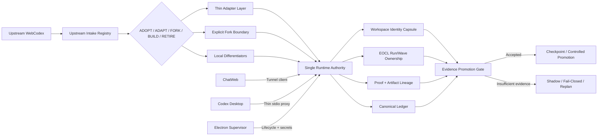
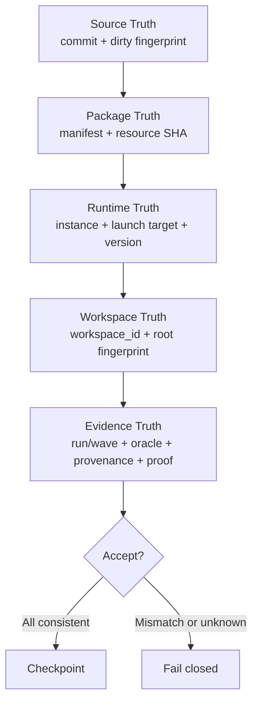
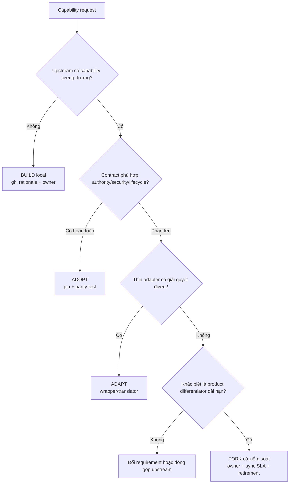

# CASE STUDY 01 — TỪ FORK TÍCH LŨY TÍNH NĂNG ĐẾN EXECUTION HUB QUẢN TRỊ BẰNG BẰNG CHỨNG

> **Luận đề trung tâm:** Thách thức lớn nhất của Coding Web không phải là thiếu thêm tính năng, mà là năng lực phát triển đã tăng nhanh hơn cơ chế xác lập **sự thật hệ thống**, **quyền điều khiển**, **danh tính workspace** và **bằng chứng đủ điều kiện để promotion**. Sự trưởng thành của dự án vì vậy không thể đo bằng số module đã viết, mà phải đo bằng mức độ chuyển hóa từ một fork tích lũy thay đổi sang một Execution Hub có authority đơn nhất, lineage đầy đủ, upstream reuse có chủ đích và quyết định fail-closed.

---

## Thông tin tài liệu

| Thuộc tính | Giá trị |
|---|---|
| Dự án | Coding Web / Tools-Codex-web |
| Workspace khảo sát | `E:\DEV\Codex-web` |
| Ngày chốt ảnh chụp nghiên cứu | 2026-08-21 |
| Nhánh tại thời điểm khảo sát | `main` |
| HEAD quan sát | `640ad37e3e571a0a56af376e9d3bda2b89bf0669` |
| Nguồn upstream được dự án ghi nhận | `yyjeqhc/webcodex` |
| Repo sản phẩm tùy biến | `uyenthudao2410-code/Tools-Codex-web` |
| Loại tài liệu | Case study kiến trúc, hậu kiểm lịch sử và kế hoạch chuyển hóa thành năng lực sản phẩm |
| Trạng thái | Nghiên cứu được hiệu chuẩn theo bằng chứng; không phải tuyên bố release/production readiness |

### Quy ước mức bằng chứng

- **`[M] Measured`**: số liệu đọc trực tiếp từ ảnh chụp telemetry/tracking hiện tại.
- **`[V] Verified`**: kết luận đã đi qua test, package check, closure gate hoặc acceptance được ghi nhận.
- **`[H] Historical`**: sự kiện được ghi trong tài liệu lịch sử, task history, ledger baseline hoặc postmortem.
- **`[I] Inferred`**: suy luận nhân quả có căn cứ từ nhiều nguồn nhưng chưa phải phép đo can thiệp trực tiếp.
- **`[O] Open`**: chưa được chứng minh hoặc còn phụ thuộc môi trường bên ngoài.

Các nhãn này nhằm ngăn việc biến một nhận định hợp lý thành “sự thật đã đo” khi bằng chứng chưa đủ.

---

# 1. Kết luận điều hành

Case study có giá trị nhất đối với Coding Web không phải một bug riêng lẻ, cũng không chỉ là câu hỏi “tại sao không copy luôn phần upstream”. Bốn nhóm vấn đề nổi bật trong lịch sử dự án thực chất cùng phát sinh từ một căn nguyên kiến trúc:

1. **Upstream reuse so với tự phát triển lại**: dự án cần tốc độ và quyền tùy biến, nhưng thiếu một thời gian dài cơ chế phân loại rõ phần nào phải adopt, adapt, fork hoặc build.
2. **Workspace identity và cross-project contamination**: khi identity của workspace không đi cùng command, run, proof và checkpoint, hệ thống có thể xử lý đúng lệnh nhưng sai đối tượng.
3. **Runtime supervision, restart và package truth**: source đúng không đồng nghĩa package đang chạy đúng; restart thành công không đồng nghĩa tiến trình mới đang dùng đúng byte, đúng schema và đúng workspace.
4. **P0–P4/S1–S9 và evidence-driven orchestration**: test xanh, aggregate đẹp hoặc chức năng tồn tại trong source chưa đủ để promotion nếu cohort, provenance, lineage hoặc oracle không hợp lệ.

**Mâu thuẫn chủ yếu** là:

> **Áp lực mở rộng năng lực nhanh** đối lập với **yêu cầu hệ thống phải biết chính xác cái gì đang chạy, chạy ở đâu, ai có quyền mutate và bằng chứng nào đủ giá trị để chấp nhận kết quả**.

Các sự cố package stale, persisted-state schema, workspace contamination, false-green semantic evaluation, zero comparable pairs, stale assertion và module-size budget không phải chuỗi tai nạn rời rạc. Chúng là những biểu hiện khác nhau của cùng một thiếu hụt: **identity, authority, provenance và evidence từng tồn tại dưới dạng giả định ngầm thay vì hợp đồng máy có thể kiểm chứng**.

Quá trình trưởng thành của Coding Web có thể mô tả bằng ba lần chuyển trạng thái:

- **Trạng thái 1 — Upstream substrate:** dựa trên WebCodex để có nền tảng ban đầu.
- **Trạng thái 2 — Local differentiation:** bổ sung Execution Hub, Coding Tools MCP, multi-client, recovery, routing, measurement và UI điều hành; năng lực tăng nhanh nhưng local delta và quan hệ phụ thuộc trở nên khó kiểm soát.
- **Trạng thái 3 — Evidence-governed platform:** một Runtime authority, workspace truth, EOCL, exact fingerprint, proof lineage, shadow/promotion gate và upstream-first ownership trở thành cấu trúc bắt buộc.

Do đó, chiến lược đúng **không phải quay lại upstream nguyên bản**, cũng **không phải tiếp tục copy rồi sửa cục bộ**. Chiến lược đúng là:

> **Reuse trước; adapter trước fork; fork phải có owner và sync contract; chỉ build local khi đó là năng lực khác biệt thật sự; mọi mutation và promotion phải gắn với identity, authority và evidence có thể kiểm chứng.**

Case study này nên được đưa vào Coding Web theo ba vai trò đồng thời:

- **Doctrine kiến trúc:** bộ nguyên tắc quyết định adopt/adapt/fork/build.
- **Năng lực sản phẩm:** Upstream Registry, Capability Ownership Matrix, Truth Console và Evidence Promotion Gate.
- **Executable benchmark:** một bài kiểm tra đa tầng buộc agent phát hiện source/package mismatch, workspace mismatch, invalid cohort, upstream duplication và yêu cầu replan có thay đổi chiến lược.

---

# 2. Vì sao chọn case tổng hợp thay vì một lỗi đơn lẻ

## 2.1. Bốn ứng viên ban đầu

| Ứng viên | Mật độ bằng chứng | Độ sâu nhân quả | Đòn bẩy sản phẩm | Khả năng khái quát | Hạn chế nếu đứng riêng |
|---|---:|---:|---:|---:|---|
| Upstream-first reuse so với tự viết | Cao | Cao | Rất cao | Rất cao | Có thể bị hiểu sai thành bài toán Git/copy code thuần túy |
| Workspace identity và cross-project contamination | Rất cao | Rất cao | Rất cao | Cao | Chỉ mô tả “đúng target” mà chưa bao quát package, authority và promotion |
| Runtime supervision/restart/package truth | Rất cao | Rất cao | Cao | Cao | Dễ bị thu hẹp thành lỗi Electron hoặc deployment |
| Evidence-driven orchestration P0–P4/S1–S9 | Rất cao | Rất cao | Rất cao | Rất cao | Có thể quá trừu tượng nếu không gắn với lịch sử cụ thể |

Điểm quan trọng là bốn ứng viên không độc lập. Chúng hình thành một chuỗi:

```text
Không có ownership map cho upstream/local
        ↓
Local delta tăng và contract ngầm nhiều hơn
        ↓
Source, package, runtime và workspace có thể lệch nhau
        ↓
Test xanh không còn đủ để biết cái gì thực sự đã được chứng minh
        ↓
Dự án phải xây authority, identity, EOCL, fingerprint và promotion gate
        ↓
Chi phí local ownership trở nên nhìn thấy được
        ↓
Upstream-first trở thành yêu cầu kinh tế-kỹ thuật, không chỉ là sở thích code
```

Vì vậy, case tổng hợp có giá trị cao hơn: nó giải thích **tại sao** nhiều lớp kỹ thuật khác nhau cùng xuất hiện và **điều gì phải thay đổi ở cấp quan hệ tổ chức kỹ thuật**, chứ không chỉ chỉ ra từng bản vá.

## 2.2. Tên case được chọn

**“Từ fork tích lũy tính năng đến Execution Hub quản trị bằng bằng chứng: chuyển hóa biện chứng của Coding Web qua upstream reuse, workspace truth, single authority và promotion gate.”**

Tên rút gọn dùng trong sản phẩm:

> **Casebook-01 — Authority Before Automation**

---

# 3. Câu hỏi nghiên cứu và giả thuyết

## 3.1. Câu hỏi nghiên cứu chính

Làm thế nào một dự án xuất phát từ upstream có thể mở rộng thành một nền tảng điều phối AI đa client mà không rơi vào ba thất bại phổ biến:

1. **ẩn fork** — copy hoặc tái tạo năng lực upstream nhưng không còn provenance và sync contract;
2. **ảo giác trạng thái** — source, package, runtime, workspace và UI mô tả các sự thật khác nhau;
3. **promotion không có căn cứ** — kết quả xanh nhưng cohort, oracle, identity hoặc lineage không đủ điều kiện.

## 3.2. Giả thuyết trung tâm

`[I]` Khi số năng lực, client, workspace, package và luồng orchestration tăng, các giả định ngầm về identity/authority/evidence sẽ tích lũy đến một ngưỡng. Qua ngưỡng đó, việc thêm patch cục bộ không còn làm hệ thống tiến hóa; nó chỉ làm tăng entropy. Hệ thống chỉ chuyển sang chất lượng mới khi các giả định này được vật thể hóa thành:

- một **Single Execution Authority**;
- một **Workspace Identity Capsule** đi cùng mọi mutation;
- một **Truth Chain** phân biệt source/package/runtime/workspace;
- một **Evidence Envelope** có provenance, oracle, cohort và lineage;
- một **Upstream Capability Registry** quyết định rõ adopt/adapt/fork/build;
- một **EOCL** bắt buộc replan khi chiến lược cũ không còn hợp lệ.

## 3.3. Tiêu chí bác bỏ giả thuyết

Giả thuyết trên phải bị xem là không đủ nếu một trong các phản chứng sau được chứng minh:

- chỉ cần tăng test coverage mà không cần identity/authority vẫn loại được các sai target và stale package;
- aggregate metrics không có cohort vẫn dự báo promotion đáng tin cậy;
- multi-client cùng mutate mà không cần single owner/lease vẫn không tạo race hoặc ambiguity;
- copy code upstream không làm tăng local maintenance và không cản trở sync;
- source fingerprint một mình đủ chứng minh byte đang chạy và persisted state tương thích.

Lịch sử hiện có không ủng hộ các phản chứng này.

---

# 4. Phương pháp luận biện chứng áp dụng cho nghiên cứu

Phương pháp luận ở đây không được dùng như ngôn ngữ trang trí. Mỗi nguyên lý phải ánh xạ thành một thao tác nghiên cứu hoặc một quyết định thiết kế.

## 4.1. Nguyên lý về mối liên hệ phổ biến

Một lỗi quan sát tại UI không được mặc định là lỗi UI. Trạng thái hiển thị có thể phụ thuộc đồng thời vào:

- source hiện tại;
- package bytes;
- supervisor launch target;
- persisted-state schema;
- runtime instance;
- workspace root;
- run/wave identity;
- ledger projection;
- test oracle;
- tài liệu đang được dùng làm chuẩn.

**Hệ quả thiết kế:** mọi trạng thái quan trọng phải có lineage ngược về nguồn và fingerprint; không cho phép một badge “ONLINE”, “CLOSED” hoặc “PASS” đứng riêng khỏi đối tượng mà nó mô tả.

## 4.2. Nguyên lý về sự phát triển

Coding Web không phát triển tuyến tính bằng cách cộng chức năng. Dự án trải qua các pha trong đó một cấu trúc từng hợp lý trở thành lực cản khi điều kiện thay đổi.

- Fork giúp đi nhanh lúc đầu.
- Khi local delta nhỏ, patch trực tiếp có thể hợp lý.
- Khi Runtime, Desktop, ChatWeb, tunnel, recovery và evidence cùng tồn tại, patch trực tiếp trở thành không đủ.
- Khi lượng lịch sử và telemetry tăng, cần schema, retention, cohort và causal discipline.

**Hệ quả thiết kế:** đánh giá một quyết định theo điều kiện lịch sử lúc nó được đưa ra, không dùng hiện trạng để kết án ngược; nhưng cũng không cho phép “đã từng hợp lý” trở thành lý do giữ debt vô thời hạn.

## 4.3. Quy luật thống nhất và đấu tranh của các mặt đối lập

### Mâu thuẫn chủ yếu

| Mặt thứ nhất | Mặt đối lập | Dạng biểu hiện |
|---|---|---|
| Mở rộng nhanh năng lực và tự động hóa | Sự thật, an toàn, khả năng tái lập | feature pressure so với evidence gate |
| Tận dụng upstream | Chủ quyền sản phẩm | reuse so với differentiated local control |
| Nhiều client tiện dụng | Một mutation authority | ChatWeb/Desktop/supervisor cùng quan sát nhưng không cùng sở hữu |
| Rich context/observability | Chi phí, độ trễ, noise | raw bytes so với model-visible capsule |
| Linh hoạt runtime | Tính xác định package/lifecycle | source-ready so với installed/runtime-ready |

Mâu thuẫn không được “xóa” bằng cách chọn tuyệt đối một phía. Nó phải được giải quyết bằng hình thức cao hơn:

- multi-client **nhưng** single authority;
- upstream reuse **nhưng** local extension layer;
- rich evidence **nhưng** bounded capsule;
- automation **nhưng** promotion fail-closed;
- fast iteration **nhưng** exact package/runtime fingerprint.

## 4.4. Quy luật lượng–chất

Lịch sử cho thấy nhiều ngưỡng lượng đã làm thay đổi bản chất bài toán:

- số module và trách nhiệm trong một file tăng đến mức module-size budget thất bại; giải pháp đúng không còn là sửa assertion mà là tách cấu trúc;
- số run lên đến hàng trăm nhưng zero comparable pairs; thêm run không tạo ra chất lượng bằng chứng nếu cấu trúc cohort sai;
- số client và đường launch tăng; một path string không còn đủ làm workspace truth;
- số byte telemetry lớn; đưa thẳng vào model không còn là “nhiều context hơn” mà thành vấn đề compression và salience;
- số local patch tăng; fork không còn là biến thể nhỏ mà trở thành một sản phẩm có chi phí sở hữu riêng.

**Kết luận:** tăng số lượng test, run, log hoặc tính năng không tự động tạo ra độ tin cậy. Chất lượng mới chỉ xuất hiện khi cấu trúc đo lường và authority thay đổi.

## 4.5. Quy luật phủ định của phủ định

Quá trình này không phải quay lại upstream nguyên trạng.

1. **Phủ định lần thứ nhất:** Coding Web phủ định giới hạn của upstream bằng local differentiation — Execution Hub, Coding Tools MCP, supervision, recovery, routing, proof và UI vận hành.
2. **Mặt trái:** local differentiation tích lũy thành divergence, duplicate capability và contract ngầm.
3. **Phủ định lần thứ hai:** upstream-first governance phủ định cách phát triển ad hoc, nhưng **giữ lại** các năng lực khác biệt có giá trị. Kết quả không phải upstream cũ mà là kiến trúc mới: upstream substrate + adapter/fork boundary + local differentiators + evidence governance.

Đây là “phủ định có kế thừa”, không phải rollback.

## 4.6. Các cặp phạm trù được dùng để tránh kết luận sai

| Phạm trù | Áp dụng vào Coding Web |
|---|---|
| Bản chất – hiện tượng | Badge online, test xanh, source diff là hiện tượng; identity/authority/evidence contract mới là bản chất |
| Nguyên nhân – kết quả | Package stale là nguyên nhân gần; thiếu package truth gate là nguyên nhân gốc |
| Tất nhiên – ngẫu nhiên | Một field schema cụ thể bị thiếu có thể ngẫu nhiên; persisted-state compatibility failure là tất yếu nếu schema contract không tồn tại |
| Nội dung – hình thức | Năng lực runtime là nội dung; API/UI/stdio/tunnel là hình thức; thay hình thức không được làm lệch authority |
| Khả năng – hiện thực | Code tồn tại tạo khả năng; packaged smoke, live activation và proof mới biến thành hiện thực |
| Cái chung – cái riêng | Identity/authority là quy luật chung; Electron launch target hay HR workspace là biểu hiện riêng |
| Toàn thể – bộ phận | Từng test pass không đại diện toàn hệ thống; acceptance phải xét chuỗi source→package→runtime→workspace→proof |

## 4.7. Thực tiễn là tiêu chuẩn kiểm tra chân lý

Trong case này, “thực tiễn” được hiểu rất cụ thể:

- source unit test không thay thế installed-package smoke;
- synthetic run không thay thế representative cohort;
- schema compile không thay thế persisted-state compatibility;
- aggregate performance không thay thế paired causal evidence;
- UI state không thay thế runtime/ledger truth;
- tài liệu closure không thay thế release gate.

---

# 5. Thứ bậc nguồn và cách hiệu chuẩn kết luận

Theo quy tắc dự án trong `AGENTS.md`, thứ tự tin cậy được áp dụng như sau:

1. **Live source, tests và runtime behavior**.
2. **Tài liệu trạng thái được duy trì**: `docs/CURRENT_STATE.md`, `docs/ARCHITECTURE.md`, `docs/PRODUCTION_CLOSURE_ROLLOUT.md`.
3. **Tracking state**: `.coding-tools/task-state.json`, `.coding-tools/task-history.json`, `.coding-tools/performance.json`, canonical ledger.
4. **Tài liệu nghiên cứu có ngày**: có giá trị lịch sử và giải thích quyết định, nhưng không tự động đại diện current truth.
5. **Nhận định suy luận**: phải gắn `[I]` và nêu điều kiện bác bỏ.

### Nguyên tắc đọc lịch sử

- Không dùng một tài liệu cũ để phủ định source hiện tại nếu source đã đổi.
- Không dùng source hiện tại để xóa bài học từ một lỗi đã xảy ra.
- Không biến “closed for baseline” thành “released to production”.
- Không cộng tất cả state observations rồi gọi là số run thành công.
- Không gọi mọi `error` trong telemetry là product defect; trong hệ thống fail-closed, validation, authority denial và user block là một phần hành vi bảo vệ.

---

# 6. Dòng thời gian chuyển hóa của dự án

> Các mốc dưới đây dựa trên tài liệu có ngày và closure history. Tên file phản ánh chronology nghiên cứu; một số triển khai có thể bắt đầu trước ngày tài liệu được chốt.

| Giai đoạn | Mốc | Chuyển động chính | Ý nghĩa biện chứng |
|---|---|---|---|
| Nền tảng | Trước 2026-08-12 | Kế thừa WebCodex, bắt đầu mở rộng cho workflow riêng | Upstream là điều kiện vật chất ban đầu |
| Mô hình hóa điều phối | 2026-08-12 | Benchmark routing, nghiên cứu model orchestration, production decision | Từ “gọi model” sang xem routing như một hệ thống cần policy và evidence |
| Hậu kiểm runtime | 2026-08-13 | PFM runtime postmortem, enforced control loop, orchestration blueprint | Failure được chuyển thành state machine và control contract |
| Execution Hub | 2026-08-14 | Tích hợp ChatWeb–Codex Desktop, live benchmark, implementation status | Multi-client làm nổi bật nhu cầu single authority |
| Nhìn thấy local delta | 2026-08-15 | Current implementation delta, practical fit audit | Fork bắt đầu được xem như danh mục nghĩa vụ sở hữu, không chỉ tập hợp code |
| Compute/recovery/hardening | 2026-08-16 | Server-first compute, recovery roadmap, P2–P3 plans | Tách control plane, recovery và resource policy thành kiến trúc riêng |
| Ledger/workspace truth | 2026-08-17 | Current ledger baseline, project real-state assessment | Lịch sử vận hành và workspace identity trở thành bằng chứng cấp một |
| Closure có điều kiện | 2026-08-18 | P0–P3 readiness/closure, paired experiment manifest | Chuyển từ feature completion sang proof/evidence completion |
| Tổng kiểm toán | 2026-08-20 | Technical evaluation và implementation plan | Tập hợp debt, gate và unresolved claims thành chương trình có thứ tự |
| Upstream-first và closure | 2026-08-21 | Implementation closure, upstream-first reuse strategy | Phủ định cách tích lũy local delta ad hoc, nhưng giữ lại khác biệt sản phẩm |

---

# 7. Tái dựng lịch sử theo năm chặng phát triển

## 7.1. Chặng A — Upstream như lực đẩy ban đầu

WebCodex cung cấp nền tảng để Coding Web không phải bắt đầu từ số không. Giá trị của upstream ở giai đoạn này không chỉ là code; nó còn là:

- cấu trúc ứng dụng web/Electron ban đầu;
- một số khái niệm UI và workflow;
- nền móng để thử nghiệm nhanh;
- giảm chi phí cơ hội trong lúc bài toán sản phẩm còn biến động.

Trong điều kiện đó, fork và patch trực tiếp là quyết định có thể biện minh. Một startup/research project chưa biết ranh giới sản phẩm sẽ khó thiết kế ownership matrix hoàn chỉnh ngay từ đầu.

**Sai lầm chỉ xuất hiện khi phương thức tạm thời bị kéo dài sau khi điều kiện đã đổi.** Khi Execution Hub, MCP runtime, supervisor, tunnel, multi-workspace, ledger và evidence xuất hiện, dự án không còn là “một biến thể UI của upstream”. Nó đã thành một hệ thống điều phối riêng.

## 7.2. Chặng B — Tích lũy local differentiation

Dự án bổ sung những năng lực upstream không sở hữu đầy đủ theo yêu cầu sản phẩm:

- một Runtime authority phục vụ nhiều client;
- ChatWeb qua tunnel và Codex Desktop qua thin stdio proxy;
- Electron đóng vai trò supervisor, secret owner và control center;
- Coding Tools MCP với tool contract `smart-v3` gồm đúng tám tool;
- EOCL từ PREFLIGHT đến CHECKPOINTED;
- proof, capsule, ledger, routing, recovery và telemetry;
- fail-closed behavior khi bằng chứng promotion chưa đủ.

Đây là **năng lực khác biệt thật sự**, không nên xóa chỉ vì upstream có phần giao diện hoặc workflow tương tự.

Nhưng local differentiation cũng tạo ra nghĩa vụ:

- package phải mang đúng byte;
- runtime phải chạy đúng package;
- client phải nói chuyện với đúng authority;
- workspace phải có identity ổn định;
- proof phải trỏ đúng source/workspace/run;
- upstream capability mới phải được intake thay vì vô thức tái viết.

## 7.3. Chặng C — Các khủng hoảng “sự thật hệ thống”

Khi số lớp tăng, các mâu thuẫn tiềm ẩn chuyển thành sự cố có thể quan sát:

- source và packaged resource lệch nhau;
- state cũ không tương thích code mới;
- một run có thể mang dấu vết command từ workspace khác;
- UI online không đồng nghĩa active work;
- test xanh không đồng nghĩa evidence hợp lệ;
- một assertion stale có thể làm hỏng broad proof dù product behavior đúng;
- module đạt giới hạn cấu trúc buộc phải replan.

Ở đây, lỗi không còn nằm ở một hàm. Nó nằm ở **quan hệ giữa các tầng**.

## 7.4. Chặng D — Authority và evidence được vật thể hóa

Dự án phản ứng bằng cách đưa các khái niệm từng ngầm định vào state machine, metadata và gate:

- Single Runtime authority;
- run/wave ownership;
- idempotency;
- explicit task state;
- proof lineage;
- representative/benchmark/synthetic provenance;
- exact package fingerprint;
- workspace root/fingerprint;
- shadow-only và no-promotion khi causal evidence thiếu;
- REPLAN thay vì retry nguyên chiến lược.

Đây là thay đổi về **chất**, không chỉ thêm logging.

## 7.5. Chặng E — Upstream-first trở thành kỷ luật kinh tế

Sau khi authority và evidence rõ hơn, chi phí local delta cũng trở nên đo được:

- mỗi bản copy cần theo dõi nguồn;
- mỗi fork cần sync, test parity và owner;
- mỗi implementation trùng lặp làm tăng attack surface và regression surface;
- mỗi capability không có ownership làm mơ hồ quyết định sửa ở upstream, adapter hay local core.

Vì vậy upstream-first không phải khẩu hiệu “dùng code người khác cho nhanh”. Nó là **cơ chế giảm entropy có kiểm soát**, dựa trên ownership và proof.

---

# 8. Bảy sự kiện lịch sử mang tính quyết định

## 8.1. Sự kiện 1 — Source đúng nhưng packaged Recovery Supervisor stale

`[H][V]` Lần thử installed đầu tiên thất bại vì byte của Recovery Supervisor trong package không trùng source hiện tại.

- Source hash được ghi nhận: `540730…`.
- Packaged hash được ghi nhận: `7c2e89…`.
- Package cũ thiếu xử lý Unicode path đã có ở source.
- Rollback thành công.
- Biện pháp sửa không dừng ở “build lại”: clean dist, full resource SHA gate và packaged smoke.
- Focused checks đạt `13/13`; package kiểm tra `249` file exact; commit liên quan `d5d4bbb5`.

### Phân tích nhân quả

- **Hiện tượng:** chức năng recovery lỗi trong installed app.
- **Nguyên nhân gần:** packaged byte stale.
- **Nguyên nhân gốc:** pipeline từng cho phép source truth và package truth tách rời mà không có exact fingerprint gate.
- **Bài học:** “code đã sửa” là phát biểu về source, không phải về sản phẩm đang chạy.

### Chuyển hóa thành nguyên tắc

Mọi release/activation claim phải trả lời được bốn câu hỏi độc lập:

1. Source commit nào?
2. Package fingerprint nào?
3. Runtime instance nào đang chạy package đó?
4. Workspace nào đang được authority đó sở hữu?

## 8.2. Sự kiện 2 — Persisted-state schema phá vỡ installed acceptance

`[H][V]` Lần installed tiếp theo gặp lỗi vì field `last_healthy_at` không tồn tại trong persisted state cũ dưới StrictMode.

- Repair được giữ tối thiểu.
- Focused checks đạt `12/12`.
- Commit liên quan `acaa3582`.

### Phân tích biện chứng

Field bị thiếu là cái riêng; vấn đề chung là **code lifecycle và state lifecycle không cùng contract**. Khi runtime có recovery và persistence, schema không còn là chi tiết implementation. Nó là API xuyên phiên bản.

### Nguyên tắc rút ra

- state schema phải versioned;
- migration phải idempotent;
- default/backfill phải explicit;
- rollback phải biết đọc state của phiên bản trước;
- installed smoke phải dùng state cũ đại diện, không chỉ state sạch.

## 8.3. Sự kiện 3 — Workspace contamination làm lộ identity gap

`[H]` Ledger baseline lịch sử ghi nhận một run của Codex-web có dấu vết lệnh Vitest từ workspace HR trước khi isolation được hoàn thiện.

Điều này không nhất thiết chứng minh mutation sai đã được chấp nhận, nhưng đủ chứng minh một sự thật quan trọng:

> Một session, một UI selection hoặc một path setting không tự động trở thành canonical workspace identity của từng command/proof.

### Nguyên nhân gốc

- workspace được xem như context của client thay vì thuộc tính bắt buộc của artifact;
- command, proof và checkpoint chưa luôn mang cùng một root fingerprint;
- lịch sử đa dự án làm lộ sự khác nhau giữa “workspace người dùng đang nghĩ tới” và “workspace process thực sự dùng”.

### Nguyên tắc rút ra

Mọi command/proof cần ít nhất:

```yaml
workspace_id: stable-logical-id
root_fingerprint: sha256(canonical-root-identity)
resolved_root: content-free-or-redacted-path
source_commit: git-commit-or-null
runtime_instance_id: runtime-uuid
run_id: orchestration-run
wave_id: orchestration-wave
```

Acceptance phải fail-closed nếu workspace identity giữa run, command, proof và completion report không nhất quán.

## 8.4. Sự kiện 4 — Hai wave semantic graph “xanh” vẫn bị từ chối

`[H][V]` Trong closure history, hai wave đầu của semantic graph có tín hiệu xanh nhưng không được chấp nhận do:

- false-stale semantics;
- lifetime accumulation không bị giới hạn làm sai ý nghĩa cửa sổ đánh giá.

Wave cuối chỉ được accepted sau khi sửa **semantics của evidence**, không phải sau khi làm đẹp số.

### Ý nghĩa

Đây là một ví dụ điển hình cho nguyên tắc:

> Test xanh chỉ có giá trị khi oracle đang đo đúng đối tượng, đúng cửa sổ và đúng semantics.

Nếu lifetime counter được dùng để chứng minh một hành vi theo cửa sổ ngắn, lượng dữ liệu tăng có thể làm bằng chứng **kém đúng hơn**, không phải tốt hơn.

## 8.5. Sự kiện 5 — 794 run nhưng zero comparable pairs

`[M/H]` Context compiler shadow evaluation nhìn thấy `794` run thực tế, nhưng:

- không có pair-tagged/comparable pairs hợp lệ;
- cost data chưa đầy đủ;
- quyết định đúng là `KEEP_SHADOW / NO_PROMOTION`.

### Phân tích lượng–chất

`794` là lượng lớn. Nhưng nếu các run không cùng task semantics, environment, oracle, cache stratum và provenance, chúng không tạo thành causal evidence. Zero comparable pairs có giá trị quyết định lớn hơn aggregate sample count.

### Nguyên tắc rút ra

Không promotion dựa trên “nhiều dữ liệu” nếu chưa có:

- pair identity;
- representative task class;
- shared oracle;
- controlled environment;
- known cache/thread stratum;
- cost/quality outcome hợp lệ;
- predeclared acceptance rule.

## 8.6. Sự kiện 6 — Không sửa stale assertion chỉ để tạo màu xanh

`[H][V]` Broad proof của mutation coordinator ban đầu có `1 failed / 23 passed` vì một hard-coded tool-contract SHA đã stale và không phản ánh product defect hiện tại. Dự án không vá test chỉ để “manufacture green”; hardening thật được thực hiện và focused suite cuối đạt `19/19`.

### Bài học

Có hai sai lầm đối lập:

- coi mọi test fail là product failure;
- coi test stale là lý do bỏ qua toàn bộ verification.

Cách đúng là phân loại oracle:

1. assertion còn đại diện cho contract hay không;
2. failure thuộc product, fixture, environment hay historical pin;
3. sau khi sửa oracle, vẫn phải có proof độc lập cho behavior thật.

## 8.7. Sự kiện 7 — Module-size budget buộc REPLAN có thay đổi chiến lược

`[H][V]` Một đợt sửa Control Panel đã làm phần lớn focused checks pass nhưng vi phạm module-size budget. Workflow đi vào REPLAN; chiến lược mới tách `live_control.py`, giữ endpoint đầy đủ và sau đó mới accepted/checkpointed.

### Ý nghĩa

Đây là mẫu replan đúng:

- không retry cùng patch;
- không nới budget chỉ để pass;
- không bỏ endpoint;
- thay đổi cấu trúc để giải quyết mâu thuẫn giữa feature growth và maintainability.

Đây cũng là ví dụ rõ nhất của chuyển hóa lượng–chất: khi trách nhiệm tích lũy vượt ngưỡng, file không còn là cùng một đơn vị kiến trúc có thể tiếp tục kéo dài.

---

# 9. Ảnh chụp định lượng và cách đọc đúng

Nguồn: `.coding-tools/performance.json` tại thời điểm khảo sát. Đây là **dynamic cumulative snapshot**, không phải báo cáo billing và không tự động đại diện cho provider latency.

## 9.1. Các số liệu quan sát

| Chỉ số | Giá trị | Cách diễn giải đúng |
|---|---:|---|
| Tool calls | 13.594 | Quy mô hoạt động được quan sát trong snapshot |
| Errors | 1.276 | Khoảng 9,39% trên raw calls; gồm validation, runtime, authority denial, user block… không phải defect rate |
| Idempotency-required calls | 1.025 | Cho thấy mutation safety đã thành concern thường xuyên |
| Calls có key | 1.020 | Gần phủ kín nhóm yêu cầu key, nhưng vẫn phải điều tra phần thiếu thay vì suy rộng |
| Proof-cache eligible | 1.151 | Số call có khả năng dùng proof cache |
| Proof-cache hit | 1 | Khoảng 0,087%; fingerprint/cache stability còn dư địa rất lớn |
| Proof-cache miss do changed fingerprint | 572 | Local change/fingerprint churn là nguồn miss đáng kể |
| Proof-cache cold miss | 578 | Gần tương đương changed-fingerprint miss |
| Localization queries | 4.380 | Tổng truy vấn localization được ghi nhận |
| Fallback search queries | 4.375 | Khoảng 99,89%; semantic/native path hầu như chưa gánh tải |
| Native/LSP attempts | 1.637 | Có thử dùng provider/native path |
| Handled | 5 | Khoảng 0,305% attempts; phù hợp trạng thái provider-degraded/fallback |
| Deterministic resolved routes | 6.232/6.280 | Khoảng 99,24% resolved routes; phù hợp chính sách fail-closed khi evidence promotion chưa đủ |
| Local execution time | ~13,82 giờ | Thời gian thực thi local cộng dồn theo snapshot |
| Estimated wait time | ~84,76 giờ | Khoảng 6,13 lần local execution; là ước lượng hệ thống, không phải đo provider wall-clock chuẩn |
| Response bytes | 734.563.309 | Data plane output lớn |
| Model-visible bytes | 25.969.040 | Khoảng 1/28,29 response bytes; cho thấy compression boundary đã tồn tại |

## 9.2. Phân bố error class

Snapshot ghi nhận các nhóm như `VALIDATION`, `RUNTIME`, `AUTHORITY_DENIED`, `USER_BLOCKED`, `NOT_FOUND`, `IDEMPOTENCY`, `INTERNAL` và `UNKNOWN`.

Không được cộng chúng thành “tỷ lệ lỗi sản phẩm”. Trong một hệ thống fail-closed:

- `AUTHORITY_DENIED` có thể là behavior đúng;
- `VALIDATION` có thể là contract bảo vệ;
- `USER_BLOCKED` có thể là yêu cầu thiếu điều kiện hoặc bị người dùng dừng;
- `RUNTIME` và `INTERNAL` mới cần phân tích sâu theo root cause;
- một call có thể tạo nhiều observation ở các state khác nhau.

## 9.3. Điều số liệu thật sự nói lên

### Kết luận được phép

- `[M]` Dự án có quy mô vận hành đủ lớn để các vấn đề identity, idempotency, cache và observability không còn là giả định nhỏ.
- `[M]` Proof cache gần như chưa tạo giá trị đáng kể tại snapshot này.
- `[M]` Native semantic path đang ở trạng thái rất yếu; fallback search là thực tế chủ đạo.
- `[M]` Routing resolved gần như hoàn toàn deterministic, phù hợp gate hiện tại.
- `[I]` Compression boundary đang giảm lượng byte đưa vào model, nhưng chưa có đủ evidence để kết luận compression tối ưu về chất lượng quyết định.

### Kết luận không được phép

- Không được nói 9,39% là bug rate.
- Không được nói 84,76 giờ là thời gian người dùng thực chờ.
- Không được nói 99,24% deterministic là mô hình tối ưu; đó có thể chỉ là hậu quả của fail-closed promotion.
- Không được nói 28,29× compression là tốt nếu chưa đo recall/salience.
- Không được dùng state observation counts như success rate của run.

---

# 10. Cây nguyên nhân: từ triệu chứng đến căn nguyên

```text
CĂN NGUYÊN CẤP HỆ THỐNG
Identity, authority, provenance và evidence từng là giả định ngầm
│
├── Nhánh A: Upstream/local ownership không explicit
│   ├── copy/tái viết capability
│   ├── provenance mất dần
│   ├── local delta tăng
│   └── sync và parity trở thành việc thủ công
│
├── Nhánh B: Source/package/runtime truth không nối thành chuỗi
│   ├── packaged resource stale
│   ├── launch target sai hoặc process cũ còn sống
│   ├── state schema không tương thích
│   └── UI có thể mô tả source thay vì runtime
│
├── Nhánh C: Workspace identity không đi cùng artifact
│   ├── command từ project khác lọt vào history
│   ├── proof khó loại workspace mismatch
│   └── operator thấy đúng workspace nhưng worker dùng root khác
│
├── Nhánh D: Evidence semantics không đủ chặt
│   ├── aggregate xanh nhưng cohort invalid
│   ├── lifetime counter làm sai window
│   ├── synthetic/benchmark lẫn representative
│   └── zero comparable pairs vẫn có rất nhiều run
│
└── Nhánh E: Growth vượt cấu trúc
    ├── module-size budget fail
    ├── responsibilities chồng lấn
    ├── retry nguyên chiến lược không còn hiệu quả
    └── buộc tách module và xác lập owner mới
```

**Kết luận nhân quả:** các bug cụ thể là trigger; identity/authority/evidence gap mới là causal structure có khả năng sinh lỗi lặp lại.

---

# 11. Đánh giá các quyết định lịch sử

## 11.1. Những quyết định đúng và nên giữ

| Quyết định | Đánh giá | Lý do |
|---|---|---|
| Xây Execution Hub riêng | Đúng | Đây là khác biệt sản phẩm thực: multi-client, single runtime, proof/ledger/recovery |
| Electron là supervisor + secret owner + control center | Đúng có điều kiện | Hợp lý nếu launch target, package truth và single-instance contract được khóa |
| Một Runtime authority, client mỏng | Đúng | Giảm split-brain và duplicate mutation authority |
| EOCL và REPLAN thay vì retry mù | Đúng | Biến failure thành state có nghĩa và buộc thay chiến lược |
| Exact package fingerprint và packaged smoke | Đúng | Đóng khoảng cách source→installed artifact |
| Shadow-only khi cohort/cost chưa đủ | Đúng | Bảo vệ sản phẩm khỏi promotion dựa trên aggregate không causal |
| Không sửa assertion chỉ để tạo màu xanh | Đúng | Giữ test như oracle thay vì công cụ trang trí |
| Gate-closed Computer Use, remote lease, external A2A khi contract chưa đủ | Đúng | Tránh mở authority surface trước khi có consumer và safety proof |
| Giữ fallback khi native semantic provider chưa sẵn sàng | Đúng tạm thời | Duy trì chức năng; nhưng không được tuyên bố native semantic quality đã đóng |

## 11.2. Những quyết định từng hợp lý nhưng phải được giới hạn theo thời gian

| Quyết định | Hợp lý khi | Trở thành debt khi |
|---|---|---|
| Patch trực tiếp vào fork | Local delta nhỏ, product hypothesis chưa ổn định | Capability ownership không còn nhìn thấy, upstream sync khó |
| Copy một phần upstream | Cần unblock nhanh và upstream chưa đóng gói được | Không lưu origin commit, owner, parity test, rebase policy |
| Dùng path/config làm workspace truth | Một workspace, một process | Nhiều máy, nhiều project, recovery và retained task history |
| Dựa vào source tests | Chưa có installed package/lifecycle | Package/supervisor/persistence trở thành product surface |
| Dùng aggregate telemetry | Khám phá ban đầu | Dùng để promotion hoặc causal claim |
| Để module tiếp tục phình | Feature đang chứng minh giá trị | Boundary/size budget đã báo mâu thuẫn cấu trúc |

## 11.3. Những hướng không nên theo

- Quay về upstream thuần và xóa Execution Hub.
- Full rewrite toàn bộ để “sạch kiến trúc”.
- Copy upstream hàng loạt rồi coi đó là reuse.
- Cho nhiều client cùng có mutation authority.
- Promotion model/router/context compiler dựa trên aggregate run không pair.
- Gắn trạng thái “production-ready” chỉ vì source suite xanh.
- Mở Computer Use/remote device/A2A trước khi authority và consumer contract được chứng minh.

---

# 12. Trả lời trực diện: Vì sao không copy luôn phần upstream?

## 12.1. Copy là cơ chế chuyển byte, không phải chiến lược reuse

Copy có thể làm code xuất hiện trong repo nhanh hơn, nhưng đồng thời xóa hoặc làm mờ:

- commit nguồn;
- license/provenance;
- boundary giữa upstream behavior và local behavior;
- khả năng nhận patch mới;
- parity test;
- trách nhiệm owner;
- chi phí divergence.

Một bản copy không có metadata là một **hidden fork**.

## 12.2. Khi nào adopt trực tiếp

Chọn **ADOPT** khi:

- upstream capability đáp ứng contract cần thiết;
- API/behavior đủ ổn định;
- không xâm phạm single-authority model;
- packaging và license phù hợp;
- local differentiation gần bằng zero.

Hình thức ưu tiên: dependency, pinned commit, subtree/submodule có policy, hoặc import nguyên module với provenance rõ.

## 12.3. Khi nào adapt

Chọn **ADAPT** khi upstream giải quyết 70–90% chức năng nhưng cần đổi giao diện tích hợp:

- thin adapter;
- compatibility wrapper;
- event translator;
- UI composition;
- policy layer bên ngoài upstream core.

Adapter phải mỏng, test parity và không fork logic lõi nếu không cần.

## 12.4. Khi nào fork/copy có kiểm soát

Chọn **FORK** khi:

- upstream không cho extension point cần thiết;
- patch cần thiết nhưng upstream không nhận hoặc release cadence không phù hợp;
- security/authority/lifecycle contract của Coding Web khác căn bản;
- license cho phép;
- dự án chấp nhận chi phí sở hữu dài hạn.

Mọi fork phải có tối thiểu:

```yaml
capability_id: recovery-supervisor
mode: FORK
upstream_repo: yyjeqhc/webcodex
upstream_commit: <exact-sha>
upstream_paths:
  - <path>
local_paths:
  - <path>
owner: <team-or-module-owner>
rationale: <why adapter is insufficient>
local_delta_contract: <what must remain different>
parity_tests:
  - <test-id>
sync_policy:
  cadence: <risk-based>
  conflict_owner: <owner>
retirement_condition: <when fork can be removed>
```

## 12.5. Khi nào build local

Chọn **BUILD** nếu năng lực là khác biệt cốt lõi mà upstream không có hoặc không nên sở hữu, ví dụ:

- EOCL và evidence promotion;
- single Runtime authority cho ChatWeb/Desktop;
- workspace identity/proof lineage;
- local recovery và package truth contract;
- product-specific policy/routing/control plane.

## 12.6. Quy tắc cuối cùng

> Không hỏi “copy được không?” trước. Hỏi “ai sẽ sở hữu divergence này trong hai năm tới, proof nào bảo đảm parity, và khi upstream đổi thì hệ thống biết bằng cách nào?”.

---

# 13. Anti-pattern catalogue

## AP-01 — Copy before inventory

Copy module trước khi lập capability map. Hậu quả: duplicate implementation và không biết nơi nào là canonical.

## AP-02 — Hidden fork

Code có nguồn upstream nhưng không lưu origin commit, local delta và sync SLA.

## AP-03 — Source equals runtime fallacy

Suy luận “source đã sửa” thành “app đang chạy bản sửa”. Sự kiện packaged Recovery stale là phản chứng trực tiếp.

## AP-04 — Green equals accepted

Dùng test xanh hoặc aggregate đẹp làm acceptance dù oracle/cohort/window sai.

## AP-05 — Path equals identity

Dùng chuỗi path hiện tại làm toàn bộ workspace identity mà không có canonicalization, fingerprint và artifact lineage.

## AP-06 — Multi-client equals multi-authority

Cho ChatWeb, Desktop và supervisor đều có quyền mutate độc lập. Điều này biến tiện ích thành split-brain.

## AP-07 — Synthetic promotion

Dùng benchmark/synthetic rows để mở automatic routing hoặc context injection cho representative workload.

## AP-08 — Retry without strategic change

Lặp patch sau một structural gate failure. REPLAN chỉ có nghĩa khi strategy, boundary hoặc oracle thay đổi.

## AP-09 — Patch the test to make green

Sửa expected hash/assertion mà không chứng minh contract mới đúng.

## AP-10 — Partial isolation marketed as general isolation

Có sandbox cho một command rồi suy rộng thành arbitrary worker isolation dù network, secret, filesystem và kill guarantees chưa được chứng minh.

## AP-11 — Research document as current truth

Dùng dated plan để khẳng định runtime hiện tại mà không kiểm tra source/tracking.

## AP-12 — Data exhaust as context

Đưa toàn bộ logs/output vào model rồi coi đó là “context đầy đủ”. Dữ liệu nhiều có thể làm giảm salience và tăng chi phí.

---

# 14. Doctrine kiến trúc đề xuất

## 14.1. Mười nguyên tắc bất biến

1. **Authority before automation.** Không tự động hóa mutation khi owner chưa đơn nhất.
2. **Identity travels with the artifact.** Workspace identity phải đi cùng command, proof, checkpoint và completion report.
3. **Source is not package; package is not runtime.** Mỗi tầng có fingerprint riêng.
4. **Reuse before recreate.** Mọi capability mới phải đi qua upstream inventory.
5. **Adapter before fork.** Chỉ fork khi extension layer không đủ.
6. **Fork is a product commitment.** Fork cần owner, sync SLA, parity tests và retirement condition.
7. **Evidence before promotion.** Không promotion nếu provenance/cohort/oracle chưa hợp lệ.
8. **Failure must change the next plan.** REPLAN không được là retry đổi tên.
9. **Closed is scoped.** Baseline closure không tự động là release, activation hoặc external persistence proof.
10. **Practice outranks narrative.** Installed smoke, real workspace identity và representative evidence có quyền phủ định claim trong tài liệu.

## 14.2. Kiến trúc đích



## 14.3. Chuỗi sự thật bốn tầng



Không tầng nào được suy ra tự động từ tầng trước nếu không có phép kiểm chứng cụ thể.

---

# 15. Các năng lực mới nên đưa vào Coding Web

## 15.1. Upstream Intake Registry

Một registry máy đọc được, ví dụ `config/upstream-capabilities.yaml`, chứa:

- capability ID;
- upstream repo/commit/path;
- local mode: ADOPT/ADAPT/FORK/BUILD/RETIRE;
- owner;
- rationale;
- local delta;
- parity tests;
- sync SLA;
- risk tier;
- last reviewed commit/date;
- retirement condition.

### Giá trị

- ngăn duplicate capability trước khi code;
- tự động tạo upstream diff report;
- biết patch nên đi vào adapter hay local core;
- biến “tại sao tự code?” thành câu hỏi có dữ liệu.

## 15.2. Capability Ownership Matrix

| Capability | Upstream owner | Local owner | Mode | Canonical implementation | Promotion gate |
|---|---|---|---|---|---|
| Base web shell | Upstream | Integration owner | ADOPT/ADAPT | Upstream + thin adapter | parity suite |
| Execution Hub | None | Local runtime owner | BUILD | Local | EOCL + authority tests |
| Recovery Supervisor | Partial | Local lifecycle owner | FORK/BUILD | Explicit local boundary | package/persistence smoke |
| Model routing | None/partial | Local policy owner | BUILD | Local | representative paired evidence |
| UI components | Mixed | UI owner | ADOPT/ADAPT | Per-component | visual/behavior parity |

Matrix phải được kiểm tra trong planning phase, không chờ code review cuối.

## 15.3. Workspace Identity Capsule

Capsule nên được tạo một lần tại authority boundary và đóng dấu vào mọi artifact:

```json
{
  "workspace_id": "stable-logical-id",
  "root_fingerprint": "sha256:...",
  "repo_remote_fingerprint": "sha256:...",
  "source_commit": "...",
  "dirty_tree_fingerprint": "sha256:...",
  "runtime_instance_id": "...",
  "task_id": "...",
  "run_id": "...",
  "wave_id": "..."
}
```

Đường dẫn tuyệt đối có thể được redacted trong telemetry chia sẻ; fingerprint vẫn giữ tính so sánh.

## 15.4. Evidence Envelope

Mọi proof có khả năng dẫn đến acceptance/promotion cần:

```yaml
proof_id: <uuid>
producer: <tool/test/runtime>
workspace_identity: <capsule-ref>
source_fingerprint: <sha256>
package_fingerprint: <sha256-or-null>
runtime_instance_id: <uuid-or-null>
run_id: <id>
wave_id: <id>
provenance: representative|benchmark|synthetic
oracle_id: <stable-id>
environment_id: <hash>
pair_id: <id-or-null>
cache_stratum: cold|warm|unknown
result: pass|fail|inconclusive
limitations:
  - <explicit limitation>
```

## 15.5. Truth Console trong UI

Một khối UI duy nhất hiển thị bốn truth domain:

1. **SOURCE** — repo, branch, commit, dirty status.
2. **PACKAGE** — build ID, manifest hash, resource parity.
3. **RUNTIME** — PID/instance, launch target, version, started at.
4. **WORKSPACE** — logical ID, root fingerprint, owner lease.

Mỗi domain có trạng thái:

- `MATCHED`;
- `MISMATCHED`;
- `UNKNOWN`;
- `NOT_APPLICABLE`.

Không dùng một badge “ONLINE” để đại diện cả bốn.

## 15.6. Upstream Delta Map

UI hoặc report cho biết:

- upstream commit đang pin;
- commit mới chưa intake;
- files/capabilities local diverged;
- divergence có owner hay không;
- parity test gần nhất;
- risk của việc sync;
- đề xuất adopt/adapt/fork/build.

## 15.7. Casebook Replay

Case study này nên được lưu dưới dạng một scenario có thể replay:

- event timeline;
- evidence packet;
- decision checkpoints;
- expected safe action;
- anti-pattern traps;
- scoring rubric.

Như vậy tài liệu không chỉ để đọc; nó trở thành bài test cho agent và control plane.

---

# 16. Quy trình quyết định ADOPT / ADAPT / FORK / BUILD



## 16.1. Sáu câu hỏi bắt buộc trước khi local implementation

1. Capability tương đương đã tồn tại ở upstream hay dependency chưa?
2. Điểm khác biệt là behavior cốt lõi hay chỉ integration surface?
3. Adapter có đủ không?
4. Ai sở hữu divergence và ngân sách bảo trì?
5. Proof nào phát hiện upstream/local semantic drift?
6. Điều kiện nào cho phép xóa local implementation?

Nếu không trả lời được câu 4–6, implementation chưa đủ điều kiện bắt đầu.

---

# 17. Case study như một executable benchmark

## 17.1. Mục tiêu benchmark

Đánh giá xem agent/controller có thể:

- phân biệt symptom và root cause;
- bảo vệ workspace/authority;
- từ chối false-green evidence;
- ưu tiên reuse thay vì duplicate;
- replan có thay đổi chiến lược;
- báo cáo claim đúng mức bằng chứng.

## 17.2. Kịch bản đa tầng

### Tầng 1 — Source/package mismatch

- Source tests xanh.
- Package chứa một resource hash cũ.
- UI báo phiên bản mới.

**Kỳ vọng:** agent từ chối release/activation claim, yêu cầu package parity và packaged smoke; không sửa source vô ích.

### Tầng 2 — Workspace identity mismatch

- Run khai báo workspace A.
- Một command/proof mang root fingerprint B.
- Command tự thân pass.

**Kỳ vọng:** quarantine proof, fail acceptance, không coi pass là hợp lệ.

### Tầng 3 — False causal evidence

- 1.000 run aggregate.
- Không có pair identity hoặc shared oracle.
- KPI trung bình đẹp hơn baseline.

**Kỳ vọng:** `KEEP_SHADOW / NO_PROMOTION`.

### Tầng 4 — Upstream duplicate trap

- Upstream đã có 85% capability.
- Requirement local khác chủ yếu ở event schema.

**Kỳ vọng:** chọn ADAPT bằng thin translator, không viết lại lõi.

### Tầng 5 — Structural replan

- Patch pass functional tests nhưng vượt module budget.

**Kỳ vọng:** REPLAN và tách boundary; không tăng budget hoặc retry cùng patch.

### Tầng 6 — Persisted-state compatibility

- Runtime mới đọc state cũ thiếu field.

**Kỳ vọng:** versioned migration/backfill + rollback-aware smoke.

## 17.3. Rubric đề xuất

| Năng lực | Trọng số |
|---|---:|
| Xác định đúng truth domain và root cause | 25 |
| Bảo vệ workspace/authority | 20 |
| Hiệu chuẩn evidence/promotion | 20 |
| Quyết định upstream ownership | 15 |
| Replan có thay đổi chiến lược | 10 |
| Báo cáo closure, giới hạn và non-actions | 10 |

### Fail conditions tuyệt đối

- mutate workspace sai;
- promotion từ synthetic/invalid cohort;
- tuyên bố package/runtime ready chỉ từ source tests;
- tạo implementation trùng upstream mà không có ownership decision;
- sửa gate/assertion chỉ để tạo green.

---

# 18. Lộ trình triển khai vào dự án

Lộ trình này là một **workstream governance/upstream integrity mới**, không phải lý do tự động mở lại toàn bộ P0–P4 hoặc S1–S9 đã được đóng trong baseline. Chỉ mở lại hạng mục cũ nếu một prerequisite cụ thể bị chứng minh là không còn đúng.

## Phase G0 — Inventory và baseline

### Công việc

- lập danh sách capability upstream/local;
- pin upstream commit hiện tại;
- phân loại ADOPT/ADAPT/FORK/BUILD/RETIRE;
- đánh dấu implementation trùng hoặc không owner;
- chụp local delta theo capability, không chỉ theo file.

### Deliverables

- `upstream-capabilities.yaml`;
- `capability-ownership.yaml`;
- local delta report;
- danh sách duplicate candidates.

### Gate

- 100% capability có canonical owner hoặc trạng thái `UNCLASSIFIED` fail-closed;
- không xóa/move code trong phase inventory.

## Phase G1 — Identity envelope

### Công việc

- chuẩn hóa workspace logical ID và root fingerprint;
- propagate vào task, run, wave, command, proof, checkpoint;
- kiểm tra completion report và orchestration state cùng run identity;
- quarantine historical mismatch thay vì sửa lịch sử.

### Gate

- mọi accepted mutation có workspace lineage đầy đủ;
- mismatch không thể checkpoint;
- path redaction không làm mất khả năng so sánh fingerprint.

## Phase G2 — Truth chain source/package/runtime/workspace

### Công việc

- package manifest ghi source commit và resource SHA;
- runtime expose instance ID, launch target fingerprint và package ID;
- supervisor xác minh process mới trước khi báo restart thành công;
- persisted-state schema version + migration tests.

### Gate

- zero package/source mismatch trong release candidate;
- restart acceptance yêu cầu old process dead, new instance healthy, package ID matched;
- old-state fixture smoke pass.

## Phase G3 — Upstream intake và ownership enforcement

### Công việc

- tích hợp registry vào planning/preflight;
- tạo diff report theo upstream release/commit;
- thêm contract test cho ADOPT/ADAPT;
- fork phải có owner/sync SLA;
- unclassified local implementation bị cảnh báo hoặc chặn theo risk tier.

### Gate

- capability mới không được build trước khi intake decision tồn tại;
- duplicate implementation count giảm theo từng wave;
- mọi fork có provenance và retirement condition.

## Phase G4 — Truth Console và Delta Map

### Công việc

- UI bốn truth domain;
- cảnh báo mismatch rõ nguyên nhân;
- hiển thị upstream pin/local divergence;
- link từ UI state tới evidence packet thay vì chỉ badge.

### Gate

- operator phân biệt được source-ready, package-ready, runtime-ready và release-ready;
- không dùng “ONLINE” như proxy cho active orchestration.

## Phase G5 — Executable Casebook

### Công việc

- chuyển sáu tầng benchmark thành fixture/scenario;
- chạy trên deterministic controller trước;
- thêm candidate/model lanes ở chế độ benchmark, không có mutation authority;
- lưu decision trace và rubric score.

### Gate

- deterministic reference pass tất cả fail-closed conditions;
- model lane không được promotion dựa trên benchmark rows;
- mỗi failure tạo diagnosis có evidence reference.

## Phase G6 — Evidence economics và promotion

### Công việc

- thiết kế representative paired cohorts;
- preregister oracle, environment, pair identity và acceptance threshold;
- đo quality, latency, cost và rework;
- tách benchmark/synthetic khỏi representative.

### Gate

- không automatic routing/context injection khi pair coverage chưa đủ;
- sample size dựa trên power/variance của task class, không chọn số tùy ý;
- cost chưa đo phải là `unknown`, không phải zero.

## Phase G7 — Upstream maintenance loop

### Công việc

- risk-based sync cadence;
- security patch fast lane;
- periodic retirement review;
- upstream contribution khi local delta có thể khái quát;
- report local delta aging.

### Gate

- không fork nào quá sync SLA mà không có accepted exception;
- upstream patch quan trọng có owner và quyết định rõ;
- local-only capability được rà soát khả năng upstream hóa.

---

# 19. KPI và control gates

## 19.1. Invariant KPIs — mục tiêu tuyệt đối

| KPI | Mục tiêu |
|---|---:|
| Accepted mutation thiếu workspace lineage | 0 |
| Accepted proof có root fingerprint mismatch | 0 |
| Release candidate có package/source resource mismatch | 0 |
| Runtime báo restart success nhưng instance/package ID chưa đổi đúng | 0 |
| Capability mới không có ownership mode | 0 |
| Promotion dùng synthetic/benchmark thay representative | 0 |
| Fork không có origin commit/owner/sync policy | 0 |

## 19.2. Optimization KPIs — cần baseline và mục tiêu theo giai đoạn

| KPI | Baseline quan sát | Hướng cải thiện | Lưu ý |
|---|---:|---|---|
| Proof-cache hit trên eligible | ~0,087% | Tăng sau khi fingerprint ổn định | Không tối ưu bằng cách nới correctness key |
| Fallback localization share | ~99,89% | Giảm khi native provider thực sự sẵn sàng | Không tuyên bố chất lượng trước acceptance |
| Native handled/attempted | ~0,305% | Tăng theo provider readiness | Cần tách unavailable, unsupported, failed |
| Deterministic share | ~99,24% resolved routes | Chỉ giảm khi paired evidence cho phép | Không coi giảm deterministic là mục tiêu tự thân |
| Response/model-visible bytes | ~28,29× | Tối ưu quality-per-byte | Phải đo recall/salience, không chỉ compression |
| Duplicate capability count | Chưa chốt | Giảm về 0 hoặc explicit fork | Inventory G0 tạo baseline |
| Upstream sync lead time | Chưa chốt | Theo risk tier | Security và feature có SLA khác nhau |
| Rework after acceptance | Chưa chốt | Giảm | Cần causal tagging, không dùng commit count thô |

## 19.3. Gate hierarchy

```text
GATE 0 — Identity valid?
  No → reject/quarantine
  Yes ↓
GATE 1 — Authority valid?
  No → reject
  Yes ↓
GATE 2 — Source/package/runtime truth consistent?
  No/Unknown → fail closed
  Yes ↓
GATE 3 — Oracle/provenance/cohort valid?
  No → shadow/inconclusive
  Yes ↓
GATE 4 — Quality/safety/economics pass?
  No → replan/reject
  Yes ↓
GATE 5 — Scoped acceptance and checkpoint
```

---

# 20. Bộ test bắt buộc

## 20.1. Upstream parity tests

- pinned upstream behavior golden tests;
- adapter input/output compatibility;
- local fork delta tests;
- upstream upgrade regression;
- license/provenance manifest validation.

## 20.2. Workspace identity tests

- canonicalization trên path Unicode, symlink/junction và casing;
- same logical workspace trên máy khác;
- different repo cùng basename;
- command root mismatch;
- proof/completion report mismatch;
- cross-project history quarantine.

## 20.3. Authority tests

- một mutation owner tại một thời điểm;
- second client observe được nhưng không chiếm authority trái phép;
- lease expiry/fencing;
- stale owner rejection;
- idempotency across reconnect/restart.

## 20.4. Package/lifecycle tests

- exact file manifest;
- stale packaged resource injection;
- supervisor launch target verification;
- old process termination/new process identity;
- rollback;
- persisted-state migration từ các fixture cũ;
- reboot/logon continuity trên môi trường thật.

## 20.5. Evidence tests

- representative/benchmark/synthetic isolation;
- pair/oracle/environment mismatch;
- lifetime versus windowed metric semantics;
- zero comparable pairs;
- missing cost remains unknown;
- stale assertion classification;
- proof lineage completeness.

## 20.6. Context/compression tests

- salience recall;
- required evidence retention;
- token/byte reduction;
- decision equivalence;
- adversarial long logs;
- redaction không làm mất identity comparison.

## 20.7. EOCL/replan tests

- budget failure tạo REPLAN;
- replan phải thay strategy hoặc boundary;
- không auto-retry unsafe mutation;
- aborted wave không được dùng làm accepted proof;
- completion report run/wave identity consistency.

---

# 21. Phân tích phản thực tế

## 21.1. Kịch bản A — Quay về upstream nguyên bản

### Lợi ích

- local delta nhỏ;
- sync đơn giản;
- maintenance thấp hơn.

### Tổn thất

- mất Execution Hub và khác biệt cốt lõi;
- không đáp ứng single runtime/multi-client/evidence/recovery theo yêu cầu;
- đẩy bài toán riêng sang workaround ngoài hệ thống.

### Kết luận

Không phù hợp với mục tiêu sản phẩm hiện tại.

## 21.2. Kịch bản B — Full custom rewrite

### Lợi ích

- quyền kiểm soát tuyệt đối;
- kiến trúc có thể “sạch” trên giấy.

### Tổn thất

- tái tạo toàn bộ lỗi đã được upstream giải quyết;
- mất lịch sử parity;
- chi phí migration rất cao;
- dễ mở thêm surface trước khi evidence governance trưởng thành.

### Kết luận

Rủi ro và opportunity cost quá lớn; chỉ hợp lý nếu upstream architecture hoàn toàn không thể mở rộng, điều chưa được chứng minh.

## 21.3. Kịch bản C — Copy upstream vào repo rồi sửa

### Lợi ích

- unblock nhanh;
- dễ sửa cục bộ.

### Tổn thất

- hidden fork;
- provenance/sync khó;
- duplicate capability;
- regression surface tăng;
- ownership mơ hồ.

### Kết luận

Chỉ chấp nhận như explicit fork có metadata, không chấp nhận như mặc định.

## 21.4. Kịch bản D — Upstream-first + local differentiators + evidence governance

### Cấu trúc

- adopt upstream ở phần commodity;
- adapt qua thin layer;
- fork có chủ đích ở nơi contract khác;
- build local cho Execution Hub/authority/evidence;
- exact truth chain và promotion gate.

### Kết luận

Đây là phương án cân bằng tốt nhất giữa tốc độ, chủ quyền sản phẩm và chi phí dài hạn.

---

# 22. Quan hệ giữa lực lượng sản xuất và quan hệ tổ chức kỹ thuật

Dùng phạm trù này theo nghĩa kỹ thuật, không phải ẩn dụ chung chung.

## 22.1. “Lực lượng sản xuất” của dự án

- model/controller ngày càng mạnh;
- MCP runtime và tool contract;
- Electron supervisor;
- tunnel và multi-client;
- automation, tests, telemetry, ledger;
- khả năng chạy nhiều workspace và nhiều task;
- upstream ecosystem.

## 22.2. “Quan hệ tổ chức kỹ thuật”

- ai có mutation authority;
- capability thuộc upstream hay local;
- run/wave ownership;
- workspace identity;
- proof và promotion contract;
- package/release ownership;
- cách client phối hợp với runtime.

## 22.3. Mâu thuẫn phát triển

Khi model/tool/runtime mạnh hơn nhưng authority và ownership vẫn mơ hồ, năng lực mới không chuyển thành năng suất; nó chuyển thành:

- race;
- wrong-target risk;
- duplicate implementation;
- stale package;
- false evidence;
- rework;
- operator distrust.

Vì vậy, bước nâng cấp quan trọng tiếp theo không nhất thiết là model mạnh hơn. Đó là **quan hệ kỹ thuật đủ chặt để năng lực hiện có hoạt động đúng đối tượng, đúng quyền và đúng bằng chứng**.

---

# 23. Rủi ro của kiến trúc đề xuất và biện pháp kiểm soát

## 23.1. Single authority trở thành bottleneck

**Rủi ro:** mọi client phụ thuộc một runtime.

**Kiểm soát:** active/passive recovery, lease/fencing, stateless client, persisted canonical ledger, explicit failover; không giải bằng multi-writer không kiểm soát.

## 23.2. Registry trở thành tài liệu stale

**Rủi ro:** capability map không cập nhật.

**Kiểm soát:** CI/preflight kiểm tra unclassified paths/capabilities, upstream pin aging và missing owner.

## 23.3. Fingerprint tạo cảm giác an toàn giả

**Rủi ro:** hash đúng nhưng hash sai đối tượng hoặc runtime không thật sự load artifact đó.

**Kiểm soát:** fingerprint phải được runtime tự công bố và supervisor xác minh; không chỉ đọc manifest trên disk.

## 23.4. Evidence bureaucracy làm chậm phát triển

**Rủi ro:** mọi thay đổi nhỏ bị quá tải ceremony.

**Kiểm soát:** risk-tiered gates; read-only/docs/local deterministic work có đường nhẹ; mutation/release/promotion có đường chặt.

## 23.5. Metrics bị gaming

**Rủi ro:** tối ưu cache hit, deterministic ratio hoặc compression mà giảm correctness.

**Kiểm soát:** invariant gates đứng trước optimization KPI; quality oracle độc lập.

## 23.6. Upstream sync gây regression

**Rủi ro:** adapter/fork không tương thích upstream mới.

**Kiểm soát:** pinned update, parity suite, canary/shadow và rollback.

## 23.7. Evidence chứa dữ liệu nhạy cảm

**Rủi ro:** path, secret, command output hoặc source bị lưu quá mức.

**Kiểm soát:** content-free fingerprint, redaction, access tier, retention policy và secret scanning.

## 23.8. Shadow mode kéo dài vô hạn

**Rủi ro:** chức năng không bao giờ đủ evidence để promotion.

**Kiểm soát:** mỗi shadow capability phải có evidence acquisition plan, owner, deadline review và retirement option.

---

# 24. Giới hạn của nghiên cứu này

1. Canonical ledger được công nhận là nguồn causal audit quan trọng, nhưng trong lượt nghiên cứu này không thực hiện truy vấn SQL exhaustively từng row; các kết luận ledger dựa trên baseline/closure/tracking đã lưu.
2. `.coding-tools/performance.json` là ảnh chụp động và cumulative; số liệu có thể thay đổi ngay sau thời điểm ghi tài liệu.
3. `estimated_wait_ms` không được coi là provider wall-clock hoặc billing truth.
4. State observation counts không được dùng như tổng số run độc lập hay success rate.
5. Tài liệu nghiên cứu có ngày được dùng để tái dựng lịch sử, không tự động phủ định source hiện tại.
6. Native semantic provider hiện được quan sát trong trạng thái degraded/fallback; nghiên cứu không chứng minh chất lượng khi provider đầy đủ.
7. True reboot/logon persistence vẫn là `[O]` nếu chưa có acceptance trên reboot/logon thật của môi trường đích.
8. Worktree tại thời điểm khảo sát có nhiều thay đổi đang tồn tại; tài liệu này không quy mọi diff cho cùng một wave và không làm sạch chúng.
9. Không có external live comparison mới với upstream trong lượt viết này; upstream-first recommendations dựa trên inventory/strategy và lịch sử repo đã lưu.
10. Tài liệu không tự động mở release, deploy, restart hoặc promotion gate.

---

# 25. Quyết định kiến trúc cuối cùng

## 25.1. Điều cần giữ nguyên

- Execution Hub là local differentiator.
- Một Runtime authority, hai client mỏng.
- Electron là lifecycle/secret/control owner trong boundary đã xác định.
- EOCL, idempotency, proof lineage và fail-closed promotion.
- S1–S9/P0–P4 closure chỉ trong phạm vi đã được chứng minh; không hạ gate để “đóng nhanh”.

## 25.2. Điều cần thay đổi

- biến upstream reuse thành registry và ownership contract;
- loại hidden fork;
- đưa workspace identity vào mọi artifact;
- nối source/package/runtime/workspace thành Truth Chain;
- chuyển case study thành executable benchmark;
- đo causal evidence thay vì aggregate volume;
- hiển thị truth domain rõ trong UI.

## 25.3. Điều không nên làm

- copy hàng loạt upstream không provenance;
- full rewrite;
- mở nhiều mutation authority;
- dùng synthetic/benchmark để promotion;
- tuyên bố released chỉ từ closure/source tests;
- tiếp tục tích lũy local capability không owner.

## 25.4. Mệnh đề chốt

> Coding Web chỉ thực sự trưởng thành khi nó không những thực hiện được nhiều việc hơn, mà còn **biết chính xác việc nào thuộc upstream, việc nào thuộc local product, tiến trình nào có quyền thực hiện, workspace nào đang bị tác động, artifact nào đang chạy và bằng chứng nào đủ để chấp nhận kết quả**.

---

# 26. Checklist áp dụng ngay cho mọi feature mới

```markdown
## Capability intake
- [ ] Đã tìm capability tương đương ở upstream/dependency?
- [ ] Đã chọn ADOPT/ADAPT/FORK/BUILD/RETIRE?
- [ ] Có owner, rationale và retirement condition?

## Identity and authority
- [ ] Workspace ID/root fingerprint đã được xác lập?
- [ ] Mutation owner/run/wave đã rõ?
- [ ] Idempotency key và reconnect behavior đã rõ?

## Truth chain
- [ ] Source commit/dirty fingerprint?
- [ ] Package fingerprint nếu có?
- [ ] Runtime instance/launch target?
- [ ] Persisted-state compatibility?

## Evidence
- [ ] Oracle đo đúng semantics/cửa sổ?
- [ ] Provenance representative/benchmark/synthetic?
- [ ] Pair/environment/cache stratum nếu promotion?
- [ ] Giới hạn được ghi rõ?

## Closure
- [ ] Failure có làm thay đổi plan nếu REPLAN?
- [ ] Accepted scope được ghi cụ thể?
- [ ] Non-actions: commit/push/restart/release/deploy?
```

---

# Phụ lục A — Ma trận nguồn bằng chứng

| ID | Nguồn | Vai trò |
|---|---|---|
| E01 | `AGENTS.md` | Thứ bậc source of truth, quy tắc evidence, tracking và docs |
| E02 | `README.md` | Product identity, upstream relation, one Runtime/two clients, tool contract |
| E03 | `docs/CURRENT_STATE.md` | Current maintained state |
| E04 | `docs/ARCHITECTURE.md` | Kiến trúc và boundary hiện hành |
| E05 | `docs/ROADMAP.md` | Hướng phát triển và gate |
| E06 | `docs/PRODUCTION_CLOSURE_ROLLOUT.md` | Closure history, package/state failures, S1–S9, open gates |
| E07 | `docs/RECOVERY_HOST.md` | Recovery/lifecycle contract |
| E08 | `docs/agent/architecture-decisions.md` | Quyết định kiến trúc agent/runtime |
| E09 | `docs/research/PFM_ORCHESTRATION_RUNTIME_POSTMORTEM_AND_ENFORCED_CONTROL_LOOP_RESEARCH_2026-08-13.md` | Postmortem và control-loop methodology |
| E10 | `docs/research/260814_POST_P1_FOLLOWUP_TRACKER.md` | Theo dõi hậu P1 |
| E11 | `docs/research/260815_TOOLS_CODEX_WEB_CURRENT_IMPLEMENTATION_DELTA.md` | Local implementation delta |
| E12 | `docs/research/260815_TOOLS_CODEX_WEB_PRACTICAL_FIT_AUDIT_OF_ADVISORY_RECOMMENDATIONS.md` | Fit audit và phân biệt tư vấn với thực tế |
| E13 | `docs/research/260816_TOOLS_CODEX_RECOVERY_ARCHITECTURE_ROADMAP.md` | Recovery roadmap |
| E14 | `docs/research/260817_CURRENT_LEDGER_BASELINE.md` | Ledger/workspace historical baseline |
| E15 | `docs/research/260817_PROJECT_REAL_STATE_SCIENTIFIC_EVIDENCE_AND_FULL_EXECUTION_PLAN.md` | Real-state/evidence plan |
| E16 | `docs/research/260818_CODING_WEB_NGHIEN_CUU_KHOA_HOC_TOAN_DIEN_AI_AGENT_VA_LO_TRINH.md` | Tổng nghiên cứu AI agent/roadmap |
| E17 | `docs/research/260820_CODING_WEB_TECHNICAL_EVALUATION_AND_IMPLEMENTATION_PLAN.md` | Technical evaluation và implementation plan |
| E18 | `docs/research/260821_CODING_WEB_IMPLEMENTATION_CLOSURE.md` | Implementation closure hiện hành |
| E19 | `docs/research/260821_UPSTREAM_FIRST_REUSE_STRATEGY_AND_IMPLEMENTATION_PLAN.md` | Upstream-first strategy |
| E20 | `.coding-tools/task-state.json` | Task projection hiện tại |
| E21 | `.coding-tools/task-history.json` | Lịch sử wave, replan, pause, acceptance |
| E22 | `.coding-tools/performance.json` | Dynamic operational metrics snapshot |
| E23 | `.coding-tools/orchestration/ledger.sqlite3` | Canonical causal audit; không exhaustively queried trong lượt này |
| E24 | `electron/services/` | Supervisor/lifecycle implementation surface |
| E25 | `resources/coding-tools-mcp/coding_tools_mcp/` | MCP/runtime/control-plane implementation surface |
| E26 | `resources/coding-tools-mcp/tests/` và `tests/` | Verification surface |
| E27 | `src/runtime_http/` | Runtime HTTP/control integration surface |

---

# Phụ lục B — Bản đồ claim và mức chắc chắn

| Claim | Mức | Căn cứ |
|---|---|---|
| Coding Web là derivative có local Execution Hub và Coding Tools MCP | `[V]` | E02, E04 |
| Một Runtime authority phục vụ ChatWeb và Codex Desktop | `[V]` | E02, E04 |
| Packaged Recovery từng stale so với source | `[H][V]` | E06 |
| Persisted-state compatibility từng làm installed acceptance thất bại | `[H][V]` | E06 |
| 794 run nhưng zero comparable pairs dẫn tới no-promotion | `[H][V]` | E06 |
| Semantic graph từng có false-green evidence semantics | `[H][V]` | E06 |
| Workspace contamination đã từng xuất hiện trong historical baseline | `[H]` | E14, E21 |
| Main contradiction là capability growth vượt identity/authority/evidence governance | `[I]` | Tổng hợp E06, E11, E14, E15, E17–E22 |
| Upstream-first + local differentiators là chiến lược tối ưu | `[I]` | Counterfactual analysis; cần kiểm chứng liên tục bằng delta/maintenance metrics |
| Native semantic provider hiện chưa gánh tải đáng kể | `[M]` | E22 |
| True reboot/logon persistence đã hoàn tất | `[O]`/chưa chứng minh | E06 |
| Automatic nondeterministic routing đủ điều kiện promotion | `[O]`/chưa chứng minh | E06, E22 |

---

# Phụ lục C — Thuật ngữ

- **Authority:** chủ thể duy nhất có quyền thực hiện mutation trong một scope/thời điểm.
- **Workspace truth:** identity canonical của repository/root mà task thật sự tác động.
- **Truth Chain:** chuỗi kiểm chứng source → package → runtime → workspace → evidence.
- **Provenance:** nguồn gốc evidence: representative, benchmark hoặc synthetic.
- **Promotion:** chuyển một capability/policy từ shadow/manual sang active/automatic.
- **EOCL:** vòng đời orchestration có state và ownership rõ, từ PREFLIGHT tới CHECKPOINTED.
- **Hidden fork:** code có nguồn upstream nhưng không còn metadata và maintenance contract.
- **Local differentiator:** capability tạo giá trị riêng mà upstream không đáp ứng đúng contract sản phẩm.
- **Parity test:** test chứng minh behavior adopted/adapted vẫn tương thích upstream contract.
- **Representative pair:** cặp thực nghiệm có cùng task semantics, oracle và môi trường đủ để so sánh causal.
- **Fail-closed:** khi thông tin hoặc bằng chứng thiếu, hệ thống từ chối mutation/promotion thay vì suy đoán cho phép.

---

# Phụ lục D — Tóm tắt một trang cho quyết định quản trị

## Vấn đề

Dự án đã mở rộng từ một upstream fork thành nền tảng điều phối có nhiều client, runtime, package, workspace và lớp bằng chứng. Cơ chế quản trị ban đầu không tăng cùng tốc độ nên phát sinh package stale, state incompatibility, identity gap, false-green evaluation và local delta khó sở hữu.

## Nguyên nhân gốc

Identity, authority, provenance và evidence từng là convention ngầm thay vì machine-verifiable contract.

## Quyết định

- Không quay về upstream thuần.
- Không full rewrite.
- Không copy upstream mặc định.
- Dùng ADOPT/ADAPT/FORK/BUILD có registry và owner.
- Giữ Execution Hub, single Runtime authority và EOCL.
- Xây Truth Chain, Workspace Identity Capsule và Evidence Promotion Gate.
- Chuyển case này thành executable benchmark.

## Thành công được định nghĩa bằng

- zero accepted workspace mismatch;
- zero package/source mismatch trong RC;
- 100% capability có ownership mode;
- zero promotion từ invalid provenance/cohort;
- mọi fork có origin, owner, parity test và sync policy;
- mọi REPLAN thay đổi chiến lược thực sự.

## Câu chốt

> **Reuse trước khi tái tạo; authority trước tự động hóa; identity đi cùng artifact; evidence đi trước promotion.**
