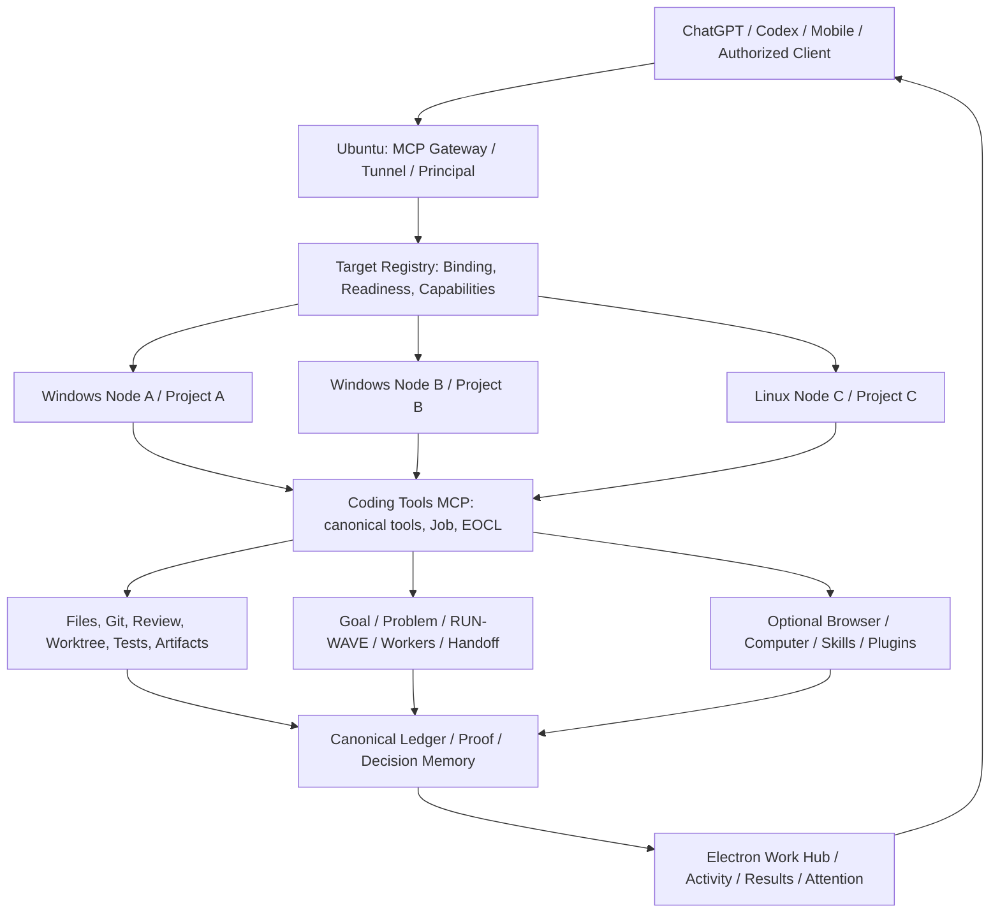

# CODEX-WEB — ĐÁNH GIÁ HIỆN TRẠNG, ĐỐI CHIẾU YÊU CẦU VÀ CHƯƠNG TRÌNH TIẾP NHẬN TÍNH NĂNG COS / WEBCODEX

> **Báo cáo đánh giá kỹ thuật và quyết định đầu tư tính năng** — ngày 22/10/2026 (Asia/Ho_Chi_Minh)  
> **Dự án đích:** `E:\DEV\Codex-web` · GitHub: [`uyenthudao2410-code/Codex-web`](https://github.com/uyenthudao2410-code/Codex-web)  
> **Tài liệu đối chiếu:** [`261022_FEATURE_EXPANSION_CATALOG.md`](https://github.com/uyenthudao2410-code/Codex-web/blob/main/docs/research/261022_FEATURE_EXPANSION_CATALOG.md), [`261022_FEATURE_ADOPTION_DECISIONS.md`](https://github.com/uyenthudao2410-code/Codex-web/blob/main/docs/research/261022_FEATURE_ADOPTION_DECISIONS.md), yêu cầu sản phẩm đã xác lập và mã nguồn upstream.  
> **Trạng thái:** **ĐÁNH GIÁ / CHƯA PHẢI ACCEPTANCE HOẶC KẾ HOẠCH TRIỂN KHAI ĐƯỢC PHÊ DUYỆT**. Không thực hiện patch, restart, commit, push hoặc release trong hoạt động biên soạn báo cáo.  
> **Ý nghĩa:** Đề xuất cách đưa các năng lực *thật sự hữu ích* từ Chat On Steroids (CoS) và WebCodex vào Codex-web, tận dụng engine và dữ liệu hiện có, không sao chép vô điều kiện hai phần mềm.

---

## 0. Tóm tắt dành cho người quyết định

### 0.1. Phán quyết

1. **Codex-web đã có lõi công cụ thực thi, MCP, liên kết workspace, Job, Git/file operations, Goal/Problem/EOCL và một Work Hub với nhiều chức năng được triển khai ở mức source.** Đây là nền tảng đáng tiếp tục phát triển, không cần viết lại sản phẩm.
2. **Chưa đạt tương đương tính năng chủ lực của cả hai dự án tham khảo.** CoS đi xa hơn về worker sống lâu, quản lý phiên ChatGPT, Goal/Loop, Compact & Resume, Skills, plugins, browser/desktop control và UX; WebCodex mạnh về durable Agent/TaskAttempt, Job input/recovery, Git review có cấu trúc, managed worktree, semantic LSP, resource references, Browser/Computer runtime và operator console.
3. **Hai kế hoạch ngày 22/10 đã triển khai một phần lớn Work Hub, không phải đã hoàn thành 40 mục.** Catalog `F01–F40` là danh mục *ứng viên*; tài liệu `A1–A8` là phạm vi *được chọn*. Tài liệu ghi D0, A1–A6 đã có implementation Hub, A7 ở mức quan sát/chuẩn bị, A8 mới preview/revalidate. Cần nghiệm thu GUI end-to-end trước khi tuyên bố đóng Đợt 1/2.
4. **Sai lệch source–message A8 là blocker cần xác minh trước:** GitHub `main` tại `e58f16743bc988fec07662fdafc2ee38318e973a` mang thông điệp commit “A8 capsule read + acceptance records”, nhưng payload commit chỉ thay đổi `.coding-tools` (không có patch `electron/main.js`, `electron/preload.js` hoặc `renderer/work-hub.js`). Các API `workhub:handoff-get` / `workhubHandoffGet` cũng **không thấy trong source `main`** đã đọc. Kết luận: *chưa có bằng chứng A8 đọc capsule đã được tích hợp trong GitHub main*. Có thể tồn tại source chưa commit trên Windows; hiện chưa đọc được live worktree để chứng minh.
5. **Ranh giới vận hành ngày đánh giá:** Ubuntu Control Plane trả một Windows node `DESKTOP-63643J4`, binding Codex-web `bind_71661b1046884174b01c99af5f8546aa`, `presence_state=online`, `readiness=degraded`, `dispatch_blockers=[]`, contract `schema_version=32`. Năm lệnh Git read-only đã queue nhưng vẫn `local_admission_pending_or_running` tại thời điểm đóng phần thu thập đầu tiên. `online` không đồng nghĩa `ready`, và queue không đồng nghĩa lệnh đã hoàn tất.
6. **Đề xuất:** ưu tiên đồng bộ nguồn–proof–runtime; đóng A8 và các lỗi tích hợp; nghiệm thu một chu trình công việc thật; sau đó đầu tư mạnh vào Developer Workbench (Git/worktree/Job/LSP), Agent–Goal Workbench (TaskAttempt/worker/continuation), Browser/Computer adapters, cuối cùng Skills/Plugins/SSH và UX. Không mở đồng loạt 40 tính năng.

### 0.2. Quyết định đề nghị

**Tiếp tục phát triển Codex-web theo hướng một hệ thống điều phối AI thực thi trên máy thật với bằng chứng có thể kiểm toán**, gồm bốn nhóm năng lực:

- **Developer Workbench:** File/context → Git/diff/patch → Job/test/build → review/acceptance → artifact.
- **AI & Goal Workbench:** Goal/Problem, task/worker, steering, Job và continuation liên phiên; *không thêm engine authority thứ hai*.
- **Browser & Computer Workbench:** browser QA và desktop automation trên target đã được ủy quyền, adapter riêng theo capability.
- **Runtime & Integrations:** Ubuntu gateway/tunnel, nhiều Windows/Linux node, Project/Runner/Workspace, Skills/Plugins và SSH resources.

Bốn nhóm này là **information architecture**, không bắt buộc thành bốn màn hình chính cồng kềnh. UX phải ít bước, tránh dồn mọi chức năng ra thanh điều hướng.

### 0.3. Không tuyên bố những điều chưa được chứng minh

- Không suy từ test PASS trên VM sang GUI Windows đã đạt.
- Không suy từ commit message sang source thật đã có.
- Không suy từ Job đã terminal sang Problem đã giải quyết hoặc người dùng đã nghiệm thu.
- Không suy từ một máy có ba workspace sang nhiều máy đồng thời.
- Không suy từ heartbeat/tunnel online sang khả năng điều phối 24/7 khi máy nguồn tắt.
- Không suy từ source module tồn tại sang connector đã quảng bá tool, runtime đã load hay policy đã cho phép gọi.
- Không suy từ chat đã tạo prompt tiếp tục sang model đã nhận, thực thi và ACK continuation.

---

## 1. Phương pháp đánh giá và thang bằng chứng

### 1.1. Nguồn sử dụng và thứ tự ưu tiên

| Nhóm | Nguồn | Giá trị | Giới hạn |
|---|---|---|---|
| LIVE-CP | Ubuntu Control Plane `workspace_context(inventory)`, contract schema 32 | Presence/readiness/binding thật của thời điểm gọi | Không tự chứng minh quyền thực thi, tính năng GUI hoặc live checkout |
| LIVE-GIT | `git rev-parse`, `git status`, `git diff`, `git ls-files --unmerged` qua binding Windows | Nguồn chuẩn cho worktree *nếu có execution receipt* | Lượt này đã queue, chưa có output thành công ở thời điểm biên soạn phần đánh giá |
| REMOTE-GIT | GitHub `main`, commit payload, file contents | Source đã công bố trên remote, so được diff/commit identity | Không đại diện dirty worktree hoặc binary runtime đang chạy |
| LOCAL-DOC | `CURRENT_STATE.md`, `ROADMAP.md`, Catalog/Adoption, kế hoạch Goal/Ubuntu | Yêu cầu, thiết kế, lịch sử chấp nhận, test claim | Nhiều phần là historical checkpoint; không phải toàn bộ trạng thái live |
| UPSTREAM | GitHub CoS/WebCodex docs và các module trực tiếp | Khả năng, kiến trúc và điều kiện tiên quyết | Đọc mã nguồn ≠ thử nghiệm installer upstream trên máy này |
| HISTORICAL | Báo cáo/receipt của các phiên trước | Gợi ý và chương trình kiểm thử | Phải tái xác minh theo exact revision/worktree khi nghiệm thu mới |

### 1.2. Thang đánh giá tính năng

- **S0 — Đề xuất:** ý tưởng, mô tả hoặc entry trong catalog; chưa có code liên quan.
- **S1 — Có nền tảng:** module/backend hoặc công cụ gần tương ứng nhưng thiếu adapter/luồng sử dụng thực.
- **S2 — Có implementation:** có source/API/UI theo luồng mong muốn.
- **S3 — Có focused proof:** cú pháp/unit/contract test ghi nhận kết quả đạt trên đúng source hash.
- **S4 — Có integration proof:** thử luồng thật file → model/Job → Git/diff/test/outputs ở cùng revision/binding.
- **S5 — Có packaged/live acceptance:** installer/runtime loaded source chính xác, smoke/GUI/reconnect/permission và owner nghiệm thu.
- **S6 — Có outcome proof:** công việc người dùng giải quyết đúng, không chỉ tool/test xanh; có dữ liệu đo hiệu quả.

**Không gán một tỷ lệ `% hoàn thiện tổng thể` khi chưa có trọng số và oracle được phê duyệt.** Với chức năng đã có trong mã nguồn nhưng chưa có GUI proof mới, báo **S2** (hoặc S3 lịch sử) chứ không ghi “100%”.

### 1.3. Mốc source để tránh lẫn nguồn

| Repository | Revision dùng cho nghiên cứu | Bằng chứng |
|---|---|---|
| [Chat On Steroids](https://github.com/totec448-spec/chat-on-steroids) | `add58bd5f6fc7f61fea0e104b23d2afec2471770` | `README`, `CHANGELOG` 2.1.44, `agents.ts`, `goal.ts`, `session/`, `skills.ts`, `plugins/`, `remote/`, `mcp/` |
| [WebCodex](https://github.com/yyjeqhc/webcodex) | `2bac8248a2e635022ae9c636fc1287bc01b6b833` | `ARCHITECTURE`, durable Agent, Jobs, Git, LSP, Browser/CDP, Computer, Plugins, Workbench |
| [Codex-web](https://github.com/uyenthudao2410-code/Codex-web) | `e58f16743bc988fec07662fdafc2ee38318e973a` | `main` đọc được từ GitHub tại thời điểm đánh giá; không thay thế live Windows HEAD |

> **Lưu ý thời gian:** mốc đánh giá cùng ngày 22/10/2026; GitHub có thể thay đổi sau khi báo cáo được lập. Khi triển khai thực tế phải tái xác minh commit và worktree trước mọi patch.

---

## 2. Mục tiêu người dùng đã xác lập — đối chiếu hiện tại

Đây là phần quyết định ưu tiên. Phát triển sản phẩm không được thu hẹp về “một Electron file viewer” khi mục tiêu ban đầu là hệ thống điều phối AI đa máy thực thụ.

| ID | Kết quả người dùng cần | Nền tảng/tiến độ có bằng chứng | Khoảng trống / điều kiện chưa chứng minh | Mức đánh giá |
|---|---|---|---|---|
| G01 | Gọi công cụ từ ChatGPT tới máy được bind mà không cần thao tác tay chuyển yêu cầu | Ubuntu gateway + Windows node đã từng hoàn thành structured exec; inventory vẫn nhận máy | Readiness hiện `degraded`; cần live admission/response proof ở thời điểm hiện tại | Có nền + proof lịch sử |
| G02 | Một tài khoản, 3–4 **máy thật** chạy đồng thời, mỗi máy workspace riêng | Registry/binding và routing tồn tại; có nhiều workspace trên cùng một Windows node | Chưa có proof đồng thời 3–4 node vật lý, không fallback nhầm khi node offline | Chưa đạt mục tiêu |
| G03 | Ubuntu duy trì ingress/tunnel liên tục 24/7, không cần Electron mở mới nhận MCP | `UBUNTU_CENTRAL_MCP_COMPLETION_PLAN.md` và Control Plane listener/relay hiện hữu | Cần reboot/tunnel readiness, renew, reconnect, machine power-off và session recovery E2E | Chưa nghiệm thu 24/7 |
| G04 | Dùng điện thoại/máy khác điều hành công việc đã cấp quyền | Server/relay hỗ trợ đăng nhập/targeting; có kiểm tra nhiều client lịch sử | Cần ca thật Mobile → Ubuntu → máy A/B, grant, principal isolation, không retarget Job đang chạy | Chưa nghiệm thu |
| G05 | Khác máy, khác workspace nhưng cùng control authority có ranh giới | Workspace binding + policy trên node; EOCL có owner/lease | Cần matrix wrong-target, stale generation, audit target switch, concurrent two-node test | Một phần |
| G06 | AI đọc/sửa/test/build/Git trên đúng code thực tế | Coding Tools MCP, exec/file/patch/Job, Work Hub; test có trong repository | Yêu cầu proof end-to-end trên source hiện hành và packaged GUI | Nền tảng mạnh, chưa chốt release |
| G07 | Không tự restart/commit/push/release khi chưa có proof và quyền | Repository guard, authority, receipt, delivery scripts | Cần acceptance policy cho Work Hub Git UI; test deny/replay/unknown outcome | Luật đã có, kiểm thử boundary cần đủ |
| G08 | Theo đuổi một Goal, không bắt người dùng nhắc lại mỗi bước | Goal pursuit/continuation ledger, kế hoạch BG01–BG14 | Detached/auto-dispatch, no-duplicate, grant, budget và independent result acceptance chưa có proof cuối | Chưa đạt tự chủ hoàn chỉnh |
| G09 | Tự chọn Goal tiếp theo sau khi liệt kê ứng viên, không lấy heuristic làm authority | Goal enumeration/candidate và phân tích ranking tồn tại | Selection chỉ advisory; grant/claim/dispatch atomic phải được kiểm chứng | Chưa hoàn chỉnh |
| G10 | Có worker/reviewer thật, song song khi độc lập, không làm nhiễm `main` | EOCL/delegation và một số bảng Work Hub, gợi ý worktree | Worker lifecycle, worktree writer isolation, review/merge proof chưa đầy đủ UI | Một phần |
| G11 | Mỗi lần xử lý lỗi tạo thêm tri thức dùng lại, không chỉ log | Problem/Revision/Events, ledger/proof/telemetry, chương trình EGRI | Case reuse có causal conditions, negative evidence và measured benefit chưa chứng minh live | Có dữ liệu, thiếu decision memory hiệu quả |
| G12 | Giao diện gọn, đẹp, nắm trạng thái thật, dễ xử lý trên desktop | Work Hub và các giao diện chính đã có | Cần thử GUI vòng làm việc, responsive, loading/stale-state và accessibility | Chưa nghiệm thu UX |
| G13 | Đa phương tiện / web / ứng dụng chuyên ngành (ví dụ AutoCAD) | MCP extensibility, riêng module AutoCAD tồn tại ở workspace khác | Browser QA, Computer Use UIA/CDP, permissions và adapter ứng dụng chưa đủ | Định hướng mở rộng |
| G14 | Phát hành cài đặt ổn định, tự phục hồi, nguồn và bằng chứng khớp | Recovery Host, package scripts, lịch sử installer smoke | Cần exact-current-source install, reboot, upgrade, rollback, proof/runtime identity mới | Chưa coi là accepted phiên bản hiện tại |

### 2.1. Mẫu nghiệm thu mục tiêu tổng thể

Một phiên nghiệm thu sản phẩm thành công cần thực hiện: **ChatGPT từ thiết bị khác → Ubuntu gateway → chọn đúng máy và workspace → xem tệp/tri thức → agent sửa ở worktree có quyền → nhận Job/test bằng chứng → review diff → chấp nhận kết quả → lưu Case/Problem → mở chat mới tiếp tục đúng Goal**. Trong quá trình đó, tắt/khởi động lại một node phải đưa về trạng thái chờ/khôi phục có thông báo rõ, **không tự chuyển quyền sang node khác**.

**Không có bằng chứng trong lượt nghiên cứu này rằng chu trình trên đã PASS nguyên vẹn.**

---

## 3. Hiện trạng kỹ thuật ngày 22/10/2026

### 3.1. Runtime Ubuntu/Windows

- Node nhìn thấy: **01 thiết bị Windows `DESKTOP-63643J4`** với các workspace Codex-web, AutoCAD, worktrees trong các inventory trước; đây không phải ba máy vật lý.
- Binding Codex-web: `bind_71661b1046884174b01c99af5f8546aa`.
- Mốc inventory kiểm tra: `online`, `degraded`, heartbeat ~3 giây, `dispatch_blockers=[]`, contract schema 32 / `control-plane-private-tunnel-service-v1`.
- Một số lệnh `git` đã được queue theo task `task_0004019b013242599c0746d8637defd8`; **chưa có receipt đủ kết luận HEAD local, diff sạch hay conflict-free** tại thời điểm thu thập ban đầu. Không lấy trạng thái GitHub để ngụy tạo bằng chứng worktree.
- `degraded` phải được giải thích bằng machine health, local admission/capability, source/runtime contract và typed diagnostics. Không nên tự restart để làm xanh màu.

### 3.2. GitHub `main` và A8 capsule

- `main` GitHub tại `e58f1674…` (22/10/2026), commit ngay trước là `b6351d16…`.
- `b6351d16…` mang scope Work Hub D0 + Đợt 1/2 theo tài liệu; mã nguồn main có `workhub:job-run`, `workhub:git-log`, `handoffPreview` local.
- Commit `e58f1674…` có *tên* “feat(work-hub): A8 capsule read + acceptance records; fix system-setup test harness stub”. Nhưng payload commit được đọc qua GitHub API chỉ gồm các file `.coding-tools/` (ledger, snapshot, performance, task contexts), **không có UI/IPC/test source mà tên commit ám chỉ**.
- Nội dung `electron/main.js` trong main **chưa có** `workhub:handoff-get`; `electron/preload.js` **chưa có** `workhubHandoffGet`; `renderer/work-hub.js` có `handoffPreview` (preview dựa vào task state) nhưng **chưa có** đường đọc capsule đã ghi qua IPC riêng. Đây là quan sát từ source remote, không là phán quyết về dirty local checkout.
- Đã từng có diff A8 *chưa commit* trên Windows theo lần đối chiếu trước: IPC đọc capsule + UI đọc capsule. Tình trạng chính xác của diff này **chưa được tái xác minh ở lượt này** vì local admission còn pending. Không tuyên bố đã xóa/mất code.
- `system-setup-console.test.js` trong GitHub main cũng chưa có source delta tương ứng trong commit `e58…`; không lấy commit message làm test receipt.

### 3.3. Lỗi tích hợp đã nhận diện cần tái kiểm chứng (không mặc nhiên còn tồn tại trong bản đang sửa)

Trong diff A8 được quan sát ở phiên trước, có hai rủi ro kỹ thuật cụ thể:

1. **Sai contract Git log:** `workHubFiles.gitLog()` trả về mảng commit; bản diff A8 đã dùng hình thức truy cập như object `{commits:[]}`. Nếu code đó còn, HEAD check có thể báo sai hoặc không phát hiện drift. Kiểm tra type `Array.isArray(log)` và `commit.hash` từ service thực.
2. **Rủi ro định danh `run_id`:** đường đọc capsule không được fallback sang “latest” của task khác khi thiếu RUN của selection hiện tại. Phải lấy đúng RUN từ canonical projection (`task.orchestration.run_id` hoặc nguồn định danh đã xác minh), kèm project/generation/HEAD fence. Bị thiếu phải báo `run_identity_unavailable`, không đoán.

Một điểm khác ở source main: thao tác F07 chọn/import tệp trong `renderer/work-hub.js` dùng `.catch(() => null)` rồi xóa `pendingImports` ngay sau vòng lặp. Nó có thể giấu thất bại từng tệp và mất cơ hội retry. Đây là defect candidate rõ ràng cho focused regression.

### 3.4. Các mức proof đang có — không cộng dồn lẫn thời điểm

| Nhóm proof | Đã nhìn thấy | Chưa đủ để kết luận |
|---|---|---|
| Test Work Hub trên VM theo docs | 45/45 liên quan PASS ở mốc triển khai ghi trong `261022_FEATURE_EXPANSION_CATALOG` | Không chứng minh patch A8 chưa commit hoặc GUI Electron Windows hiện tại |
| Windows Node syntax check phiên trước | `node --check` ở `electron/main.js` và `renderer/work-hub.js` nhận receipt exit 0 | Cú pháp hợp lệ không chứng minh lifecycle A8, Job, multi-project |
| GitHub source | Work Hub D0/A1–A7 có các đường source và test; A8 main chỉ preview | Không chứng minh loaded package hoặc remote node đã chạy code mới |
| E2E source/installer lịch sử | Có nhiều smoke checkpoint trong `CURRENT_STATE.md` | Không tự quy đổi sang revision GitHub mới và worktree chưa rõ |
| Runtime inventory | Binding Windows online/degraded, contract hợp lệ | Không chứng minh health 24/7, grant cho mọi command, đa máy |

### 3.5. Dữ liệu ledger/Git và rủi ro vận hành

- Repo chủ động dùng `.coding-tools` làm evidence; không được tùy tiện thêm toàn bộ vào `.gitignore` khi chưa đổi chính sách lưu proof.
- Snapshot ledger ở commit ngày 22/10 tăng khoảng 101 MB và nhiều task-context đang ở trạng thái `active`/`waiting`; dữ liệu thời điểm snapshot không mặc nhiên đại diện tiến trình còn thực thi.
- Cần **transactionally consistent** snapshot, lọc secret, staging/delivery guard và archive/manifest. Tách data-plane runtime đang ghi với bằng chứng đã chốt, tránh commit SQLite file đang mutable chỉ để làm sạch Git.
- Nếu telemetry cho biết cache hit thấp hoặc localizer dùng nhiều fallback, phải đọc scope/dataset/provenance trước khi quyết định tối ưu hoặc coi đó là lỗi trực tiếp.

## 4. Nghiên cứu sâu dự án A — Chat On Steroids (CoS)

**Tham chiếu:** [`totec448-spec/chat-on-steroids`](https://github.com/totec448-spec/chat-on-steroids/tree/add58bd5f6fc7f61fea0e104b23d2afec2471770), commit `add58bd5…`, changelog ghi 2.1.44. **CoS thiên về trải nghiệm cộng tác với ChatGPT và khả năng AI tương tác trực tiếp với môi trường desktop/browser.** Không coi việc có module source là bằng chứng mọi tính năng đã được triển khai production trên Windows người dùng.

### 4.1. CoS-01 — Prime/Worker lifecycle và agent collaboration

**Source:** [`src/main/agents.ts`](https://github.com/totec448-spec/chat-on-steroids/blob/add58bd5f6fc7f61fea0e104b23d2afec2471770/src/main/agents.ts), `agent-admission.ts`, [`src/renderer/agent-panel.ts`](https://github.com/totec448-spec/chat-on-steroids/blob/add58bd5f6fc7f61fea0e104b23d2afec2471770/src/renderer/agent-panel.ts), `agent-activity.ts`, [`docs/tool-surface.md`](https://github.com/totec448-spec/chat-on-steroids/blob/add58bd5f6fc7f61fea0e104b23d2afec2471770/docs/tool-surface.md).

**Cơ chế:** Prime sở hữu một họ worker; `agents.spawn/message/status/finish` tạo, giao, quan sát và nhận handoff. Worker có định danh theo conversation, slot admission, vòng đời running/sleeping/attention; worker ngủ có thể thức dậy trong ngữ cảnh đã có, nhưng vẫn phải tuân quota/permission của host. Trạng thái silence/uncertain không bị suy thành terminal success. UI hiển thị từng hoạt động, file sửa, kết quả và sức khỏe worker. CoS giới hạn worker context và có cơ chế không khôi phục worker đã vượt ngưỡng phù hợp.

**Khoảng trống Codex-web:** Có delegation/EOCL/reviewer và thẻ A7, nhưng chưa có trải nghiệm worker lifecycle thống nhất. **Đưa vào:** Worker Board dựa trên RUN/WAVE/lease hiện hành, trạng thái `queued/running/waiting/uncertain/finished/accepted`, công việc, allowed paths, proof, workspace ID và điều khiển có quyền; không tạo agent credential hoặc scheduler song song không được phê duyệt. **Proof:** 2 worker độc lập, 1 worker ngủ rồi resume, 1 worker outcome unknown; không duplicate dispatch/merge và không nhầm workspace. **Ưu tiên P1.**

### 4.2. CoS-02 — Goal, Loop, long turn và chuẩn hóa ý nghĩa “continue”

**Source:** [`src/main/goal.ts`](https://github.com/totec448-spec/chat-on-steroids/blob/add58bd5f6fc7f61fea0e104b23d2afec2471770/src/main/goal.ts), `turn-rotation.ts`, `session/automatic-replies.ts`.

**Cơ chế:** Theo dõi mục tiêu chưa hoàn tất; tạo các lời nhắc tiếp tục khi có điều kiện; phân biệt lượt ChatGPT đang tạo phản hồi, bị từ chối gửi, đã gửi và thực sự được xử lý. Changelog 2.1.42–44 bổ sung fresh-turn recovery, sự kiện Stop, hiển thị worker slots; một số fallback thử nghiệm tắt mặc định.

**Khoảng trống:** Codex-web có Goal/Problem/continuation nhưng người dùng vẫn thường phải nhắc “tiếp tục”; A7 chỉ mới dựng đề nghị/queue, không có host send/consume proof cuối. **Đưa vào:** `GoalEpisode` → `ContinuationIntent` → `HostDeliveryReceipt` → `ExactConsume/DispatchReceipt` → `IndependentAcceptance`. Chỉ tự chạy khi parent grant, budget, model/controller carrier cho phép. **Không đưa vào:** tự động thao tác DOM ChatGPT để vượt ràng buộc Host hoặc tài khoản. **Proof:** sau turn kết thúc, một continuation hợp lệ thực sự bắt đầu bước tiếp theo; phải chứng minh `manual_nudge_count=0`, không duplicate, STOP dừng thật. **Ưu tiên P1 sau M0.**

### 4.3. CoS-03 — Compact & Resume là giao dịch đổi binding, không phải copy-paste summary

**Source:** [`src/main/session/continuation.ts`](https://github.com/totec448-spec/chat-on-steroids/blob/add58bd5f6fc7f61fea0e104b23d2afec2471770/src/main/session/continuation.ts), `session/handoff.ts`, `resume-gate.ts`, `recorder.ts`.

**Cơ chế đáng học:** Một session bền có thể chuyển từ ChatGPT conversation A sang B; giao dịch pin/summary/claim/commit ràng buộc đúng nguồn–đích, chống hai destination cùng nhận một continuation. Summary là *model context*; ledger/identity không được tái tạo bằng cách đoán từ summary. Source có xử lý race giữa recorder tạo session mới và rebind session cũ.

**Áp dụng:** Hoàn thiện A8: lựa chọn exact task/RUN → đọc capsule đã tồn tại → revalidate HEAD/proof/lease → chuẩn bị resume → ghi nhận claim/consume. Không chọn capsule global “latest”; không biến preview thành quyền thực thi. **Proof:** A→B 1 lần; hai chat tranh cùng token chỉ một chat claim; crash/reconnect không re-dispatch. **Ưu tiên P0/P1.**

### 4.4. CoS-04 — Browser automation qua companion

**Source:** [`src/main/mcp/tools-browser.ts`](https://github.com/totec448-spec/chat-on-steroids/blob/add58bd5f6fc7f61fea0e104b23d2afec2471770/src/main/mcp/tools-browser.ts), `browser-control.ts`, `extension/`.

**Cơ chế:** browser tabs, snapshot, screenshot, navigate, action, console/network và một số evaluate; dùng tab/page/element identity, quan sát trước tác động, invalidation sau navigation. Có browser extension và tương tác với website/Host thực. **Rủi ro:** phụ thuộc extension/DOM và điều khoản của từng nền tảng; tool/browser automation không nên lén thực hiện provider-blocked action.

**Áp dụng:** Browser QA cho website trong dự án (app dev URL) qua adapter có quyền rõ ràng: select target → observe → act → verify → attach screenshot/log tới Job/Test. Tách browser session khỏi ChatGPT session. Không sao chép tính năng giám sát/ghi lại hội thoại ChatGPT qua DOM. **Ưu tiên P1 sau Job+artifact.**

### 4.5. CoS-05 — Windows/macOS Computer Use

**Source:** [`src/main/mcp/tools-desktop-windows.ts`](https://github.com/totec448-spec/chat-on-steroids/blob/add58bd5f6fc7f61fea0e104b23d2afec2471770/src/main/mcp/tools-desktop-windows.ts), `tools-desktop-macos.ts`, `src/main/computer/`.

**Cơ chế:** liệt kê cửa sổ/ứng dụng, đọc trạng thái UI, kích hoạt/nhập liệu, click/scroll/drag, clipboard; quan sát có tính đến window/frame identity, kiểm tra chính sách trước thao tác. Đường điều khiển Windows cần kiểm soát session tương tác, desktop active và quyền người dùng; không tự có khả năng điều khiển mọi ứng dụng.

**Áp dụng:** adapter `observe_computer` và `control_computer` riêng; exact `device_id/window_id/snapshot_generation`, permission per operation, cancellation và postcondition. Với AutoCAD/PCCC: ưu tiên API add-in chuyên dụng cho đối tượng CAD, UIA chỉ cho workflow giao diện; không coi click tọa độ là API dựng hình. **Ưu tiên P2 theo use case cụ thể.**

### 4.6. CoS-06 — Files, code editor, Git Review và Composer ngữ cảnh

**Source:** `src/renderer/file-panel.ts`, `file-code-editor.ts`, `unified-diff.ts`, `composer-drafts.ts`, `skills.ts`, `src/main/project-files.ts`.

**Cơ chế:** Files/Changes/Review là các bề mặt liên kết, không ba hệ trạng thái riêng. Người dùng tìm code, gắn `@file`, so diff, sửa file, duyệt thay đổi; composer hỗ trợ draft, skill slash command, lịch sử nhập và interaction nhanh. Changelog 2.1.41 đưa xung đột merge ra nhóm nổi bật.

**Áp dụng:** nâng Work Hub thành flow file → context → task → diff → review; show `project`, `git HEAD`, `diff base`, `change source` và `hash`. F07 phải báo rõ import thành công/thất bại từng file; F08/F10 phải fail nếu file đổi. Giữ ô chính chỉ chứa các thao tác thường dùng; file edit/advanced diff là panel theo ngữ cảnh. **Ưu tiên P0/P1.**

### 4.7. CoS-07 — SSH Projects + SFTP filesystem abstraction

**Source:** [`src/main/remote/ssh.ts`](https://github.com/totec448-spec/chat-on-steroids/blob/add58bd5f6fc7f61fea0e104b23d2afec2471770/src/main/remote/ssh.ts), `project-fs.ts`, `sftp.ts`; changelog 2.1.40.

**Cơ chế:** remote project có identity, file IO qua SFTP, terminal bằng SSH, sử dụng cấu hình SSH/key cá nhân. Đường command, file, editor và Git có thể có độ phủ khác nhau; upstream ghi rõ một số thao tác remote GUI chưa sẵn có trong đợt đầu.

**Áp dụng:** chọn `target_kind=bound_node` (ưu tiên Ubuntu registry) hoặc `ssh_resource` (khi được cấu hình), báo *capability matrix* riêng `file/git/shell/test` cho từng target; không chỉ đổi CWD của local command và gắn nhãn remote. **Ưu tiên P2.**

### 4.8. CoS-08 — Skills library có lifecycle thực

**Source:** [`src/main/skills.ts`](https://github.com/totec448-spec/chat-on-steroids/blob/add58bd5f6fc7f61fea0e104b23d2afec2471770/src/main/skills.ts), `skill-library.ts`, `skill-github.ts`, `skill-routing.ts`.

**Cơ chế:** import/đọc/list/update/version/scope/route skill theo client/consumer; phân biệt kỹ năng quản lý trong app với kỹ năng đến từ client hoặc plugin. Tài liệu Skill là hướng dẫn, không mặc nhiên là executable capability.

**Áp dụng:** `SkillCatalog` cho mỗi workspace/consumer, nguồn và revision SHA, preview trước dùng, validate frontend availability/permission, ngăn cùng tên đè skill nguồn khác; chỉ inject chỉ dẫn vào consumer hỗ trợ. Không tự tạo marketplace cho đến khi có ít nhất hai consumer thực. **Ưu tiên P1/P2.**

### 4.9. CoS-09 — External MCP Plugins manager

**Source:** [`src/main/plugins/manager.ts`](https://github.com/totec448-spec/chat-on-steroids/blob/add58bd5f6fc7f61fea0e104b23d2afec2471770/src/main/plugins/manager.ts), `installer.ts`, `oauth.ts`, [`docs/plugins.md`](https://github.com/totec448-spec/chat-on-steroids/blob/add58bd5f6fc7f61fea0e104b23d2afec2471770/docs/plugins.md).

**Cơ chế:** Core, Desktop, Plugins dùng connector và authorization boundary riêng; manager quản lý install, enable/disable tool, credentials, health/discovery, timeout, cancel, restart/update/rollback. Plugin executable chạy theo quyền OS thực, không được CoS filesystem approval sandbox tự động. Một server cài được không có nghĩa tools của nó được host quảng bá.

**Áp dụng:** một registry `configured/installed/connected/discovered/exposed/authorized` tách biệt, scope theo machine/project, schema fingerprint/health. Không dựng proxy marketplace khi thực tế chỉ cần 2–3 adapters. Không route một hành động bị policy từ chối qua plugin khác. **Ưu tiên P2.**

### 4.10. CoS-10 — Conversation record, search, edit/branch, export

**Source:** `src/main/session/recorder.ts`, `store.ts`, `search.ts`, `branch-history.ts`, `markdown-export.ts`; changelog 2.1.41–44.

**Cơ chế:** lịch sử tool và các quan sát hội thoại có identity; index tìm kiếm nội dung từ dữ liệu đã ghi; edit message/branch liên quan native chat identity và browser extension; export/recall hỗ trợ ngữ cảnh dài.

**Áp dụng có chọn lọc:** Codex-web nên tìm Session/Goal/Task/Problem/Report/Artifact do **chính runtime** quản lý và metadata hội thoại do người dùng chủ động liên kết. Không tự ghi hàng loạt nội dung hội thoại ChatGPT hay giả lập chức năng fork Host nếu không có integration chính thức và consent rõ ràng. **Ưu tiên P2; không phải dependency để đóng Work Hub.**

### 4.11. CoS-11 — Notifications, presence, power, UX polish và long-task ergonomics

**Source:** `src/main/turn-notifications.ts`, `keep-awake.ts`, `src/renderer/workspace-docks.ts`, `agent-panel.ts`, `chat.ts`, `CHANGELOG`.

**Cơ chế:** thông báo trạng thái có action về đúng công việc, hide duplicate; terminal/tab/dock; keyboard shortcut, user input recall, support multi-chat; keep-awake có điều kiện. Một số cải tiến gần đây xử lý UI đứt luồng khi Stop, context dài hoặc hai browser.

**Áp dụng:** A6 phải hoạt động khi Hub không mở, route theo `run_id/task_id`, không báo `success` trước proof; keep-awake nhả khi Job terminal, app đóng hoặc nguồn trạng thái không xác thực. UX bố trí workspace chọn target trên cùng, center là task/result, side panel cho file/Git/Agent, status lane cố định. **Ưu tiên P0/P1.**

### 4.12. Kết luận riêng từ CoS

**Nên học trực tiếp:** worker lifecycle + activity UI; transaction handoff; Goal continuation semantics; Files/Git/Composer ergonomics; Skills và plugin lifecycle; browser/desktop adapter; terminal UX.  
**Không nên copy nguyên:** browser-driven ChatGPT auto-send/DOM recording, model/plan quota assumptions, hệ recorder riêng cạnh tranh canonical ledger, hoặc chạy shell ngoài policy hiện tại. CoS là nguồn **thiết kế UX/interaction** và cơ chế chống race rất hữu ích, không phải authority gốc của Codex-web.

---

## 5. Nghiên cứu sâu dự án B — WebCodex

**Tham chiếu:** [`yyjeqhc/webcodex`](https://github.com/yyjeqhc/webcodex/tree/2bac8248a2e635022ae9c636fc1287bc01b6b833). **WebCodex thiên về môi trường developer agent self-hosted, chạy đúng project thật và giữ lifecycle/evidence không phụ thuộc hội thoại.** Phân biệt tính năng Rust source/document đã mô tả với thực tế deployment acceptance: upstream cũng lưu ý nhiều installer/cross-platform gate chưa nghiệm thu trên mọi OS.

### 5.1. W-01 — Client → Server → Runner và nhiều máy sở hữu repository

**Source:** [`docs/ARCHITECTURE.md`](https://github.com/yyjeqhc/webcodex/blob/2bac8248a2e635022ae9c636fc1287bc01b6b833/docs/ARCHITECTURE.md), `docs/RUNNER.md`, runner registry. Server authenticate/authorize/route; Runner sở hữu project path, file, Git, shell, Jobs. Server không tự đọc filesystem remote bằng path của nó; mọi tác động qua Runner có authority.

**Áp dụng:** đối chiếu Ubuntu gateway với `registry → exact binding → local node policy → receipt`. Quan tâm trường hợp một principal dùng nhiều thiết bị: target picker có readiness/allowed capabilities, pin Job và task vào binding thế hệ cụ thể. **Mục tiêu ưu tiên P0:** 2 máy vật lý chạy hai project khác nhau, offline một máy không retarget công việc.

### 5.2. W-02 — Durable Agent identity, Conversation, Endpoint, TaskAttempt

**Source:** [`docs/architecture/durable-agent-runtime.md`](https://github.com/yyjeqhc/webcodex/blob/2bac8248a2e635022ae9c636fc1287bc01b6b833/docs/architecture/durable-agent-runtime.md), `durable-agent-conversation.md`, `src/tool_runtime/agent_task.rs`.

**Cơ chế:** Agent là thực thể lâu dài; Endpoint/Window là đường kết nối hiện thời; Conversation/message là giao tiếp; Task là trách nhiệm; TaskAttempt là quyền sở hữu lần thử có generation/lease. WebCodex cố ý **chưa** biến cấu trúc này thành swarm scheduler tổng quát. Host delivery, Wake, Task execution và Goal state không bị đồng nhất.

**Áp dụng:** map vào dữ liệu hiện tại theo quan hệ: `Principal → Controller/Endpoint → Goal/Problem → RUN/WAVE → Task/Attempt → Job → Proof`. Nếu có entity mới phải có use case thật và migration; ưu tiên một projection read-only trước để tránh dual authority. **Ưu tiên P1.**

### 5.3. W-03 — Job bền vững, observe/wait/input/stop chính xác

**Source:** [`docs/agent/job-reliability-and-concurrency.md`](https://github.com/yyjeqhc/webcodex/blob/2bac8248a2e635022ae9c636fc1287bc01b6b833/docs/agent/job-reliability-and-concurrency.md), [`src/tool_runtime/job_input.rs`](https://github.com/yyjeqhc/webcodex/blob/2bac8248a2e635022ae9c636fc1287bc01b6b833/src/tool_runtime/job_input.rs), `observe_jobs.rs`, `docs/implementation/interactive-job-input.md`.

**Cơ chế:** `run_process(interactive=true)` tạo **pipe Job** chứ không phải PTY; `write_job_input` có `input_id` và typed receipt, `observe_jobs` đọc bounded status/output; `wait_for_job_readiness` là barrier tạm thời, không launch executor khác. Uncertain outcome phải reconcile cùng identity; reconnect không tự chạy lại lệnh. Runner capacity được chia sẻ cho các Window/Project.

**Áp dụng:** A3 cần input receipt/idempotency và UI states `starting/running/waiting_input/outcome_unknown/terminal/expired`; nhiều consumer có cursor riêng. Terminal PTY cá nhân là scope riêng, không hứa `vim/top/REPL` từ pipe. **Ưu tiên P0/P1.**

### 5.4. W-04 — Workflow Session và handoff explicit

**Source:** [`docs/SESSION_CONTINUITY.md`](https://github.com/yyjeqhc/webcodex/blob/2bac8248a2e635022ae9c636fc1287bc01b6b833/docs/SESSION_CONTINUITY.md), `src/tool_runtime/session_context.rs`, `docs/implementation/task-context-recovery.md`.

**Cơ chế:** Session ghi decision/progress/todo/risk và exact event refs; `delivery_key` tạo retry-stable write; Goal checkpoint revision-fenced; Session handoff dùng exact identity. Ghi chú từ model không phải proof; data có retention/lifetime.

**Áp dụng:** A8 đọc canonically recorded capsule với provenance; phân biệt `context_recovered`, `execution_recovered` và `result_accepted`. Khi source HEAD đổi, capsule không tự mất nhưng proof cần invalidation/revalidation theo scope. **Ưu tiên P0.**

### 5.5. W-05 — Git review, commit chọn file và managed worktree

**Source:** [`src/tool_runtime/git_review.rs`](https://github.com/yyjeqhc/webcodex/blob/2bac8248a2e635022ae9c636fc1287bc01b6b833/src/tool_runtime/git_review.rs), `src/tool_runtime/git/mutations.rs`, [`managed_worktree.rs`](https://github.com/yyjeqhc/webcodex/blob/2bac8248a2e635022ae9c636fc1287bc01b6b833/crates/webcodex-runner/src/webcodex_runner/projects/managed_worktree.rs), `docs/agent/git-review-summary.md`.

**Cơ chế:** review committed range ràng buộc exact base/head SHA, parse diff/rename/name-status và phân loại subsystem. `git_commit_paths` yêu cầu `expected_head` và giới hạn file; stale HEAD hoặc uncertain mutation fail-closed. Managed worktree tạo workspace riêng dưới root được duyệt, track source fingerprint/lifecycle và không làm rơi dirty changes vào mặc định.

**Áp dụng:** triển khai F26–F28 theo một gói quản trị Git: `review range` → `approved path set` → `stage preview` → `check delivery guards` → `commit` (push riêng có grant). Worktree owner, base, initial dirty state và cleanup phải hiện rõ; không `git reset --hard`/`clean` toàn bộ. **Ưu tiên P1, rất cao với chính Codex-web đang có concurrent write.**

### 5.6. W-06 — Resource reference: Project/File/Goal/Artifact là tài nguyên có định danh

**Source:** [`src/tool_runtime/resource_references.rs`](https://github.com/yyjeqhc/webcodex/blob/2bac8248a2e635022ae9c636fc1287bc01b6b833/src/tool_runtime/resource_references.rs), [`docs/implementation/workbench-resource-references.md`](https://github.com/yyjeqhc/webcodex/blob/2bac8248a2e635022ae9c636fc1287bc01b6b833/docs/implementation/workbench-resource-references.md).

**Cơ chế:** tìm/chọn resource theo identity được phát hành, đọc latest content qua ủy quyền hiện tại; project root và ID không đoán theo tên, Session/Artifact phải chọn explicit. Một reference hiển thị không mặc nhiên là quyền ghi vào file.

**Áp dụng:** F05/F12/A1/A4 có `project_id, binding_id, relpath, revision/hash, origin_run, content_limit, access_policy`, không chỉ string path. UI phân biệt `missing/expired/not_authorized/stale/available`. **Ưu tiên P1.**

### 5.7. W-07 — Semantic/LSP navigation có capability thật

**Source:** [`src/tool_runtime/lsp_tools.rs`](https://github.com/yyjeqhc/webcodex/blob/2bac8248a2e635022ae9c636fc1287bc01b6b833/src/tool_runtime/lsp_tools.rs), `src/tool_runtime/semantic_navigation.rs`, crate `webcodex-lsp`.

**Cơ chế:** `definition/references/hover/document_symbols/workspace_symbols/diagnostics/call_hierarchy` đi qua Runner có status/error rõ; không gắn label “LSP result” vào text grep fallback. **Áp dụng:** F13 UI sẽ tách `provider_available`, `provider_unsupported`, `semantic_result`, `text_fallback`, `partial_coverage`. Mục tiêu giảm repeated scanning ở dự án lớn, đo trên tập task cụ thể, không đầu tư LSP daemon khi chưa có provider thật. **Ưu tiên P1 theo baseline.**

### 5.8. W-08 — Browser/CDP có session và profile lifecycle

**Source:** [`docs/architecture/browser-cdp-runtime.md`](https://github.com/yyjeqhc/webcodex/blob/2bac8248a2e635022ae9c636fc1287bc01b6b833/docs/architecture/browser-cdp-runtime.md), `browser-session-continuity.md`, `src/tool_runtime/browser_tools.rs`.

**Cơ chế:** observe và control là hai tool/actions có governance riêng. Browser/page/element generation invalidation; profile `owned_ephemeral`, `owned_managed_persistent`, `attached_external` với cleanup khác nhau; API action cố định thay vì generic evaluate tùy ý. Không xóa/đóng browser cá nhân khi chỉ được attach external. **Áp dụng:** F37 Browser QA, exact selected tab/profile, trace screenshot/console/network, upload/download có hạn mức; thao tác chỉ trên session đang cho phép. **Ưu tiên P1/P2.**

### 5.9. W-09 — Computer Use và Windows UIA

**Source:** [`docs/COMPUTER_USE.md`](https://github.com/yyjeqhc/webcodex/blob/2bac8248a2e635022ae9c636fc1287bc01b6b833/docs/COMPUTER_USE.md), `src/tool_runtime/computer_tools/`.

**Cơ chế:** semantic-first, `observe_computer` vs `control_computer`, kiểm soát window/display/element/snapshot generation; thao tác hiện tại và planned slices không đồng mức hoàn thiện. **Áp dụng:** F38 UIA adapter riêng Windows, có người dùng mục tiêu, window focus, stale frame, screenshot provenance và verify. Không suy từ khả năng chạy PowerShell ra khả năng điều khiển UI AutoCAD. **Ưu tiên P2.**

### 5.10. W-10 — Native Plugin/Skills runtime

**Source:** [`docs/PLUGINS.md`](https://github.com/yyjeqhc/webcodex/blob/2bac8248a2e635022ae9c636fc1287bc01b6b833/docs/PLUGINS.md), `src/tool_runtime/skills.rs`.

**Cơ chế:** Plugin native chạy trên Runner theo protocol được quy định; không nhất thiết tự là một MCP server, nhưng vẫn là trusted executable có quyền OS. Skills catalog/resolve/read/project scope được tách khỏi plugin execution. **Áp dụng:** F34/F36 bằng một registry capability; config khác installed khác connected khác exposed; version/consumer contract rõ. **Ưu tiên P2.**

### 5.11. W-11 — Operator Runtime Console, collaboration và multi-window

**Source:** [`docs/runtime-console.md`](https://github.com/yyjeqhc/webcodex/blob/2bac8248a2e635022ae9c636fc1287bc01b6b833/docs/runtime-console.md), `frontend/src/runtime-v2/components/`, `docs/agent/manual-window-collaboration.md`.

**Cơ chế:** Project/Window/Session/Runner identity được trình bày tách biệt; tool-call stream, Agent Inbox, Collaboration và Goal Workbench; status `stale` khi refresh lỗi; đổi Window không được để dữ liệu Window cũ dưới identity mới. Peer message không phải lock hoặc quyền tự thực thi.

**Áp dụng:** A7 Work Hub hiện thiếu deep task/worker operations; cần Activity/Result/Attention/History theo exact scope, còn Debug diagnostics đặt sau disclosure để UX ngắn gọn. **Ưu tiên P1.**

### 5.12. W-12 — Project validation và accepted-result protocol

**Source:** `src/tool_runtime/validation.rs`, `validation_profile.rs`, `docs/CODING_WORKFLOW.md`, `docs/implementation/chat-task-loop.md`, `docs/agent/git-review-summary.md`.

**Cơ chế:** validation adapter theo loại dự án, test/build/format bounded và trả evidence, phân biệt code đã viết, tool hoàn thành, test pass và outcome người dùng; review committed-range là công cụ xác định tập cần đọc, không phải LLM approval. **Áp dụng:** liên kết recipe/test profiles và EOCL acceptance; reviewer đọc diff/proof/failure thay vì “test count” thô. **Ưu tiên P0/P1.**

### 5.13. W-13 — Chat attachment import và artifact lifecycle

**Source:** `src/tool_runtime/conversation_import.rs`, `artifact_transfer.rs`, `files/artifacts.rs`, `docs/implementation/workbench-resource-references.md`.

**Cơ chế:** file đính kèm từ host được kiểm tra loại/nguồn/size rồi import qua mutation scoped; không copy mọi attachment bằng giả định rằng link trong chat là file hệ thống. Artifact có manifest, context và lifetime. **Áp dụng:** nâng F07/F12 với error per file, SHA/size, source trust, preview; không tự gắn tệp nhạy cảm vào Git. **Ưu tiên P1.**

### 5.14. W-14 — Nguyên tắc phụ thuộc cần giữ

WebCodex vẫn có các chức năng ghi trong tài liệu dưới dạng **direction/roadmap/gated experimental**. Không tự dịch “có file `agent_task.rs`”, “có Browser/CDP” hoặc “có release target Windows/macOS/Linux” thành kết luận đã đạt 100% trên mọi môi trường. Ranh giới rõ ràng giữa *capability source*, *authorization*, *runtime loaded identity*, *GUI acceptance* và *real Host continuation* phải giữ nguyên khi học WebCodex.

---

## 6. Ma trận chi tiết 40 mục F01–F40 — đọc đúng trạng thái đã làm

**Lưu ý:** bảng sau là nhận định *source-level từ main GitHub + tài liệu triển khai*, không phải nghiệm thu GUI/installer. `S1` = có nền tảng; `S2` = có implementation; `S2?` = tài liệu nói có nhưng chưa xác minh đầy đủ contract hoặc scope; `S0` = chưa có tính năng sản phẩm đúng mô tả. Trạng thái ở đây không cho phép tự động commit hoặc mở quyền.

| Mã | Năng lực | Hiện trạng nguồn Codex-web | Thiếu gì để tương đương sử dụng thực | Ưu tiên mới |
|---|---|---|---|---|
| **F01** | Prompt library | **S2** — CRUD/mẫu/preview ở `work-hub-store.js` | Version/consumer, attach context có proof; tránh tự gửi | P1-UX |
| **F02** | Draft theo project | **S2** — autosave/restore | Scope và concurrent selection; bảo vệ draft khi đổi project nhanh | P1-UX |
| **F03** | Ghim/nhãn project | **S2** — dựa MRU hiện có | Tách project identity khỏi path hiển thị/alias | P1-UX |
| **F04** | Form loại công việc | **S2** — 5 loại + yêu cầu/tiêu chí | Target, consumer, requirement/proof contract cuối | P1-UX |
| **F05** | Context basket / `@file` | **S2** — chọn file, đoạn, hash/truncation | Resource refs và stale source fencing; file thật phải gắn đúng project | P0/P1 |
| **F06** | File tree, read, search | **S2** — `workHubFiles.js`, IPC list/read/search | Large file, symlink, stale project và GUI E2E | P0 |
| **F07** | Import file/ảnh | **S2 một phần** — file picker/copy vào project | Per-file failure UI, retry, collision, source trust; `.catch(()=>null)` cần sửa | **P0 bug** |
| **F08** | Quick edit | **S2** — guarded write/hash | Versioned diff, review quyền ghi, undo/hunk semantics | P1 |
| **F09** | Task-aware diff | **S2** — file changes + Git diff | Phân biệt exact task diff và dirty worktree; base/ref giữ bền | P0/P1 |
| **F10** | Review patch | **S2** — diff hash guard/approval | Approval phải ràng exact patch + target identity; test stale approval | P0/P1 |
| **F11** | Save code thành file | **S2** — form create file | Preview collision rõ; exact source nhập; không tự lấy chat block | P1 |
| **F12** | Artifact tray | **S2** — report/artifact/viewer | Manifest/hash, file lifetime, renderer đa định dạng có guard | P1 |
| **F13** | Semantic/LSP navigation | **S1** — localization/graph backend | Provider proof, LSP UI, hover/references/diagnostics | P1 theo provider |
| **F14** | Web preview | **S2 giới hạn** — URL/HTTP check | Lifecycle dev server, port readiness, Browser QA | P1 |
| **F15** | Task queue | **S2 chuẩn bị** — sắp hàng/chuẩn bị yêu cầu | Dispatch + claim + ack + permission/budget; không có AI queue tự chạy | P1 sau Goal |
| **F16** | Task board | **S2 read-only** — task hiện tại/lịch sử | Exact scopes, multi-run pagination, stale selection | P1 |
| **F17** | Plan/milestones | **S2 read-only/chuẩn bị** | Thao tác revise/ACK qua authority + proof per milestone | P1 |
| **F18** | Steering khi đang chạy | **S2 theo mức** — saved/copied/acknowledged | ACK của runtime/consumer thật; không biến copy thành delivered | **P1 cao** |
| **F19** | Command/Job console | **S2** — `exec_command`/`command_control` | Input ID, multi-Job observe, restart recovery, PTY riêng | **P0/P1** |
| **F20** | Saved recipes | **S2** — recipe project + Job | Idempotency, validation profile, job recovery và scoped command preview | P0/P1 |
| **F21** | Worker/reviewer panel | **S2 read-only** — lanes/inventory | Worker lifecycle, sleep/wake, scope/ownership, review receipts | P1 |
| **F22** | Notifications/keep-awake | **S2** — poll nền + native notification | Nhấn mở đúng task, không alert lặp, không giữ máy thức sai | P1 |
| **F23** | Bounded Goal continuation | **S2 chuẩn bị prompt**; engine ngoài Hub có nền | End-to-end automatic dispatch + grant/budget/STOP + acceptance | **P1 cao** |
| **F24** | Scheduled recipe | **S2 khi app mở** theo docs | Durable scheduler, missed-run/host availability, auth | P3, chỉ khi có nhu cầu |
| **F25** | Git status/history/blame | **S2** — IPC read-only đã có | Review committed range, exact version, dirty-file taxonomy | P1 |
| **F26** | Selective commit | **S0 UI/API chuyên dụng** | `expected_head`, selected files, staging preview + delivery guards | **P1 cao** |
| **F27** | Managed worktree | **S0 UI/API sản phẩm** | Allocation/lease/base/cleanup + authorizations; không đụng dirty root | **P1 cao** |
| **F28** | Scoped checkpoint/restore | **S0 sản phẩm** | Snapshot/preview/fingerprint + chống thao tác phá hoại | P2 |
| **F29** | Handoff/resume | **S2 preview**, IPC đọc capsule chưa thấy trong GitHub main | A8 exact run capsule, revalidation, single-claim, E2E | **P0 blocker** |
| **F30** | Export task report | **S2** — Markdown/report | Source/proof provenance, redaction, export formats nếu thực cần | P1 |
| **F31** | Global search / Ctrl+K | **S2 metadata** | Index source có quyền, search session/task/case/result quy mô lớn | P1/P2 |
| **F32** | Project notes | **S2** — note/draft vào context | Revision/provenance, tránh biến note thành luật hay sửa `AGENTS.md` | P1 |
| **F33** | Machine/project picker | **S1/S2 inventory** — liệt kê Control Plane | Explicit target picker, readiness/capability/lease; nhiều máy | **P0/P1** |
| **F34** | Skills library | **S2 guide-only** | Real consumer resolve/version/import/use; không chỉ text lưu local | P2 |
| **F35** | Voice draft | **S2 có điều kiện** — khi engine có mặt | Quyền mic, accuracy, privacy, confirmation trước gửi | P3 |
| **F36** | MCP/plugin manager | **S1 inventory** | Lifecycle install/discovery/exposure/credential/health/revoke | P2 |
| **F37** | Browser QA | **S1 HTTP check** | Browser session/CDP/tab/page/console/network/act+verify | **P1 theo web workload** |
| **F38** | Windows Computer Use | **S1 window list** | Windows UIA/snapshot/generation/act+verify/cancel | P2 theo AutoCAD |
| **F39** | Chat organization/branch | **S1 metadata** | Content/message identity/authorized host integration/consent | Giữ deferred |
| **F40** | Named SSH resources | **S0/S1 underlying remote** | Resource target, SSH host trust, per-capability file/shell/Git | P2 |

### 6.1. Kết quả đáng chú ý khi đối chiếu bảng

- F01–F12 phần lớn đã có implementation, nhưng **còn chưa chứng minh đúng một luồng thật**. F07 không nên gọi “đạt” cho đến khi có per-file receipt rõ.
- F13, F26–F28, F36–F40 là vùng lớn nhất còn cách upstream tương đương; một số tính năng có nền tảng nhưng **không có sản phẩm vận hành hoàn chỉnh**.
- F15/F23/F24 rất dễ bị báo quá: queue trong localStorage, prompt Continue và lịch chỉ xét khi app mở **không phải** durable autonomous scheduler.
- F33 là năng lực có giá trị sản phẩm *đặc biệt cao* vì phù hợp mục tiêu nhiều máy của người dùng; nên ưu tiên hơn voice/plugin marketplace.
- F29/A8 cần trả về trạng thái `source_remote_missing`, `local_patch_unknown`, `runtime_loaded_unknown` độc lập; khi có git receipt mới mới nâng hạng.

---

## 7. Ma trận quyết định A1–A8 và kết luận về “đã hoàn thiện kế hoạch”

| Nhóm | Kỳ vọng được duyệt | Tình trạng ở source/docs 22/10 | Proof đủ mạnh hiện có | Việc phải làm để đóng |
|---|---|---|---|---|
| **D0** | 6 điểm sửa tích hợp trước nghiệm thu | Doc ghi đã triển khai: canonical task projection, project/generation, realpath, bounded read/search, `porcelain -z`, notification exact scope | Focused VM suite lịch sử | E2E symlink/switch-project/stale async/Unicode rename/notify real node |
| **A1** | File/context usable | Có body + hash + truncated marker ở Work Hub | Source + unit theo docs | Chứng minh end user chọn file/đoạn và task dùng đúng byte/version |
| **A2** | Git task diff/review/edit | Có file changes + history/blame, hash-guard | Source + unit theo docs | Chạy dirty-file + staged + untracked + rename và stale approval trên GUI |
| **A3** | Recipe → Job → console | Có runtime bridge `exec_command`/`command_control` | Source + một số targeted checks | Exact Job output/input/stop/reconnect, không duplicate, đúng permission |
| **A4** | Artifact/report | Có artifact tray, preview, open, Markdown report | Source + test theo docs | Truy xuất đúng artifact đã nghiệm thu, hash/provenance, path missing |
| **A5** | Draft/search/projects | Có local draft, Ctrl+K và note | Source + store tests | Dữ liệu không rò scope khi switch project/session, old async response rejected |
| **A6** | Notification có hành động | Có nền event/poll & keep-awake | Unit/projection theo docs | Win notification thật, exact click target, post-restart dedup |
| **A7** | Task/worker/steering | Có bảng quan sát, draft điều chỉnh, queue chuẩn bị | Source, chưa proof controller dispatch | Exact worker/steering ACK + hai task độc lập; định nghĩa phạm vi không gồm auto swarm |
| **A8** | Preview + đọc capsule + resume | Preview có; commit main nói A8 nhưng không có source IPC | **Không có source/GUI proof cho IPC trên `main@e58f…`** | Khôi phục/merge đúng source nếu tồn tại, fix identity/shape, test race/cross-project, exact acceptance |

### 7.1. Hai đợt theo plan — tình trạng

**Đợt 1 (A1+A2+A3+A4 + A6):** đạt **mức có implementation**, chưa có **acceptance một workflow thật**: chọn hai file → tạo yêu cầu → agent sửa → review diff → test → report; có thao tác đổi project/đóng panel mà không lẫn state.

**Đợt 2 (A5+A8+A7):** **chưa đóng**, vì A8 capsule chưa có source đã công bố trong main và A7 mới quan sát/chuẩn bị, chưa chứng minh steering/claim tiếp nhận ở runtime độc lập.

**Đợt 3 (chuyên sâu theo điều kiện):** không được tự coi 40/40 “phải xây ngay”. Nhưng sau nghiên cứu sâu, nên mở chương trình **B01–B12** bên dưới vì có những hợp đồng thiết yếu chưa được đặc tả ở catalog cũ.

---

## 8. Backlog hợp đồng mới B01–B12 — phần catalog cũ chưa đi sâu

| ID | Hợp đồng/năng lực | Mượn tư duy từ | Chủ sở hữu nên là | Tiêu chí đóng | Ưu tiên |
|---|---|---|---|---|---|
| **B01** | Worker lifecycle có identity/sleep/wake/status | CoS Agents | EOCL runtime + Hub projection | 2 worker độc lập, resume worker cũ không mở duplicate | P1 |
| **B02** | Atomic handoff single claim, no duplicate turn | CoS Compact/Resume | Goal/continuation engine | 2 client claim cùng capsule chỉ 1 được quyền | **P0/P1** |
| **B03** | Job input ID + uncertain reconciliation | WebCodex pipe Job | MCP Job/input owner | Gửi mất response, retry không ghi đôi | **P0** |
| **B04** | Resource references + per-project version | WebCodex resource model | Workspace/Files adapter | Project switch không đọc nhầm file/artifact | P1 |
| **B05** | Agent Inbox/message delivery + ACK | WebCodex Agent domain | Existing message/EOCL ledger | saved vs delivered vs consumed rõ bằng identity | P1 |
| **B06** | TaskAttempt owner/generation/lease | WebCodex TaskAttempt | EOCL lease owner | Hai writer không cùng sửa vùng đã khóa | P1 |
| **B07** | Source-bound Git/Review/Acceptance | WebCodex Git review | Git/delivery + EOCL acceptance | HEAD/diff/test khác fingerprint phải invalidation | **P0** |
| **B08** | Browser profile/session lifecycle | CoS Browser + WebCodex CDP | Optional Browser adapter | Sai profile, stale page/element fail-closed | P1/P2 |
| **B09** | Plugin capability/health registry | CoS Plugins + W Native | Extension/Registry + node policy | Installed ≠ Ready ≠ Exposed ≠ Authorized | P2 |
| **B10** | Job/restart/tunnel reconciliation contract | WebCodex Job Reliability | Control Plane + Node/Recovery | Mất link không chạy lại Job mù; cùng ID khi tái quan sát | **P0** |
| **B11** | Queryable decision memory/reuse provenance | CoS Search + WebCodex Session | PRL/EGRI ledger/query | Case cũ truy ra điều kiện áp dụng/phản chứng và hiệu quả đo được | P1/P2 |
| **B12** | Unified Activity/Result/Attention view | WebCodex Runtime Console | Electron Work Hub | Một view không lẫn Project/Window/RUN; stale rõ | **P1** |

### 8.1. Chống trùng kiến trúc khi thêm B01–B12

- `Agent Task` không có quyền cạnh tranh với `EOCL.RUN/WAVE` hay `Problem Revision`.
- `Queue` không được tự đổi thành `Job`; chỉ tạo Intent, Runtime mới quyết định admission/dispatch.
- `Worker result` không phải `accepted result`; acceptance owner kiểm chứng độc lập.
- `Read-only projection` có thể tổng hợp nhiều nguồn; mutation đi tới một authority hiện hành duy nhất.
- `Resource URI` không mang grant; mọi lần đọc/ghi vẫn phải reauthorize theo binding hiện tại.
- Browser/Computer/Plugin không tự mượn quyền generic exec. Tool scope/read vs effectful phải tách riêng.

---

## 9. Kiến trúc đích — cách ghép năng lực mới, không viết lại ứng dụng



**Chú thích thiết kế:** biểu đồ là **kiến trúc đích**, không phải sơ đồ topology đã nghiệm thu ở ngày đánh giá. Cụ thể, kết nối nhiều Windows/Linux node và browser/computer adapters là bước còn cần chứng minh/triển khai.

### 9.1. Mapping theo module Codex-web

| Vùng code | Vai trò tiếp nhận | Hạn chế |
|---|---|---|
| `renderer/work-hub.js`, `work-hub-store.js`, `index.html` | UX Project/Activity/Jobs/Git/Agents/Results, query state, cấu hình nhẹ | Không cấp authority, không tự điều khiển provider khi chưa có Host contract |
| `electron/main.js`, `preload.js` | IPC bridge giới hạn, user-gesture guard, capability checks, typed result | Không spawn executor khác song song với MCP engine |
| `electron/services/workHubFiles.js` | Files/Git viewer, bounded read, guarded write, file import | Không biến root-relative cwd thành OS sandbox, không chấp nhận stale path |
| `resources/coding-tools-mcp/coding_tools_mcp/` | Executor/Job, policy, Goal/Problem/EOCL, exact evidence | Nguồn authority và lifecycle; mọi retry phải idempotent |
| `control-plane/` + Windows node | Enrollment, selected binding, remote routing, tunnel/reconnect | Multi-machine không tự failover target, quyền host luôn enforce |
| `.coding-tools` + ledger/reporter | Durable events/receipts/proof, EGRI Case projection | Ghi chú AI là advisory, không nâng thành truth hoặc authority |
| Optional adapters | Browser CDP, Windows UIA, Skills, Plugins, SSH | Capability-scoped, opt-in, per-device health, không mở rộng ngầm shell |

### 9.2. Quy tắc UX tối giản

1. **Top bar:** Project + Machine/Binding + trạng thái `online/ready/degraded/offline` + nút mở task.
2. **Work center:** chỉ hiển thị Task/Result chính; action `Chạy`, `Xem diff`, `Kiểm tra`, `Chấp nhận` phụ thuộc current state.
3. **Side rail theo ngữ cảnh:** Files / Git / Agents / Jobs / Artifacts (không bày toàn bộ cùng lúc).
4. **Attention lane:** approvals, unknown result, offline, stale/source mismatch, retry needed — lỗi ưu tiên hơn thông báo phụ.
5. **Advanced drawer:** model routing, ledger details, runner diagnostics, technical IDs, debug data.
6. **Keyboard first:** Ctrl+K context search, `@` file, `/` skills, history/draft; lệnh nguy hiểm bắt buộc preview & confirm.
7. **Không làm mờ sự thật:** trạng thái `saved`, `dispatched`, `acknowledged`, `verified`, `accepted` phải dùng nhãn khác nhau.

---

## 10. Risk register — các vấn đề cần xử lý theo mức ưu tiên

| ID | Mức | Phát hiện / nguyên nhân cần xác minh | Tác hại nếu bỏ qua | Hành động và evidence cần có |
|---|---|---|---|---|
| **R01** | **P0 / BLOCKER** | `main@e58f…` tên commit nói A8 đã xong nhưng chỉ chứa `.coding-tools` | Review nhầm rằng tính năng đã nằm trong source/release | Read local `git status/diff/HEAD` khi admission ready; tìm đúng source patch; diff source, test, commit riêng có proof, không chép mù |
| **R02** | **P0 / BLOCKER** | Live binding `online` nhưng `readiness=degraded`; lệnh Git queue chưa có receipt | Không thể xác thực tình trạng thực thi/HEAD hiện tại | Đọc typed health/admission diagnostics, kiểm source/runtime schema/connection, không blind restart |
| **R03** | **P0 / HIGH** | A8 capsule có khả năng thiếu exact `run_id` hoặc fallback sang latest | Resume nhầm tác vụ, nhầm quyền/context | `project_id+task_id+run_id+generation+HEAD` bắt buộc, fail closed nếu thiếu |
| **R04** | P0 / HIGH | Contract Git log dùng array nhưng diff A8 từng truy cập object | HEAD drift check có thể sai | Fix shape, assert typed result và test có fixture Git thật |
| **R05** | P0 / HIGH | F07 `.catch(()=>null)` và xóa toàn bộ pending import | Báo thành công giả, mất file chưa copy | Per-file result, aggregate errors, giữ retry entries, không xoá queued file khi thất bại |
| **R06** | P0 / HIGH | Docs VM PASS và source main không cùng fingerprint patch mới | Sai lầm về acceptance | Recapture exact SHA, full touched-source diff, node tests, integration + GUI proof |
| **R07** | P0 / HIGH | Job input chưa có exact `input_id` trên mọi route | Input/side-effect lặp khi retry | Distinguish not-started/pending/written/unknown; no blind replay |
| **R08** | P0 / HIGH | Nhiều workspace/máy và controller share một tài khoản, target selection còn thiếu UI chuẩn | Viết nhầm repo/máy | Exact binding selector trước mutation, pinned job/capsule, wrong-device denial |
| **R09** | P1 / HIGH | Git selective commit/worktree chưa đầy đủ | Concurrent workers đụng dirty main, merge conflict | Managed worktree + expected HEAD, separate review, no broad reset/clean |
| **R10** | P1 / HIGH | Goal auto-resume chưa có host consumed receipt end-to-end | “Đã tiếp tục” nhưng thực tế chưa chạy bước mới | Host-ACK ≠ consume; prove one new turn, manual_nudge=0, STOP |
| **R11** | P1 / MEDIUM | LSP fallback/search nhiều, chưa có provider live proof | Chi phí quét context cao | Instrument provider availability/coverage, compare representative tasks |
| **R12** | P1 / MEDIUM | Ledger/snapshot `.coding-tools` lớn và mutable | Git size/history, inconsistent proof hoặc rò secrets | Snapshot/manifest/retention, delivery guard, không reset ledger bằng code rollback |
| **R13** | P2 / HIGH | Plugin/Computer/Browser mở effectful capability | Vượt quyền thiết bị, lộ màn hình/clipboard | Separate surface/permission/consent, sensitive output scrubbing, stale identity fencing |
| **R14** | P2 / MEDIUM | Chat recorder của CoS phụ thuộc browser DOM/host | Hỏng do UI, legal/privacy risk | Chỉ lấy runtime-owned events; host-native import/consent nếu hỗ trợ |
| **R15** | P2 / MEDIUM | Hai upstream cùng có Agent/Goal/Session và Plugin | Trùng data model/authority, kéo dài latency | Adoption qua adapters/projections; one canonical owner per effect |
| **R16** | P2 / MEDIUM | Import trực tiếp upstream code | License/provenance/dependency, ABI drift | Third-party notice, pinned commit, security/license review, tests sau adaptation |

### 10.1. Những blocker nào *thực* sự đủ mạnh để dừng mutation?

- Chưa chứng minh exact target/workspace/source HEAD mà thay đổi có thể ghi lên checkout chính.
- Runtime `degraded` mà hành động cần capability chưa được local node accept.
- Source drift so với proof/approval, patch scope không rõ, một writer lease khác đang active.
- Unknown outcome từ Job/commit/handoff chưa reconcile được, đặc biệt khi retry có side effect.
- Kết quả review/Goal/Job không có authoritative receipt mà code lại định nâng lên `ACCEPTED`.

Đây không phải lý do để ngừng toàn bộ chương trình nghiên cứu hoặc làm UI read-only; chỉ là **dừng phần mutation không thể chứng minh an toàn**.

---

## 11. Chương trình triển khai theo milestone, không làm dàn trải

### M0 — Hội tụ nguồn, hợp đồng runtime và khép phần A8 cũ (**ưu tiên đầu tiên**)

**Đầu vào:** `main@e58f…`, hai tài liệu 261022, inventory Ubuntu `degraded`, diff A8 được thấy ở lần trước nhưng chưa chốt.

**Thứ tự thực hiện:**

1. **M0.1 — Source truth:** lấy live `HEAD`, `git status`, unmerged index, `diff --name-status`, exact hunk của A8, test; ghi source fingerprint. Nếu worktree vẫn thay đổi do đồng thời, chụp stable snapshot hoặc isolated worktree, không overwrite.
2. **M0.2 — Runtime truth:** điều tra nguyên nhân typed `degraded` và queued admission; phân biệt policy rejection, node busy, relay, health, schema và permission. Không restart/reinstall nếu chưa có bằng chứng và quyền.
3. **M0.3 — A8 patch:** IPC capsule có shape/version rõ; read exact `run_id`, fix Git log array, project/generation/revision fencing, stale asynchronous responses, no-fallback-cross-task.
4. **M0.4 — F07 quality:** per-file import receipt, rollback phần chưa tạo, thông báo lỗi và retry đúng file.
5. **M0.5 — Focused proof:** test source, IPC mapping, race, wrong RUN, stale HEAD, copy error; `git diff --check` và sensitive-path guard. Ghi SHA/revision sử dụng.
6. **M0.6 — Work Hub GUI smoke:** mở trong Electron Windows, đổi 2 project, mở task A/B, đọc capsule đúng RUN; xác nhận task khác không bị chọn.
7. **M0.7 — Commit/release readiness:** chỉ khi proof cùng source, điều kiện delivery guard và authority đầy đủ; không tự commit/push nếu chưa có yêu cầu phê duyệt tương ứng.

**Điều kiện đạt:** A8 đọc capsule từ nguồn bền vững đúng scope, không phóng đại thành auto-execute; F07 không báo thành công giả; source–test–runtime identity rõ; không còn status mơ hồ ảnh hưởng run chọn.

### M1 — Developer Workbench thực sự hoàn chỉnh (tiếp nhận WebCodex Git/Job/LSP)

| Work package | Scope ít nhất | Dependency | Exit gate |
|---|---|---|---|
| M1.1 File/Context/Resource refs | A1/A2/A4 + B04 | M0 | File/line/hash gắn Project, no stale reads |
| M1.2 Git review/commit | F25/F26 + B07 | M0/M1.1 | Preview exact HEAD/index, only-selected-path commit, guard trước write |
| M1.3 Managed worktree | F27 + B06 | M1.2 | 2 worker tách checkout, không mất dirty main, cleanup an toàn |
| M1.4 Job/input/recovery | A3/F19 + B03/B10 | M0 | Interactive pipe nhập đúng một lần, reconnect theo ID, cancel đúng task |
| M1.5 LSP navigation | F13 | M1.1 | Provider status thật, definition/reference/navigation, fallback labeled |
| M1.6 Test/review/outcome | F20/A4 + B07 | M1.1–M1.4 | Một coding task được accept độc lập cùng đúng source/proof |

**Không bao gồm:** tự push mọi commit, tự dọn worktree có uncommitted changes, tạo thêm independent executor hoặc generic agent swarm.

### M2 — AI & Goal Workbench (tiếp nhận CoS worker UX + WebCodex TaskAttempt)

1. Hiển thị Agent/Worker/Reviewer theo exact RUN/WAVE, role và owner; có activity feed, files touched, lease và proof.
2. Thiết lập steering có trạng thái `draft/saved/dispatched/acknowledged/consumed`, exact recipient; không suy `copied` là `acknowledged`.
3. Resume capsule → controller → exact Goal; no duplicate continuation, no implicit authority transfer.
4. Bounded queue chỉ chuyển từ “đề nghị” sang “có dispatch” sau khi có controller/permission/budget/claim.
5. Nghiệm thu hai công việc độc lập và một trường hợp dependency join; unknown outcome/reconnect/STOP được thử rõ.

**Exit gate:** một Goal được điều phối đúng qua ít nhất một thay đổi phiên, có independent acceptance và tiêu chí dừng; không lệ thuộc nhắc lại thủ công ở ca thử đã được uỷ quyền.

### M3 — Browser QA và Computer Use (adapter riêng)

- **M3.1 Browser**: app preview URL liên kết Job, browser/page identity, DOM/screenshot/console/network, supported actions, verify và artifact capture. Test stale tab sau navigation.
- **M3.2 Windows Computer**: chọn cửa sổ từ inventory, capture semantic snapshot/screenshot, UIA action giới hạn, cancellation, window revalidation. Test cửa sổ bị đóng/chuyển focus và denied permission.
- **M3.3 Domain workflow AutoCAD (tùy use case)**: hành động MEP/PCCC nên đi qua add-in/API có object model; UIA chỉ thao tác giao diện bề mặt có thể xác minh.

**Exit gate:** quan sát→tác động được phép→postcondition→evidence; không dùng generic shell/GUI actions để đi vòng một lệnh bị chính sách từ chối.

### M4 — Kỹ năng, plugin, SSH và hệ sinh thái

- Skills theo client/project scope, source SHA, revision và consumer; cài/đọc/bật/tắt/thử thực sự.
- Native/MCP plugin capability registry: configured/installed/connected/discovered/exposed/authorized, timeout/health, secrets, revocation.
- SSH resources/remote Project: exact host identity, known-hosts, file/Git/shell capability riêng, offline/unknown policy, approval.
- Search/decision memory: Task/Problem/Case/proof query, không nhập trộm ChatGPT conversation recorder.

**Exit gate:** 1 Skill được consumer thật dùng; 1 plugin được cài/thử/tắt an toàn; 1 SSH target đọc/exec đúng quyền; mọi case đều có permission và audit.

### M5 — Đóng sản phẩm, UI/UX, release và vận hành

- Điểm điều hướng một cửa Work Hub; responsive desktop/laptop; progressive disclosure, accessibility, keyboard shortcuts.
- Bộ end-to-end GUI đa project và bài test multi-node qua Ubuntu 24/7, tình huống reboot/disconnect/renew.
- Build installer từ exact accepted revision; packaged/installed smoke; proof SHA; rollback/upgrade; không mất cấu hình/ledger.
- Đo time-to-accepted-result và rework trên Problem tự nhiên để quyết định đầu tư tiếp.

**Exit gate:** ít nhất một representative workflow chạy hoàn chỉnh từ ChatGPT qua Ubuntu/Windows và GUI, được nghiệm thu outcome; những gate chưa đạt giữ trạng thái OPEN bằng evidence chứ không bị làm xanh qua cách đặt tên commit.

---

## 12. Bộ kiểm thử nghiệm thu đề xuất — phải tạo oracle đủ phân biệt lỗi

| Test ID | Tình huống | Kết quả bắt buộc |
|---|---|---|
| **T01** | Mở project A, đọc file, chuyển B khi response A chậm | Không hiển thị dữ liệu A dưới selection B; request generation mismatch bị bỏ |
| **T02** | Folder dùng symlink/junction thoát root | Read/write bị deny theo realpath, không rò ngoài workspace |
| **T03** | File 50MB và tìm nội dung bounded | Không treo Electron, báo scan budget/truncated và mở đúng dòng |
| **T04** | Git staged/unstaged/untracked/rename/Unicode | Hiển thị đúng danh sách và đúng base; untracked không giả diff |
| **T05** | Người dùng duyệt patch X, file đổi thành Y | Approval X vô hiệu; không apply/commit dựa hash cũ |
| **T06** | F07 copy 3 files, file thứ hai thất bại | UI báo 2 kết quả thật, giữ file lỗi để retry; không báo toàn bộ thành công |
| **T07** | Capsule A/B, chuyển selection qua lại | Read đúng `run_id`, không fallback lấy capsule mới nhất từ task khác |
| **T08** | Resume capsule ở hai chat cùng lúc | Một claim được chấp nhận; claim còn lại fail-closed; không chạy Job đôi |
| **T09** | Git HEAD đổi trong lúc mở A8 resume | Báo stale/revalidate; chưa đủ proof không tự continuation |
| **T10** | Start Job rồi mất socket/màn hình | Reattach đúng Job ID, không launch lại, đúng stdout/stderr cursor |
| **T11** | Gửi input có `input_id`, reply mất | Retry same ID cho one effect hoặc `outcome_unknown`, không blind replay |
| **T12** | Stop Job/Goal đang chạy, race terminal | Nhận receipt phân biệt accepted/terminal; không âm thầm chạy tiếp |
| **T13** | Hai worker ghi hai vùng disjoint qua worktree | Mỗi checkout sạch scope; review/merge có lease, không contamination |
| **T14** | Hai worker cùng xin sửa một path | Lease/owner policy chặn hoặc tuần tự hóa có bằng chứng |
| **T15** | `git_commit_paths` với stale `expected_head` | Từ chối trước mutation; nguyên dirty state còn nguyên |
| **T16** | Git commit selected files với ledger runtime đang thay đổi | Không commit ngầm SQLite hoặc file chưa chọn; guard chạy đúng phạm vi |
| **T17** | Node A offline, node B ready, task pinned A | Task A chờ/báo offline, **không** chuyển việc sang B tự động |
| **T18** | Mobile/client thứ hai đọc project A/B | Principal/target binding rõ; không lẫn dữ liệu hay quyền giữa session |
| **T19** | Browser navigate làm stale element ID | Action stale bị deny; bắt buộc quan sát lại |
| **T20** | Windows window focus/geometry thay đổi | UIA/snapshot action từ chối hoặc revalidate, không click ứng dụng khác |
| **T21** | Plugin được cấu hình nhưng disabled/undiscovered | UI không báo Ready; model không nhận tool chưa exposed/authorized |
| **T22** | Có terminal Job hoàn tất nhưng tác vụ business chưa đạt | Hệ thống báo tool PASS, Problem vẫn OPEN/needs user acceptance |
| **T23** | Reboot Ubuntu tunnel/controller và node Windows | Recovery đúng identity, no duplicate dispatch, readiness từng lớp rõ |
| **T24** | Chốt installer Windows từ accepted revision | Source/installer hash đúng, GUI+MCP+Recovery smoke pass, release gate độc lập |

**Bắt đầu bằng focused tests T05–T11 trên source A8/Job**; chỉ chạy M3/M5 acceptance khi adapter và môi trường đã sẵn sàng. Các test này là **đề xuất**, không phải test kết quả đã PASS.

### 12.1. Lệnh kiểm tra có sẵn trong dự án để tạo proof sau khi source ổn định

```powershell
# Chỉ chạy sau khi đã chốt đúng checkout/authority; không tự coi stdout là final acceptance.
git status --short --branch
git ls-files --unmerged
git diff --check
node --check electron/main.js
node --check electron/preload.js
node --check renderer/work-hub.js
node --test tests/work-hub-files.test.js tests/work-hub-store.test.js tests/settings.test.js
# npm test / npm run test:all / npm run dist theo package.json và chính sách delivery; không chạy release sớm.
```

**Thêm tests mới** cho capsule IPC/selection race, F07 import failures, input ID, target rebind và worker lease khi đúng scope; không tuyên bố các bài này đã tồn tại.

---

## 13. Chương trình dữ liệu và tri thức: từ log sự kiện đến giảm rework

### 13.1. Vấn đề nghiên cứu

Codex-web có ledger, Problem/Revision/Events, RUN/WAVE, proof, telemetry, nhưng **Event Memory không tự biến thành Decision Memory**. Một lần sửa lỗi chỉ thành tài sản khi sau đó có thể trả lời:

1. Vấn đề thực chất là gì; có tái hiện được không?
2. Giả thuyết ban đầu đúng/sai; bằng chứng phân biệt ở đâu?
3. Source/runtime/permission/host nào tạo ra lỗi?
4. Những can thiệp nào đã thử, cái nào không có hiệu quả, tại sao?
5. Test nào chứng minh kỹ thuật; outcome nào xác nhận người dùng thực sự được giải quyết?
6. Khi nào được tái sử dụng ca này; khi nào phải loại bỏ vì schema/base/OS/model/policy đã đổi?

### 13.2. Case record đề xuất, không tạo database authority thứ hai

| Field | Bắt buộc | Nguồn hợp lệ |
|---|---|---|
| `problem_id`, `revision_id`, `goal_id` | Có khi có Problem/Goal | Canonical PRL/Goal ledger |
| `run_id`, `wave_id`, `task_id`, `job_id` | Theo mức đã sử dụng | EOCL/Job receipts |
| `project_id`, `binding_id`, `source_head`, `worktree_fp` | Có trước mutation | Live runtime/Git record |
| `failure_signature`, `reproduction` | Có nếu là bug | Test/log user-visible đã được redacted |
| `hypotheses`, `contradictions` | Có khi phân tích | Analyst notes gắn source refs, không là authority |
| `intervention`, `patch_scope`, `source_sha` | Có khi sửa | Exact diff/fingerprint |
| `proofs`, `test_oracles`, `missing_proofs` | Có | Runtime/CI/GUI receipts |
| `accepted_result`, `user_outcome` | Có sau nghiệm thu | Acceptance owner và phản hồi thực tế |
| `reuse_conditions`, `non_applicable_when` | Có khi lưu tri thức | Advisory rules có thể tra nguồn gốc |
| `cost_and_duration_provenance` | Khi có đo | Wall-clock/source-specific timestamps; không trộn clock domains |

Tri thức có thể được tìm theo signature/module/workflow bằng index **read-only**, sau đó model đề xuất cách kiểm tra hoặc sửa; không được tự biến pattern match thành grant/patch approval.

### 13.3. KPI đo kết quả thật và chống tối ưu sai

| Chỉ số | Định nghĩa | Guardrail |
|---|---|---|
| **TTPR** | Thời gian từ yêu cầu hợp lệ đến kết quả được owner nghiệm thu | Không tính tool pass thay owner outcome; ghi timezone/clock source |
| **First-pass accepted rate** | Tỷ lệ Problem đóng đúng lần đầu không re-open theo cửa sổ theo dõi | Cần cohort đủ lớn, không chọn ca dễ làm mẫu |
| **Rework burden** | Số replan/patch retries/time đến acceptance | Không giấu failure hay ép close Problem |
| **Manual nudge count** | Số lần người dùng phải nhắc tiếp tục do workflow không tự tiến | Chỉ xét Goal đã cấp auto grant hợp lệ |
| **Duplicate effect count** | Số input/command/commit/dispatch cùng intent tạo side effect trùng | Bất kỳ vụ trùng nghiêm trọng phải STOP và postmortem |
| **Proof reuse effectiveness** | Số proof cache hợp lệ tái sử dụng / eligible cùng fingerprint | Không dùng proof khi source drift |
| **Cross-target error count** | Lần thử wrong binding/workspace hoặc state leakage | Mục tiêu 0 mutation sai target |
| **Recovery time & certainty** | Thời gian và tỷ lệ xác định đúng trạng thái sau disconnect/reboot | Unknown không được tự gán Failed/Success |
| **Resource cost** | Tool/model/Host/CI calls + token/cpu/time có provenance | Không giảm chi phí bằng bỏ proof cần thiết |
| **Operator friction** | Số bước UI và số quyết định chủ hệ thống phải xử lý | Giảm thao tác lặp, không lược bỏ quyền quyết định quan trọng |

### 13.4. Mẫu nghiệm thu giá trị của tri thức

Tạo cohort gồm 5–10 Problem tự nhiên, có thể dùng nhiều loại (Git conflict, Job timeout, GUI stale, reconnect, Python tool issue). Với mỗi Problem, lưu *baseline* trước khi model dùng EGRI Case; chạy ca tiếp theo có match phù hợp và ca negative-control không phù hợp; so sánh oracle đúng/sai, số lượt inspection, retry và TTPR. Không bật “tự chữa” chỉ vì một thuật toán retrieval trả điểm cao. Một tham chiếu lịch sử của chương trình EGRI đã ghi 188 RUN tự nhiên accepted, 58 có rework (~30,85%); đó là **cohort lịch sử**, không phải benchmark hiện tại của Work Hub ngày 22/10.

---

## 14. Bản đồ quyết định và thứ tự công việc ngay sau báo cáo

### 14.1. Chọn tính năng theo giá trị, không theo số lượng

| Cụm | Value to user | Độ phức tạp/rủi ro | Kết luận |
|---|---|---|---|
| A8 + exact proof/continuation | Rất cao — tránh mất/ngắt ngữ cảnh khi làm dài | Cao ở identity/authority, code UI không quá lớn | **Làm trước** |
| Job identity/input/recovery | Rất cao — giảm retry không chắc chắn | Cao do side effect/OS | **P0** |
| Multi-machine target picker | Rất cao — đúng mục tiêu Ubuntu/Windows | Cao ở auth/remote | **P0/P1** |
| Git review/selective commit/worktree | Rất cao — giảm xung đột và giữ main sạch | Cao ở dữ liệu/merge | **P1 sớm** |
| Worker lifecycle và Goal continuation | Rất cao — tự tiếp tục có kiểm soát | Rất cao ở Host/authority | **P1 sau P0** |
| LSP provider/UI | Cao cho repo lớn | Trung bình nếu provider có thật | **P1, pilot trước** |
| Browser QA | Cao với tác vụ web | Cao ở browser identity | **P1/P2 theo nhu cầu** |
| Windows Computer Use | Cao cho workflow AutoCAD/ứng dụng | Rất cao ở permission/geometry | **P2 adapter chuyên biệt** |
| Skills + plugin manager | Cao khi nhiều tool lặp | Cao ở lifecycle & security | **P2 sau consumer** |
| Chat recorder/fork/voice/pets/marketplace | Thay đổi theo người dùng, không giải quyết core goal | Cao hoặc rủi ro Host | **Deferred / Không copy nguyên** |

### 14.2. Gói việc đủ cụ thể để chuyển thành Problem/Goal mới

**Problem P0-A8-SOURCE-PROOF** — `A8 capsule source/runtime discrepancy and no-cross-task retrieval`:

- **Objective:** đưa đúng read-capsule API/UI vào source có kiểm chứng, so với code local nếu vẫn tồn tại, đóng trường hợp stale/wrong RUN; không thay quyền chạy Goal.
- **Files allowlist dự kiến:** `electron/main.js`, `electron/preload.js`, `renderer/work-hub.js`, `renderer/work-hub-store.js`, `tests/work-hub-*.test.js` và focused test mới nếu cần.
- **Protected:** `control-plane` production auth, `.coding-tools/orchestration/ledger.sqlite3`, data không thuộc Task, branch/worktree khác, installer/release.
- **Oracle:** T01, T07–T09; source exact SHA, working-tree fingerprint, focused tests, Electron GUI smoke và owner acceptance.
- **STOP:** live admission không được chấp nhận, source drift, writer lease khác, thiếu run identity, unsupported API, không có independent proof.

**Problem P0-WORKHUB-TRUE-RESULT** — `Complete single coding work cycle with truthful results`:

- **Objective:** file import/context → task → Job/test → diff → proof → artifact/report; F07 không nuốt lỗi, không nhầm status.
- **Oracle:** T01–T06, T10–T12, T22, một GUI E2E thật.
- **STOP:** unknown execution effect, missing source/target proof, state leak sau switch project.

**Goal P1-DEVELOPER-WORKBENCH** — `exact Git review, scoped commit, managed worktree, Job recovery`:

- Chia leaf độc lập theo File/Git/Job; ưu tiên cơ chế không ghi đè dirty main.
- Hợp đồng shared được đóng trước implementation, không giao nhiều writer cùng file.
- Lần chấp nhận cuối có real workflow và review theo exact HEAD.

**Goal P1-AUTONOMOUS-GOAL-WITHOUT-DUAL-AUTHORITY** — `one bounded Goal survives turns and accepts outcome`:

- Mapping từ chương trình BG01–BG14 cũ, không tạo scheduler cạnh tranh.
- Chỉ nâng cấp từ advisory next-action lên actual dispatch khi explicit grant/Host/carrier/receipt chứng minh được.
- Mọi iteration tạo trace/decision context có provenance, đồng thời giữ nút STOP thực.

**Goal P2-OPTIONAL-ADAPTERS** — Browser/Computer/Skills/Plugins/SSH theo use case thật; cần tách từng capability envelope và permission.

### 14.3. Các quyết định chỉ chủ hệ thống mới có thể phê duyệt

1. Có chấp thuận mở phạm vi Work Hub sau A1–A8 sang **B01–B12** như backlog có chọn lọc hay không?
2. Có cho phép **Git commit chọn file** từ GUI sau exact preview/guard hay chỉ xem diff và xuất command để người dùng thực hiện?
3. Có chọn **worktree riêng là mặc định** cho task do model sửa source hay chỉ khi có nhiều writer?
4. Browser/Computer adapters được cấp quyền đọc mặc định hay luôn opt-in theo từng session? Đề xuất: **read-only mặc định, effectful per-target consent**.
5. Có cho phép **Goal tự gửi bước tiếp theo** trong những carrier thật sự hỗ trợ, với quota/budget/STOP, hay chỉ tạo đề xuất? Đề xuất: mặc định OFF đến khi live no-duplicate/host-consume proof đạt.
6. Có phân loại lịch sử hội thoại ChatGPT vào dữ liệu cần lưu hay chỉ runtime-owned Task/Problem events? Đề xuất: runtime-owned + user-opt-in metadata, không DOM recorder mặc định.

Không phê duyệt các quyết định này bằng suy đoán từ tên feature hay dự án upstream.

---

## 15. Chỉ dẫn dùng báo cáo để quản lý triển khai tiếp

### 15.1. Quy trình mỗi đợt

1. **Read back** văn bản mục tiêu và danh sách điều kiện hoàn thành của Problem/Goal đang làm.
2. **Pin** workspace/binding/HEAD/base/worktree/source hash và kiểm quyền read/write/acceptance.
3. **Compare** tiến độ theo bảng F/A/B/M ở trên với source thực, không copy chữ “done” giữa tài liệu.
4. **Implement** một thay đổi đủ nhỏ, không phá hợp đồng nền; khi nhiều worker phải có ownership tách biệt.
5. **Prove** với oracle đủ phân biệt; nếu source drift, huỷ hoặc revalidate proof, không giả định vẫn PASS.
6. **Accept** độc lập đúng user outcome; checkpoint rồi mới cân nhắc bước tiếp.
7. **Learn** bằng case record có điều kiện áp dụng và phản chứng; cập nhật measurement đúng nguồn.
8. **Deliver** bằng diff, proof IDs, typed blockers, next step. Đóng Problem khi tiêu chí đạt — không dùng một commit message làm bằng chứng.

### 15.2. Mẫu status ngắn mỗi lần báo cáo

```yaml
workspace: E:\DEV\Codex-web
binding_id: <live exact binding>
source_head: <live git HEAD or unknown>
base_head: <exact>
worktree_fingerprint: <exact or unknown>
runtime_readiness: ready|degraded|offline|unknown
run_wave: <IDs, EOCL state, authority owners or unknown>
feature_scope: [Fxx, Axx, Bxx]
implementation: missing|partial|present
proof: [source_sha, test_receipts, gui_receipts, packaged_identity]
acceptance: not_run|blocked|reject|accepted
blockers: [typed reason]
next_action: <single most valuable authorized step>
```

### 15.3. Phân biệt ba loại tài liệu

- **`FEATURE_EXPANSION_CATALOG`**: inventory ứng viên & mức giá trị.
- **`FEATURE_ADOPTION_DECISIONS`**: quyền ưu tiên/phạm vi đã lựa chọn ở đợt trước, không tự đổi do báo cáo này.
- **Báo cáo hiện tại**: *assessment + kiến nghị* mở rộng backlog với B01–B12/M0–M5. Đây là cơ sở quyết định, không tự trở thành accepted implementation plan. Khi được duyệt, lập Problem/Goal kèm acceptance test theo từng gói, không sửa các bản nghiên cứu lịch sử như thể chúng tiên đoán code mới.

---

## 16. Nguồn tham chiếu chính (có thể tái kiểm chứng)

### 16.1. Codex-web — mã nguồn và kế hoạch hiện có

1. [Codex-web GitHub](https://github.com/uyenthudao2410-code/Codex-web) · `main@e58f16743bc988fec07662fdafc2ee38318e973a`.
2. [Commit `e58f167…`](https://github.com/uyenthudao2410-code/Codex-web/commit/e58f16743bc988fec07662fdafc2ee38318e973a) — commit title vs danh sách file thực.
3. [Commit `b6351d…`](https://github.com/uyenthudao2410-code/Codex-web/commit/b6351d16963698bc8ce16b42712305f7d95b667d) — mốc Work Hub D0/A1–A8 cũ.
4. [`docs/research/261022_FEATURE_EXPANSION_CATALOG.md`](https://github.com/uyenthudao2410-code/Codex-web/blob/e58f16743bc988fec07662fdafc2ee38318e973a/docs/research/261022_FEATURE_EXPANSION_CATALOG.md).
5. [`docs/research/261022_FEATURE_ADOPTION_DECISIONS.md`](https://github.com/uyenthudao2410-code/Codex-web/blob/e58f16743bc988fec07662fdafc2ee38318e973a/docs/research/261022_FEATURE_ADOPTION_DECISIONS.md).
6. [`renderer/work-hub.js`](https://github.com/uyenthudao2410-code/Codex-web/blob/e58f16743bc988fec07662fdafc2ee38318e973a/renderer/work-hub.js), [`work-hub-store.js`](https://github.com/uyenthudao2410-code/Codex-web/blob/e58f16743bc988fec07662fdafc2ee38318e973a/renderer/work-hub-store.js).
7. [`electron/main.js`](https://github.com/uyenthudao2410-code/Codex-web/blob/e58f16743bc988fec07662fdafc2ee38318e973a/electron/main.js), [`electron/preload.js`](https://github.com/uyenthudao2410-code/Codex-web/blob/e58f16743bc988fec07662fdafc2ee38318e973a/electron/preload.js), [`workHubFiles.js`](https://github.com/uyenthudao2410-code/Codex-web/blob/e58f16743bc988fec07662fdafc2ee38318e973a/electron/services/workHubFiles.js).
8. [`docs/CURRENT_STATE.md`](https://github.com/uyenthudao2410-code/Codex-web/blob/main/docs/CURRENT_STATE.md), [`docs/ROADMAP.md`](https://github.com/uyenthudao2410-code/Codex-web/blob/main/docs/ROADMAP.md).
9. [`docs/SINGLE_GOAL_BACKGROUND_CONTINUATION_PLAN.md`](https://github.com/uyenthudao2410-code/Codex-web/blob/main/docs/SINGLE_GOAL_BACKGROUND_CONTINUATION_PLAN.md).
10. [`docs/UBUNTU_CENTRAL_MCP_COMPLETION_PLAN.md`](https://github.com/uyenthudao2410-code/Codex-web/blob/main/docs/UBUNTU_CENTRAL_MCP_COMPLETION_PLAN.md).
11. [`README.md`](https://github.com/uyenthudao2410-code/Codex-web/blob/main/README.md), [`package.json`](https://github.com/uyenthudao2410-code/Codex-web/blob/main/package.json), [`AGENTS.md`](https://github.com/uyenthudao2410-code/Codex-web/blob/main/AGENTS.md).

### 16.2. Chat On Steroids — source theo revision khảo sát

12. [CoS repo](https://github.com/totec448-spec/chat-on-steroids/tree/add58bd5f6fc7f61fea0e104b23d2afec2471770), [README](https://github.com/totec448-spec/chat-on-steroids/blob/add58bd5f6fc7f61fea0e104b23d2afec2471770/README.md), [Changelog](https://github.com/totec448-spec/chat-on-steroids/blob/add58bd5f6fc7f61fea0e104b23d2afec2471770/CHANGELOG.md).
13. [Model-facing tool surface](https://github.com/totec448-spec/chat-on-steroids/blob/add58bd5f6fc7f61fea0e104b23d2afec2471770/docs/tool-surface.md).
14. [Agents/worker lifecycle](https://github.com/totec448-spec/chat-on-steroids/blob/add58bd5f6fc7f61fea0e104b23d2afec2471770/src/main/agents.ts).
15. [Goal engine](https://github.com/totec448-spec/chat-on-steroids/blob/add58bd5f6fc7f61fea0e104b23d2afec2471770/src/main/goal.ts).
16. [Session continuation](https://github.com/totec448-spec/chat-on-steroids/blob/add58bd5f6fc7f61fea0e104b23d2afec2471770/src/main/session/continuation.ts), [recording](https://github.com/totec448-spec/chat-on-steroids/blob/add58bd5f6fc7f61fea0e104b23d2afec2471770/src/main/session/recorder.ts).
17. [Worker worktrees](https://github.com/totec448-spec/chat-on-steroids/blob/add58bd5f6fc7f61fea0e104b23d2afec2471770/src/main/worktrees/index.ts).
18. [Browser tools](https://github.com/totec448-spec/chat-on-steroids/blob/add58bd5f6fc7f61fea0e104b23d2afec2471770/src/main/mcp/tools-browser.ts), [Windows desktop tools](https://github.com/totec448-spec/chat-on-steroids/blob/add58bd5f6fc7f61fea0e104b23d2afec2471770/src/main/mcp/tools-desktop-windows.ts).
19. [Skills runtime](https://github.com/totec448-spec/chat-on-steroids/blob/add58bd5f6fc7f61fea0e104b23d2afec2471770/src/main/skills.ts), [Plugins manager](https://github.com/totec448-spec/chat-on-steroids/blob/add58bd5f6fc7f61fea0e104b23d2afec2471770/src/main/plugins/manager.ts), [Plugin guide](https://github.com/totec448-spec/chat-on-steroids/blob/add58bd5f6fc7f61fea0e104b23d2afec2471770/docs/plugins.md).
20. [SSH project filesystem](https://github.com/totec448-spec/chat-on-steroids/blob/add58bd5f6fc7f61fea0e104b23d2afec2471770/src/main/remote/project-fs.ts), [File UI](https://github.com/totec448-spec/chat-on-steroids/blob/add58bd5f6fc7f61fea0e104b23d2afec2471770/src/renderer/file-panel.ts).

### 16.3. WebCodex — source theo revision khảo sát

21. [WebCodex repo](https://github.com/yyjeqhc/webcodex/tree/2bac8248a2e635022ae9c636fc1287bc01b6b833), [Architecture](https://github.com/yyjeqhc/webcodex/blob/2bac8248a2e635022ae9c636fc1287bc01b6b833/docs/ARCHITECTURE.md).
22. [Durable Agent Runtime](https://github.com/yyjeqhc/webcodex/blob/2bac8248a2e635022ae9c636fc1287bc01b6b833/docs/architecture/durable-agent-runtime.md), [Conversation/wake](https://github.com/yyjeqhc/webcodex/blob/2bac8248a2e635022ae9c636fc1287bc01b6b833/docs/architecture/durable-agent-conversation.md).
23. [Job input](https://github.com/yyjeqhc/webcodex/blob/2bac8248a2e635022ae9c636fc1287bc01b6b833/src/tool_runtime/job_input.rs), [Job reliability](https://github.com/yyjeqhc/webcodex/blob/2bac8248a2e635022ae9c636fc1287bc01b6b833/docs/agent/job-reliability-and-concurrency.md), [Interactive pipe](https://github.com/yyjeqhc/webcodex/blob/2bac8248a2e635022ae9c636fc1287bc01b6b833/docs/implementation/interactive-job-input.md).
24. [Workflow Session](https://github.com/yyjeqhc/webcodex/blob/2bac8248a2e635022ae9c636fc1287bc01b6b833/docs/SESSION_CONTINUITY.md), [Task-context recovery](https://github.com/yyjeqhc/webcodex/blob/2bac8248a2e635022ae9c636fc1287bc01b6b833/docs/implementation/task-context-recovery.md).
25. [Git mutations](https://github.com/yyjeqhc/webcodex/blob/2bac8248a2e635022ae9c636fc1287bc01b6b833/src/tool_runtime/git/mutations.rs), [Git review](https://github.com/yyjeqhc/webcodex/blob/2bac8248a2e635022ae9c636fc1287bc01b6b833/src/tool_runtime/git_review.rs), [Managed worktree](https://github.com/yyjeqhc/webcodex/blob/2bac8248a2e635022ae9c636fc1287bc01b6b833/crates/webcodex-runner/src/webcodex_runner/projects/managed_worktree.rs).
26. [LSP tools](https://github.com/yyjeqhc/webcodex/blob/2bac8248a2e635022ae9c636fc1287bc01b6b833/src/tool_runtime/lsp_tools.rs), [Resource references](https://github.com/yyjeqhc/webcodex/blob/2bac8248a2e635022ae9c636fc1287bc01b6b833/src/tool_runtime/resource_references.rs).
27. [Browser/CDP](https://github.com/yyjeqhc/webcodex/blob/2bac8248a2e635022ae9c636fc1287bc01b6b833/docs/architecture/browser-cdp-runtime.md), [Computer Use roadmap](https://github.com/yyjeqhc/webcodex/blob/2bac8248a2e635022ae9c636fc1287bc01b6b833/docs/COMPUTER_USE.md).
28. [Native Plugins](https://github.com/yyjeqhc/webcodex/blob/2bac8248a2e635022ae9c636fc1287bc01b6b833/docs/PLUGINS.md), [Skills runtime](https://github.com/yyjeqhc/webcodex/blob/2bac8248a2e635022ae9c636fc1287bc01b6b833/src/tool_runtime/skills.rs).
29. [Runtime Console](https://github.com/yyjeqhc/webcodex/blob/2bac8248a2e635022ae9c636fc1287bc01b6b833/docs/runtime-console.md), [Projects & Resources Workbench](https://github.com/yyjeqhc/webcodex/blob/2bac8248a2e635022ae9c636fc1287bc01b6b833/docs/implementation/workbench-resource-references.md).
30. [Coding workflow](https://github.com/yyjeqhc/webcodex/blob/2bac8248a2e635022ae9c636fc1287bc01b6b833/docs/CODING_WORKFLOW.md), [Manual multi-window collaboration](https://github.com/yyjeqhc/webcodex/blob/2bac8248a2e635022ae9c636fc1287bc01b6b833/docs/agent/manual-window-collaboration.md).

---

## 17. Kết luận cuối cùng và đề xuất phê duyệt

**Đánh giá tổng thể:** Codex-web có lõi vận hành giá trị và đã tiến xa ở source Work Hub; nhưng còn khoảng cách đáng kể với **năng lực hoàn chỉnh** của CoS và WebCodex, đặc biệt ở Worker/Goal continuity có thật, multi-machine 24/7, Git/worktree chuyên nghiệp, Job uncertainty recovery, Browser/Computer adapters, Skills/Plugins lifecycle và GUI/product acceptance. Không nên tuyên bố sản phẩm đã “đủ tất cả tính năng như hai dự án”.

**Từ góc độ kinh tế kỹ thuật:** việc giải quyết A8 source–receipt drift, khôi phục đúng Job, điều phối đúng target và bảo vệ dirty main có giá trị lớn hơn thêm nhiều menu nhỏ. Đây là cách giảm thao tác, rework và thời gian tới kết quả đáng tin cậy — mục tiêu chính của Codex-web.

**Khuyến nghị hành động ngay:**

1. **Phê duyệt phạm vi phân tích M0**, giao xử lý A8/source discrepancy + runtime degraded + GUI một luồng; đòi nguồn và proof chính xác.
2. **Chấp nhận B01–B12 là backlog ứng viên mới**, nhưng không coi tất cả là bắt buộc phát triển ngay. Triển khai M1 sau M0; M2/M3/M4 theo authority và nhu cầu thực.
3. **Chưa commit/push/restart/release** chỉ vì báo cáo này. Mọi mutation tương lai phải có owner, allowlist, lease/proof và ý định người dùng rõ theo chính sách dự án.
4. Cập nhật tiến độ mỗi lần theo **source / runtime / proof / user outcome**; dùng report này để kiểm tra chéo, không chỉnh sửa ngược tài liệu nghiên cứu lịch sử.

> **Kết luận gọn:** Hướng đúng không phải “lắp hết 40 nút của CoS/WebCodex”, mà là **hình thành một Codex-web đáng tin cậy, đa máy, tự theo đuổi mục tiêu trong giới hạn được phép, có Workbench mạnh và học được từ lỗi thực tế**. Mục tiêu này **chưa hoàn thành**, nhưng phần kiến trúc nền có khả năng tiếp nhận một lộ trình có thứ tự và nghiệm thu được.

*Hết báo cáo. Tài liệu phục vụ đánh giá; chưa là receipt triển khai hoặc chứng nhận production.*
